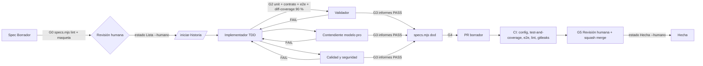

# Flujo agéntico de punta a punta (ruteando-web)

Plantilla de origen: harness-engineering (isesgeotraking), adaptada en ADR-0003. Formatos de Antigravity verificados el 2026-11-18.

## Mapa de archivos
| Ruta | Qué es | Cómo lo carga Antigravity |
| --- | --- | --- |
| `AGENTS.md` | Reglas del proyecto | Siempre activo |
| `.agents/rules/*.md` | Reglas por contexto: `seguridad` (siempre), `angularjs`, `specs`, `pruebas-y-cobertura`, `configuracion-antigravity` (por glob), `contrato-api-v1`, `alcance`, `github-flow`, `memoria-de-codigo` (por decisión del modelo) | Según `trigger` |
| `.agents/agents/*.md` | 5 roles | Panel de agentes; `invoke_subagent` |
| `.agents/skills/*/SKILL.md` | 12 procedimientos (los *workflows* están deprecados) | Por descripción o `/<nombre>` |
| `.agents/mcp_config.json` | MCP del workspace (`codebase-memory`) | Al abrir el workspace |
| `specs/migracion-api-v1/` | 41 historias por fase (F0–F8) + trazabilidad | Lectura |
| `docs/contracts/` | Contrato `/api/v1` del backend (canónico: `source/migration-guide.md`) | Lectura |
| `docs/ui/` | Sistema UI y maquetas navegables | Lectura / `/disenar-pantalla` |
| `tools/specs.mjs` | Gates mecánicos: `lint` (DoR), `dod`, `trace`, `next`, `estado`, `legacy-scan`, `lint-ui`, `contract-diff` | Terminal |

## Gates de una historia

| Gate | Qué se comprueba | Cómo | Quién decide |
| --- | --- | --- | --- |
| G0 Spec lista | Plantilla completa, CA Dado/Cuando/Entonces con caso de prueba, contrato con fixture, maqueta enlazada si hay UI | `node tools/specs.mjs lint <ID>` | Humano: `estado <ID> Lista --humano` |
| G1 Inicio | Dependencias cerradas, árbol limpio, rama desde la base | `/iniciar-historia` | Orquestador |
| G2 Implementación | Pruebas `[<ID> CA-n]` en verde, cobertura de diff ≥ 90 %, lint de líneas cambiadas, legacy retirado | `/implementar-spec` | Implementador (evidencia) |
| G3 Verificación | Cada CA demostrado; regresión; ataques reproducibles; controles de calidad | `/validar-spec`, `/revision-contendiente`, `/revision-calidad-seguridad` | 3 agentes independientes |
| G4 Done mecánico | Informes con veredicto, CA con prueba, sección 10 completa, sin pruebas enfocadas | `node tools/specs.mjs dod <ID>` | Orquestador |
| G5 Integración | CI verde + revisión de código y de pantalla | GitHub | Humano |

## Contratos por rol
| Rol | Entrada | Salida | No puede |
| --- | --- | --- | --- |
| Orquestador | Issue, spec, plan, reglas | Rama, delegaciones, evidencia guardada, trazabilidad, PR borrador | Implementar producto, cambiar alcance sin registro, fusionar |
| Implementador | Spec `Lista`, rama/worktree, maqueta | Commits + pruebas + informe | Tocar archivos no autorizados, declarar CA sin prueba |
| Validador | Spec, rama, diff | Informe por CA con veredicto | Editar, ampliar alcance |
| Contendiente | Spec, rama, diff, modelo de la sesión | Hallazgos reproducibles con severidad | Editar el repo, tocar el backend compartido, simular independencia |
| Calidad y seguridad | Spec, rama, diff | Resultados de controles ejecutados | Afirmar controles no ejecutados |

## Aislamiento y paralelismo
- Cada implementador corre con espacio de trabajo `branch` (worktree propio). No se lanzan en paralelo dos historias cuyos "Archivos autorizados" se solapen (`master/js/modules/config.js`, `server/sidebar-menu.json` y `master/i18n/*.json` son los puntos calientes: se serializan).
- Los revisores arrancan con contexto limpio y se lanzan en paralelo sobre el mismo commit.

## Incorporar una historia sin conocimiento tácito
1. Issue con el formulario **Historia**.
2. En Antigravity, agente `orquestador`: `/nueva-spec` (o revisar la spec existente) → `/disenar-pantalla` si hay UI → un humano la pasa a `Lista`.
3. `/entregar-historia <ID>`.
4. Revisa el PR borrador: spec, maqueta, capturas, informes y checks. Aprueba y fusiona tú; luego `node tools/specs.mjs estado <ID> Hecha --humano "<tu nombre>"`.
