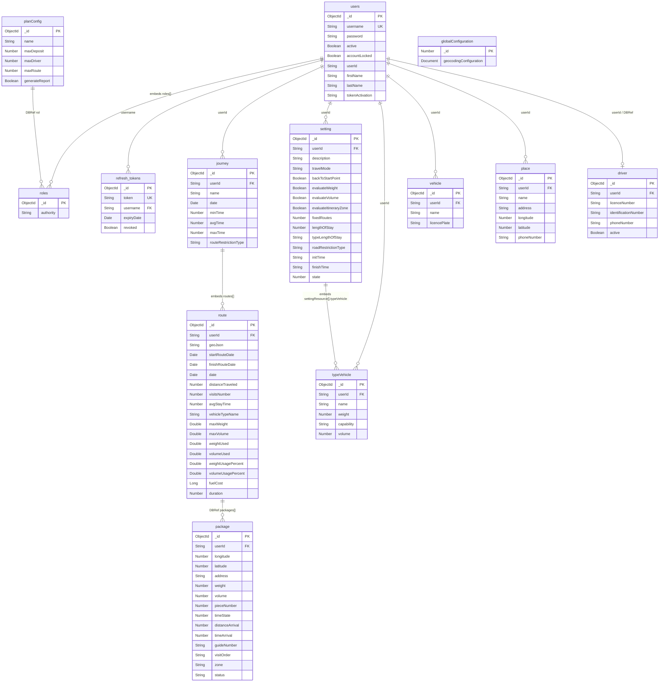
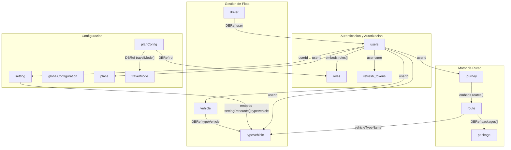
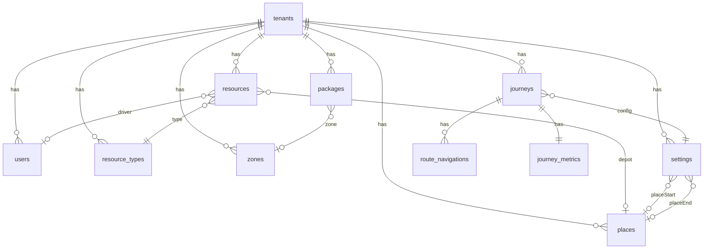

# HanoIT Routing Platform — Diccionario de Datos (MongoDB)

**Estado:** Actualizado | **Fase 1:** Completada | **Última verificación:** 2026-04-14

**Base de datos:** `hanoit` (MongoDB 7.x+) · **Stack aplicación:** Java 21 + Spring Boot 3.2.12 + Spring Data MongoDB · **Puerto API (referencia):** 8000

Este documento describe **dos modelos**: (1) el modelo **legado** (OAuth, `userId` String, `_class`, `DBRef`) marcado como **deprecado** frente a la migración Fase 1, y (2) el modelo **Fase 1** con multitenancy por `tenantId` (ObjectId) y **12 colecciones** canónicas.

---

## Parte A — Modelo legado (deprecado)

> [!CAUTION]
> **Retirado (2026-11-19, histórico).** Las colecciones, la discriminación multi-tenant por `userId` (email), el campo `_class` de Spring Data, el uso de `DBRef`, y los valores de dominio en MAYÚSCULAS documentados en esta parte corresponden al **modelo anterior**. Sus clases Java (`business.object.*` de persistencia, `repository.mongo`, `service.core`) y la migración de datos se eliminaron: la plataforma arranca en limpio. Las colecciones que queden en una base se borran con [`../operations/LEGACY_DB_CLEANUP.md`](../operations/LEGACY_DB_CLEANUP.md). Para diseño e implementación, usar la **Parte B**. La configuración de geocodificación vive ahora en `geocoding_config` y las posiciones GPS en `vehicle_positions` (ver [`DATABASE_ER_DIAGRAM.md`](DATABASE_ER_DIAGRAM.md)).

> [!NOTE]
> La verificación de volumetría e índices con fecha **2026-04-08** en este apartado reflejaba una **instantánea** de una instancia concreta; los conteos pueden diferir en otros entornos.

---

> **Convencion `_class`:** Spring Data MongoDB persiste un campo `_class` con el FQCN (fully qualified class name) de la entidad Java en cada documento. Esto se usa para polimorfismo y deserializacion. Si se renombran clases Java, se debe migrar este campo o configurar `DefaultMongoTypeMapper(null)` en `MongoConfig.java` para omitirlo.

> [!NOTE]
> **Patron Multi-tenant:** Todas las colecciones de dominio usan `userId` (String, email del usuario) como discriminador de tenant. Este campo **no esta indexado** en la mayoria de colecciones, lo que puede causar full-scans.

---

## Diagrama ER (Mermaid)



---

## Diagrama de Relaciones por Funcionalidad



---

## Flujo de Escritura (Write Path)

```
                       REST API / CSV Upload
                              |
                              v
            Controller (DeliveryController / JourneyController)
                              |
                              v
                Service Layer (JourneyServiceMongo / RouteServiceMongo)
                              |
    +-------------------------+----------------------------+
    |                         |                            |
    v                         v                            v
JourneyRepository      RouteRepository           PackageRepository
    |                         |                            |
    v                         v                            v
  journey              route (standalone)            package
  (embeds routes[])    (referenced from             (referenced via
                        journey.routes[]             route.packages[]
                        as subdocuments)             as DBRef)
```

### Relacion Journey ↔ Route ↔ Package

1. **Journey** contiene un array `routes[]` con sub-documentos `Route` embebidos directamente.
2. Cada **Route** embebida contiene un array `packages[]` con **DBRef** apuntando a documentos en la coleccion `package`.
3. Las **Route** standalone (coleccion `route`) tambien existen como documentos independientes con el mismo esquema.
4. Los **Package** siempre son documentos independientes referenciados via `@DBRef`.

---

## 1. Coleccion: `users`

**Proposito:** Cuentas de usuario del sistema. Autenticacion y autorizacion OAuth2/JWT.  
**Cardinalidad:** 1 doc por usuario. **5 documentos** en produccion.  
**Clase Java:** `com.hanoit.oauth.business.object.User` — `@Document(collection = "users")`, `implements UserDetails`  
**Patron de naming:** camelCase (Spring Data default).

### 1.1 Campos

| Campo | Tipo BSON Real | Tipo Java | Req | PK/FK/UK | Descripcion | Objetivo de negocio |
|:------|:--------------|:----------|:---:|:---------|:------------|:--------------------|
| `_id` | ObjectId | String (`@Id`) | Si | PK | Clave primaria auto-generada | Identificacion interna del documento |
| `username` | String | String | Si | UK | Email del usuario. `@Indexed(unique=true)`, `@Email`, `@NotBlank` | Login unico e identificacion del usuario |
| `password` | String | String | Si | — | Contrasena encriptada (BCrypt). `@NotBlank` | Autenticacion |
| `active` | Boolean | boolean | Si | — | Indica si la cuenta esta activa | Control de acceso |
| `accountLocked` | Boolean | boolean | Si | — | Indica si la cuenta esta bloqueada | Seguridad anti-fuerza bruta |
| `userId` | String | String | No | — | Identificador de tenant/propietario. `@JsonIgnore` | Aislamiento multi-tenant para datos de dominio |
| `firstName` | String | String | No | — | Nombre del usuario | Identificacion personal |
| `lastName` | String | String | No | — | Apellido del usuario | Identificacion personal |
| `tokenActivation` | String | String | No | — | Token UUID para activacion de cuenta via email | Flujo de registro y verificacion |
| `tokenRestore` | String | String | No | — | Token UUID para restablecimiento de contrasena. **En Java pero no observado en MongoDB sample** | Flujo de "olvide mi contrasena" |
| `roles` | Array[Document] | Set\<Role\> | Si | — | Roles asignados al usuario (embebidos, no DBRef) | Autorizacion basada en roles |
| `roles[]._id` | ObjectId | String | Si | FK-logico → roles | ObjectId del rol (coincide con coleccion `roles`) | Referencia al catalogo |
| `roles[].authority` | String | String | Si | — | Nombre del rol. Ej: `"ROLE_FREE"`, `"ROLE_ADMIN"` | Permiso de acceso |
| `accountExpirationDate` | — | LocalDate | No | — | Fecha de expiracion de cuenta. **En Java pero no observado en MongoDB** | Control de vigencia |
| `credentialsExpirationDate` | — | LocalDate | No | — | Fecha de expiracion de credenciales. **En Java pero no observado** | Politica de rotacion de passwords |
| `_class` | String | — | Si | — | FQCN: `"com.hanoit.oauth.business.object.User"` | Discriminador Spring Data |

> [!NOTE]
> **Campos en Java no observados en MongoDB:** `tokenRestore`, `accountExpirationDate`, `credentialsExpirationDate`. Estos campos existen en el modelo Java pero no estan presentes en ningun documento actual — se persisten solo cuando se asigna un valor no-null.

### 1.2 Enum: Roles del sistema
| Valor | Descripcion |
|:------|:------------|
| `ROLE_ADMIN` | Administrador del sistema — acceso total |
| `ROLE_ENTERPRISE` | Plan empresarial — limites maximos |
| `ROLE_PREMIUM` | Plan premium — limites intermedios |
| `ROLE_BASIC` | Plan basico — limites reducidos |
| `ROLE_FREE` | Plan gratuito — limites minimos |
| `ROLE_DRIVER` | Conductor — acceso movil limitado |

### 1.3 Indices en produccion

| Nombre | Campos | Tipo | Unique |
|:-------|:-------|:-----|:------:|
| `_id_` | `{_id: 1}` | Classic | Si |
| `username_1` | `{username: 1}` | Classic | Si (via `@Indexed(unique=true)`) |

### 1.4 Dato de ejemplo
```json
{
  "_id": ObjectId("6923d6f51775413d6d34e7a9"),
  "username": "free@gmail.com",
  "active": true,
  "roles": [{"_id": ObjectId("69228a7cb553bbd56435f210"), "authority": "ROLE_FREE"}],
  "accountLocked": false,
  "_class": "com.hanoit.oauth.business.object.User"
}
```

---

## 2. Coleccion: `roles`

**Proposito:** Catalogo maestro de roles de autorizacion. Tabla de dominio global.  
**Cardinalidad:** 1 doc por rol. **7 documentos** en produccion.  
**Clase Java:** `com.hanoit.oauth.business.object.Role` — `@Document(collection = "roles")`, `implements GrantedAuthority`

### 2.1 Campos

| Campo | Tipo BSON Real | Tipo Java | Req | PK/FK | Descripcion | Objetivo |
|:------|:--------------|:----------|:---:|:------|:------------|:---------|
| `_id` | ObjectId | String (`@Id`) | Si | PK | Clave primaria | Identificacion interna |
| `authority` | String | String | Si | — | Nombre del rol. Ej: `"ROLE_ADMIN"`, `"ROLE_FREE"` | Valor del permiso para Spring Security |
| `_class` | String | — | Si | — | FQCN: `"com.hanoit.oauth.business.object.Role"` | Discriminador Spring Data |

> [!WARNING]
> **Duplicado detectado:** Existen **2 documentos** con `authority: "ROLE_FREE"` (ObjectIds distintos). Sin indice unico en `authority`, esto permite duplicados accidentales.

### 2.2 Indices en produccion

| Nombre | Campos | Tipo | Unique |
|:-------|:-------|:-----|:------:|
| `_id_` | `{_id: 1}` | Classic | Si |

> [!WARNING]
> **Indice faltante:** Se recomienda agregar `{authority: 1}` con `unique: true` para evitar roles duplicados.

### 2.3 Regla de integridad
`users.roles[].authority` ∈ `roles.authority`

---

## 3. Coleccion: `refresh_tokens`

**Proposito:** Tokens de refresco OAuth2/JWT. Permite renovar access tokens sin re-autenticacion.  
**Cardinalidad:** N docs por usuario. **2 documentos** en produccion.  
**Clase Java:** `com.hanoit.oauth.business.object.RefreshToken` — `@Document(collection = "refresh_tokens")`

### 3.1 Campos

| Campo | Tipo BSON Real | Tipo Java | Req | PK/FK | Descripcion | Objetivo |
|:------|:--------------|:----------|:---:|:------|:------------|:---------|
| `_id` | ObjectId | String (`@Id`) | Si | PK | Clave primaria | Identificacion interna |
| `token` | String | String | Si | UK | Valor UUID del refresh token. `@Indexed(unique=true)` | Token de refresco para renovacion de JWT |
| `username` | String | String | Si | FK → users.username | Email del usuario propietario. `@Indexed` | Asociacion usuario-token |
| `expiryDate` | Date | LocalDateTime | Si | — | Fecha/hora UTC de expiracion | Control de vigencia del token |
| `revoked` | Boolean | boolean | Si | — | Indica si el token fue revocado manualmente | Invalidacion de sesiones |
| `_class` | String | — | Si | — | FQCN: `"com.hanoit.oauth.business.object.RefreshToken"` | Discriminador Spring Data |

### 3.2 Indices en produccion

| Nombre | Campos | Tipo | Unique |
|:-------|:-------|:-----|:------:|
| `_id_` | `{_id: 1}` | Classic | Si |
| `username_1` | `{username: 1}` | Classic | No |

> [!NOTE]
> El indice `token` con `unique=true` esta declarado en Java via `@Indexed(unique=true)` y se crea automaticamente por `spring.data.mongodb.auto-index-creation=true`.

### 3.3 Dato de ejemplo
```json
{
  "_id": ObjectId("69c46f64dd82386f6f81ae59"),
  "token": "1f823d73-14bf-441f-8cf1-fdd57cb337ce",
  "username": "free@gmail.com",
  "expiryDate": ISODate("2026-04-01T23:27:32.003Z"),
  "revoked": false
}
```

---

## 4. Coleccion: `journey`

**Proposito:** Itinerarios de ruteo. Documento maestro que agrupa todas las rutas de una sesion de optimizacion. Contiene rutas embebidas como sub-documentos con sus paquetes referenciados via DBRef.  
**Cardinalidad:** N docs por usuario. **8 documentos** en produccion.  
**Clase Java:** `com.hanoit.business.object.Journey` — Sin `@Document` explicito (usa nombre de clase como coleccion).  
**Patron de naming:** camelCase.

> [!CAUTION]
> **Riesgo de limite 16MB:** Los journey embeben todas las rutas con sus instrucciones OSRM, viaPoints y metadata. Un journey con muchas rutas puede exceder el limite de 16MB de MongoDB. El documento de ejemplo con `fleetSummary` ocupa ~250KB.

### 4.1 Campos

| Campo | Tipo BSON Real | Tipo Java | Req | PK/FK | Descripcion | Objetivo de negocio |
|:------|:--------------|:----------|:---:|:------|:------------|:--------------------|
| `_id` | ObjectId | String (`@Id`) | Si | PK | Clave primaria | Identificacion del itinerario |
| `userId` | String | String | Si | FK-logico → users.userId | Email del usuario propietario. `@JsonIgnore` | Multi-tenancy por usuario |
| `name` | String | String | No | — | Nombre descriptivo del itinerario. Ej: `"free6"`, `"sample_weight_vol"` | Identificacion en UI |
| `date` | Date | LocalDate | No | — | Fecha del itinerario (ISO). Serializado con formato custom | Fecha de planificacion |
| `minTime` | Number (Int) | Integer | No | — | Duracion minima entre las rutas (segundos). Ej: `1570` | KPI de variabilidad de rutas |
| `avgTime` | Number (Int) | Integer | No | — | Duracion promedio entre las rutas. Ej: `3418` | KPI promedio de duracion |
| `maxTime` | Number (Int) | Integer | No | — | Duracion maxima entre las rutas. Ej: `7151` | KPI de ruta mas larga |
| `countRoutes` | — | Integer | No | — | Cantidad de rutas (calculado en getter desde `routes.size()`). **No se persiste en MongoDB** | Conteo rapido en UI |
| `place` | Document | Place | No | — | Deposito/punto de partida. **Embebido** (no DBRef) | Punto de origen de las rutas |
| `place.name` | String | String | No | — | Nombre del deposito. Ej: `"Punto 1"` | Identificacion |
| `place.address` | String | String | No | — | Direccion. Ej: `"Carrera 65A 67F 19, Bogota"` | Referencia geografica |
| `place.longitude` | Number (Double) | Double | No | — | Longitud WGS84. Ej: `-74.08469893` | Coordenada X |
| `place.latitude` | Number (Double) | Double | No | — | Latitud WGS84. Ej: `4.67431540` | Coordenada Y |
| `routeRestrictionType` | String | String | No | FK-logico → setting.roadRestrictionType | Tipo de restriccion. Ej: `"FIXED_ROUTES"`, `"RESOURCE_TIME"` | Enlaza con la configuracion usada |
| `invalidPackages` | Array | List\<Package\> | No | — | Paquetes que no pudieron ser geocodificados/ruteados. Embebidos | Trazabilidad de fallos |
| `routes` | Array[Document] | List\<Route\> | Si | — | Rutas del itinerario (**embebidas**, misma estructura que coleccion `route`). Cada Route contiene `packages[]` como DBRef | Resultado principal del algoritmo |
| `fleetSummary` | Array[Document] | List\<FleetUsageSummary\> | No | — | Resumen de uso de flota por tipo de vehiculo | KPI de utilizacion de flota |
| `fleetSummary[].vehicleTypeName` | String | String | Si | FK-logico → typeVehicle.name | Nombre del tipo de vehiculo | Clasificacion |
| `fleetSummary[].available` | Number (Int) | Integer | Si | — | Cantidad disponible en la flota | Oferta |
| `fleetSummary[].used` | Number (Int) | Integer | Si | — | Cantidad de rutas asignadas a este tipo | Demanda |
| `fleetSummary[].usagePercent` | Number (Double) | Double | No | — | `(used / available) * 100` | % de utilizacion |
| `fleetSummary[].routeIds` | Array\<String\> | List\<String\> | Si | FK-logico → route._id | IDs (ObjectId como String) de las rutas asignadas | Trazabilidad ruta-flota |
| `_class` | String | — | Si | — | `"com.hanoit.business.object.Journey"` | Discriminador Spring Data |

### 4.2 Enum: `routeRestrictionType` (relacionado con `setting.roadRestrictionType`)
| Valor | Descripcion |
|:------|:------------|
| `FIXED_ROUTES` | Numero fijo de rutas a generar |
| `RESOURCE_TIME` | Asignacion por recurso con ventana de tiempo |

### 4.3 Indices en produccion

| Nombre | Campos | Tipo | Unique |
|:-------|:-------|:-----|:------:|
| `_id_` | `{_id: 1}` | Classic | Si |

> [!WARNING]
> **Indices faltantes:** Se recomienda `{userId: 1, date: -1}` para consultas de itinerarios por usuario ordenados cronologicamente.

### 4.4 Dato de ejemplo (sin routes)
```json
{
  "_id": ObjectId("69c3f9b790351142c597fca7"),
  "userId": "free@gmail.com",
  "name": "free6",
  "date": ISODate("2026-03-25T05:00:00Z"),
  "minTime": 1570,
  "avgTime": 3418,
  "maxTime": 7151,
  "place": {
    "name": "Punto 1",
    "address": "Carrera 65A 67F 19, Bogota",
    "longitude": -74.08469893,
    "latitude": 4.67431540
  },
  "routeRestrictionType": "FIXED_ROUTES",
  "invalidPackages": [],
  "routes": [ /* ... sub-documentos Route embebidos ... */ ]
}
```

---

## 5. Coleccion: `route`

**Proposito:** Rutas individuales de entrega/recogida. Cada ruta representa un recorrido vehicular con secuencia de paradas. Existe tanto como **sub-documento embebido** dentro de `journey.routes[]` como **documento independiente** en esta coleccion.  
**Cardinalidad:** N docs (crece con cada ruteo). **862 documentos** en produccion.  
**Clase Java:** `com.hanoit.business.object.Route` — Sin `@Document` explicito.  
**Patron de naming:** camelCase.

### 5.1 Campos

| Campo | Tipo BSON Real | Tipo Java | Req | PK/FK | Descripcion | Objetivo de negocio |
|:------|:--------------|:----------|:---:|:------|:------------|:--------------------|
| `_id` | ObjectId | String (`@Id`) | Si | PK | Clave primaria | Identificacion de la ruta |
| `userId` | String | String | Si | FK-logico → users.userId | Email del usuario propietario. `@JsonIgnore` | Multi-tenancy |
| `name` | String | String | No | — | Nombre/alias de la ruta | Identificacion en UI |
| `geoJson` | String | String | No | — | Geometria codificada (Google Encoded Polyline de OSRM) | Render del trayecto en mapa |
| `startRouteDate` | Date | LocalTime | No | — | Hora de inicio de la ruta (UTC) | Horario de operacion |
| `finishRouteDate` | Date | LocalTime | No | — | Hora de finalizacion de la ruta (UTC) | Horario de cierre |
| `date` | Date | LocalDate | No | — | Fecha de la ruta | Referencia temporal |
| `distanceTraveled` | Number (Int/Double) | int | No | — | Distancia total recorrida en metros. Ej: `15093` | KPI de km recorridos |
| `visitsNumber` | Number (Int) | int | No | — | Numero de visitas/paradas. Calculado en getter: `packages.size()` | KPI de paradas |
| `avgStayTime` | Number (Double) | double | No | — | Tiempo promedio de estadia por parada (segundos). Ej: `600` | KPI de productividad |
| `vehicleTypeName` | String | String | No | FK-logico → typeVehicle.name | Nombre del tipo de vehiculo asignado. Ej: `"NHR REWARD EURO IV"` | Trazabilidad ruta-flota |
| `maxWeight` | Number (Double) | Double | No | — | Capacidad maxima de peso del vehiculo (gramos). Ej: `4100000` | Restriccion de capacidad |
| `maxVolume` | Number (Double) | Double | No | — | Capacidad maxima de volumen (cm3). Ej: `8200000` | Restriccion volumetrica |
| `weightUsed` | Number (Double) | Double | No | — | Peso total usado en la ruta (gramos). Ej: `1400000` | Utilizacion de carga |
| `volumeUsed` | Number (Double) | Double | No | — | Volumen total usado (cm3). Ej: `4375000` | Utilizacion volumetrica |
| `weightUsagePercent` | Number (Double) | Double | No | — | `(weightUsed / maxWeight) * 100`. Ej: `34.15` | % de uso de peso |
| `volumeUsagePercent` | Number (Double) | Double | No | — | `(volumeUsed / maxVolume) * 100`. Ej: `53.35` | % de uso de volumen |
| `fuelCost` | Long | long | No | — | Costo estimado de combustible. Ej: `0` | KPI economico |
| `duration` | Number (Int) | Integer | No | — | Duracion total de la ruta en segundos. Ej: `3327` | KPI de tiempo |
| `badPackages` | Array | List\<Package\> | No | — | Paquetes no ruteables (embebidos) | Trazabilidad de fallos |
| `packages` | Array[DBRef] | List\<Package\> | Si | **DBRef → package** | Referencias a documentos en coleccion `package`. **`@DBRef`** | Contenido de la ruta (paradas ordenadas) |
| `instructions` | Array[Array] | List\<List\<Object\>\> | No | — | Instrucciones de navegacion OSRM (array bidimensional de strings y numeros) | Turn-by-turn directions |
| `viaPoints` | Array[Array[Number]] | List\<List\<Double\>\> | No | — | Puntos intermedios de la ruta `[[lat, lng], ...]` | Waypoints de navegacion |
| `_class` | String | — | Si | — | `"com.hanoit.business.object.Route"` | Discriminador Spring Data |

> [!NOTE]
> **Diferencia embebido vs standalone:** Cuando la ruta se embebe en `journey.routes[]`, los campos `packages` se almacenan como DBRef. Cuando se persiste standalone en coleccion `route`, algunos campos pueden estar ausentes (ej: `vehicleTypeName`, `maxWeight`, etc. estan presentes solo en rutas con asignacion de flota).

### 5.2 Indices en produccion

| Nombre | Campos | Tipo | Unique |
|:-------|:-------|:-----|:------:|
| `_id_` | `{_id: 1}` | Classic | Si |

> [!WARNING]
> **Indices faltantes:** Se recomienda `{userId: 1, date: -1}` para consultas de rutas por usuario y fecha.

### 5.3 Dato de ejemplo
```json
{
  "_id": ObjectId("69c3f9b790351142c597fca3"),
  "userId": "free@gmail.com",
  "startRouteDate": ISODate("2026-03-25T13:00:00Z"),
  "finishRouteDate": ISODate("2026-03-25T13:55:27Z"),
  "date": ISODate("2026-03-25T05:00:00Z"),
  "distanceTraveled": 15093,
  "visitsNumber": 0,
  "avgStayTime": 600,
  "fuelCost": 0,
  "duration": 3327,
  "badPackages": []
}
```

---

## 6. Coleccion: `package`

**Proposito:** Paquetes/entregas individuales. Cada documento representa un punto de entrega o recogida con su ubicacion geocodificada, peso, volumen y estado. **Coleccion mas grande del sistema.**  
**Cardinalidad:** N docs (crece con cada ruteo). **20,060 documentos** en produccion.  
**Clase Java:** `com.hanoit.business.object.Package` — Sin `@Document` explicito. Contiene enum interno `Status`.  
**Patron de naming:** camelCase.

### 6.1 Campos

| Campo | Tipo BSON Real | Tipo Java | Req | PK/FK | Descripcion | Objetivo de negocio |
|:------|:--------------|:----------|:---:|:------|:------------|:--------------------|
| `_id` | ObjectId | String (`@Id`) | Si | PK | Clave primaria | Identificacion del paquete |
| `userId` | String | String | Si | FK-logico → users.userId | Email del propietario. `@JsonIgnore` | Multi-tenancy |
| `name` | String | String | No | — | Nombre del paquete | Identificacion en UI |
| `longitude` | Number (Double) | Double | No | — | Longitud WGS84. Setter redondea a 6 decimales. Ej: `-74.052873` | Coordenada X de entrega |
| `latitude` | Number (Double) | Double | No | — | Latitud WGS84. Setter redondea a 6 decimales. Ej: `4.665839` | Coordenada Y de entrega |
| `address` | String | String | No | — | Direccion de entrega. Ej: `"Carrera 11 #82-01"` | Instruccion para el repartidor |
| `standarizedAddress` | String | String | No | — | Direccion estandarizada por geocodificador. **En Java pero no siempre en MongoDB** | Geocodificacion normalizada |
| `score` | Number (Double) | Double | No | — | Score de confianza del geocodificador. **En Java pero no siempre en MongoDB** | Calidad de geocodificacion |
| `city` | String | String | No | — | Ciudad del paquete. **En Java pero no siempre en MongoDB** | Informacion geografica |
| `country` | String | String | No | — | Pais. **En Java pero no siempre en MongoDB** | Informacion geografica |
| `weight` | Number (Double) | Double | No | — | Peso del paquete (gramos). `@JsonAlias("weigth")` | Restriccion de capacidad del vehiculo |
| `volume` | Number (Double) | Double | No | — | Volumen del paquete (cm3) | Restriccion volumetrica |
| `pieceNumber` | Number (Int) | Integer | No | — | Numero de piezas del envio | Cantidad de items |
| `timeState` | Number (Int) | Integer | No | — | Tiempo de estadia en la parada (segundos). Ej: `600` | Duracion de servicio en el punto |
| `distanceArrival` | Number (Int) | Integer | No | — | Distancia acumulada desde el inicio hasta este punto (metros). Ej: `6158` | Odometro de la ruta |
| `timeArrival` | Number (Int) | Integer | No | — | Tiempo de viaje acumulado hasta este punto (segundos). Ej: `520` | Tiempo de llegada relativo |
| `guideNumber` | String | String | No | — | Numero de guia del envio. Ej: `"G010"` | Trazabilidad logistica |
| `visitOrder` | String | String | No | — | Orden de visita dentro de la ruta (como String). Ej: `"10"` | Secuencia de entrega |
| `zone` | String | String | No | — | Zona geografica. Ej: `"null"` (String literal). | Agrupacion por zona |
| `category` | String | String | No | — | Categoria del paquete. **En Java pero no siempre en MongoDB** | Clasificacion |
| `postalCode` | String | String | No | — | Codigo postal. **En Java pero no siempre en MongoDB** | Localizacion |
| `observation` | String | String | No | — | Observaciones. **En Java pero no siempre en MongoDB** | Notas del cliente |
| `status` | String | Status (enum) | No | — | Estado del paquete. Ej: `"PENDIENTE"` | Ciclo de vida del paquete |
| `measure` | Document | Measure | No | — | Dimensiones fisicas (embebido). **En Java pero no siempre en MongoDB** | Restricciones por tamano |
| `receiver` | Document | Person | No | — | Destinatario (embebido). **En Java pero no siempre en MongoDB** | Datos del cliente |
| `sender` | Document | Person | No | — | Remitente (embebido). **En Java pero no siempre en MongoDB** | Datos del remitente |
| `statusGeocoding` | — | StatusGeocoding | No | — | Estado de geocodificacion. **En Java pero no siempre en MongoDB** | Calidad de datos |
| `_class` | String | — | Si | — | `"com.hanoit.business.object.Package"` | Discriminador Spring Data |

> [!NOTE]
> **Typo historico:** El campo `weight` se llamaba `weigth` (typo) en versiones anteriores del CSV. El backend acepta ambos nombres via `@JsonAlias("weigth")`.

> [!NOTE]
> **Campo `zone` como `"null"`:** En algunos documentos, el valor del campo `zone` es el string literal `"null"` en lugar de BSON null. Bug en el CSV parser.

### 6.2 Enum: `status`
| Valor | Descripcion |
|:------|:------------|
| `PENDIENTE` | Paquete pendiente de entrega |
| `ENTREGADO` | Paquete entregado exitosamente |
| `RECHAZADO` | Paquete rechazado por el destinatario |

### 6.3 Sub-documento: `measure` (embebido)
| Campo | Tipo | Descripcion |
|:------|:-----|:------------|
| `height` | Double | Alto |
| `width` | Double | Ancho |
| `depth` | Double | Profundidad |

### 6.4 Sub-documento: `receiver` / `sender` (embebido, tipo Person)
| Campo | Tipo | Descripcion |
|:------|:-----|:------------|
| `id` | Integer | Identificador (no `@Id`) |
| `name` | String | Nombre |
| `address` | String | Direccion |
| `phone` | String | Telefono |
| `longitude` | Double | Longitud |
| `latitude` | Double | Latitud |
| `city` | String | Ciudad |

### 6.5 Indices en produccion

| Nombre | Campos | Tipo | Unique |
|:-------|:-------|:-----|:------:|
| `_id_` | `{_id: 1}` | Classic | Si |

> [!WARNING]
> **Indices faltantes:** Con 20,060 documentos, se recomienda urgentemente `{userId: 1}` para consultas filtradas por usuario.

### 6.6 Dato de ejemplo
```json
{
  "_id": ObjectId("69c3f9b790351142c597fc99"),
  "userId": "free@gmail.com",
  "longitude": -74.052873,
  "latitude": 4.665839,
  "address": "Carrera 11 #82-01",
  "timeState": 600,
  "distanceArrival": 6158,
  "timeArrival": 520,
  "guideNumber": "G010",
  "visitOrder": "10",
  "zone": "null",
  "status": "PENDIENTE"
}
```

---

## 7. Coleccion: `setting`

**Proposito:** Configuraciones de ruteo por usuario. Define parametros del algoritmo: modo de transporte, restricciones de peso/volumen, flota disponible, horarios.  
**Cardinalidad:** N docs por usuario (1 por tipo de restriccion). **5 documentos** en produccion.  
**Clase Java:** `com.hanoit.business.object.Setting` — Sin `@Document` explicito.  
**Patron de naming:** camelCase.

### 7.1 Campos

| Campo | Tipo BSON Real | Tipo Java | Req | PK/FK | Descripcion | Objetivo de negocio |
|:------|:--------------|:----------|:---:|:------|:------------|:--------------------|
| `_id` | ObjectId | String (`@Id`) | Si | PK | Clave primaria | Identificacion de la configuracion |
| `userId` | String | String | Si | FK-logico → users.userId | Email del propietario. `@JsonIgnore` | Multi-tenancy |
| `description` | String | String | No | — | Nombre descriptivo. Ej: `"Free"`, `"Resources_Time_Vol_Weight"` | Identificacion en UI |
| `travelMode` | String | String | No | — | Modo de transporte. Ej: `"Vehiculo"` | Motor de ruteo a usar |
| `backToStartPoint` | Boolean | Boolean | No | — | Si la ruta debe retornar al deposito | Topologia round-trip vs open |
| `evaluateWeight` | Boolean | Boolean | No | — | Si se evalua la capacidad de peso | Activar restriccion CVRP |
| `evaluateVolume` | Boolean | Boolean | No | — | Si se evalua la capacidad de volumen | Activar restriccion volumetrica |
| `evaluateItineraryZone` | Boolean | Boolean | No | — | Si se evalua la zona del itinerario | Restriccion por zona |
| `fixedRoutes` | Number (Int) | Integer | No | — | Numero fijo de rutas a generar. Ej: `4` | Modo FIXED_ROUTES |
| `lengthOfStay` | Number (Int) | Integer | No | — | Tiempo de estadia por defecto (minutos). Ej: `10` | Tiempo de servicio por parada |
| `typeLengthOfStay` | String | String | No | — | Tipo de estadia. Ej: `"FIXED"`, `"DEFINE_ITINERARY"` | Logica de calculo de tiempos |
| `roadRestrictionType` | String | String | No | UK-logico | Tipo de restriccion vial. Clave para asociar con journey. Ej: `"FIXED_ROUTES"`, `"RESOURCE_TIME"` | Parametro de seleccion de algoritmo |
| `settingResource` | Array[Document] | ArrayList\<SettingResource\> | No | — | Recursos/vehiculos configurados (**embebidos**) | Definicion de flota disponible |
| `settingResource[]._id` | String | String (`@Id`) | No | — | ID del recurso (timestamp como String). Ej: `"1774625094168"` | Identificacion del setting |
| `settingResource[].quantity` | Number (Int) | int | No | — | Cantidad de vehiculos de este tipo. Ej: `5` | Disponibilidad de flota |
| `settingResource[].typeVehicle` | Document | TypeVehicle | No | — | **Copia embebida** del tipo de vehiculo (snapshot, no DBRef) | Capacidades del vehiculo |
| `settingResource[].place` | Document | Place | No | — | Deposito asignado (embebido). **En Java pero no siempre en MongoDB** | Ubicacion de base |
| `settingResource[].initTime` | String | String | No | — | Hora de inicio del recurso. **En Java pero no siempre en MongoDB** | Ventana de tiempo |
| `settingResource[].finishTime` | String | String | No | — | Hora de fin del recurso. **En Java pero no siempre en MongoDB** | Ventana de tiempo |
| `initTime` | String | String | No | — | Hora de inicio de operacion. Ej: `"08:00"`, `"08:24"` | Ventana operativa global |
| `finishTime` | String | String | No | — | Hora de fin de operacion. Ej: `""`, `"14:24"` | Ventana operativa global |
| `state` | Number (Int) | Integer | No | — | Estado de la configuracion. Default `1` | Control de vigencia |
| `_class` | String | — | Si | — | `"com.hanoit.business.object.Setting"` | Discriminador Spring Data |

> [!WARNING]
> **Copias embebidas desactualizadas:** `settingResource[].typeVehicle` es una copia snapshot del `TypeVehicle` al momento de creacion del setting. Si se actualiza un `TypeVehicle` en la coleccion `typeVehicle`, las copias embebidas en `setting` **no se actualizan automaticamente**.

### 7.2 Enum: `typeLengthOfStay`
| Valor | Descripcion |
|:------|:------------|
| `FIXED` | Tiempo de estadia fijo por parada |
| `DEFINE_ITINERARY` | Tiempo definido en el itinerario (variable por paquete) |

### 7.3 Enum: `roadRestrictionType`
| Valor | Descripcion |
|:------|:------------|
| `FIXED_ROUTES` | Generar un numero fijo de rutas |
| `RESOURCE_TIME` | Asignar rutas segun recursos y ventanas de tiempo |

### 7.4 Indices en produccion

| Nombre | Campos | Tipo | Unique |
|:-------|:-------|:-----|:------:|
| `_id_` | `{_id: 1}` | Classic | Si |

> [!WARNING]
> **Indice faltante:** Se recomienda `{userId: 1, roadRestrictionType: 1}` para busquedas de configuracion por tipo.

### 7.5 Dato de ejemplo
```json
{
  "_id": ObjectId("69c2a3fb0ecae305f5280f63"),
  "userId": "free@gmail.com",
  "description": "Free",
  "travelMode": "Vehiculo",
  "backToStartPoint": false,
  "evaluateWeight": false,
  "evaluateVolume": false,
  "evaluateItineraryZone": false,
  "fixedRoutes": 4,
  "lengthOfStay": 10,
  "typeLengthOfStay": "FIXED",
  "roadRestrictionType": "FIXED_ROUTES",
  "settingResource": [],
  "initTime": "08:00",
  "finishTime": "",
  "state": 1
}
```

---

## 8. Coleccion: `typeVehicle`

**Proposito:** Catalogo maestro de tipos de vehiculo por usuario. Define capacidades, restricciones y dimensiones de cada categoria de flota.  
**Cardinalidad:** N docs por usuario. **20 documentos** en produccion.  
**Clase Java:** `com.hanoit.business.object.TypeVehicle` — Sin `@Document` explicito.  
**Patron de naming:** camelCase.

### 8.1 Campos

| Campo | Tipo BSON Real | Tipo Java | Req | PK/FK | Descripcion | Objetivo de negocio |
|:------|:--------------|:----------|:---:|:------|:------------|:--------------------|
| `_id` | ObjectId | String (`@Id`) | Si | PK | Clave primaria | Identificacion del tipo de vehiculo |
| `userId` | String | String | Si | FK-logico → users.userId | Email del propietario. `@JsonIgnore` | Multi-tenancy |
| `name` | String | String | Si | — | Nombre del tipo. Ej: `"NHR REWARD EURO IV"`, `"SUZUKI GIXXER"`, `"Mensajero"` | Identificacion en UI y flota |
| `weight` | Number (Double) | Double | No | — | Capacidad maxima de peso (gramos). Ej: `4100000` (= 4.1 toneladas) | Restriccion CVRP de peso |
| `capability` | String | String | No | — | Tipo de capacidad evaluada. Ej: `"volume"` | Modo de evaluacion de capacidad |
| `volume` | Number (Double) | Double | No | — | Capacidad maxima de volumen (cm3). Ej: `8200000` | Restriccion CVRP de volumen |
| `measure` | Document | Measure | No | — | Dimensiones fisicas del vehiculo (embebido) | Restricciones por tamano |
| `measure.height` | Number (Double) | Double | No | — | Alto del area de carga | Dimensionamiento |
| `measure.width` | Number (Double) | Double | No | — | Ancho del area de carga | Dimensionamiento |
| `measure.depth` | Number (Double) | Double | No | — | Profundidad del area de carga | Dimensionamiento |
| `restriction` | Document | Restriction | No | — | Restricciones por pieza/paquete individual (embebido) | Filtro de compatibilidad |
| `restriction.minWeight` | Number (Double) | Double | No | — | Peso minimo aceptado por paquete | Restriccion inferior |
| `restriction.minVolume` | Number (Double) | Double | No | — | Volumen minimo aceptado por paquete | Restriccion inferior |
| `restriction.maxWeight` | Number (Double) | Double | No | — | Peso maximo por paquete. Ej: `500000` (500 kg) | Restriccion superior |
| `restriction.maxVolume` | Number (Double) | Double | No | — | Volumen maximo por paquete. Ej: `999999` | Restriccion superior |
| `_class` | String | — | Si | — | `"com.hanoit.business.object.TypeVehicle"` | Discriminador Spring Data |

### 8.2 Indices en produccion

| Nombre | Campos | Tipo | Unique |
|:-------|:-------|:-----|:------:|
| `_id_` | `{_id: 1}` | Classic | Si |

> [!WARNING]
> **Indice faltante:** Se recomienda `{userId: 1}` y opcionalmente `{userId: 1, name: 1}` con unique para evitar tipos duplicados por usuario.

### 8.3 Dato de ejemplo
```json
{
  "_id": ObjectId("69b830df6071c8314579bcc5"),
  "userId": "admin@hanoit.com",
  "name": "NHR REWARD EURO IV",
  "weight": 4100000,
  "capability": "volume",
  "volume": 8200000,
  "measure": {"height": 0, "width": 0, "depth": 0},
  "restriction": {"minWeight": 0, "minVolume": 0, "maxWeight": 0, "maxVolume": 0}
}
```

---

## 9. Coleccion: `vehicle`

**Proposito:** Vehiculos fisicos registrados por usuario. Catalogo de flota con identificacion por placa.  
**Cardinalidad:** N docs por usuario. **65 documentos** en produccion.  
**Clase Java:** `com.hanoit.business.object.Vehicle` — Sin `@Document` explicito. Tiene `@DBRef` a `TypeVehicle`.  
**Patron de naming:** camelCase.

### 9.1 Campos

| Campo | Tipo BSON Real | Tipo Java | Req | PK/FK | Descripcion | Objetivo de negocio |
|:------|:--------------|:----------|:---:|:------|:------------|:--------------------|
| `_id` | ObjectId | String (`@Id`) | Si | PK | Clave primaria | Identificacion del vehiculo |
| `userId` | String | String | Si | FK-logico → users.userId | Email del propietario. `@JsonIgnore` | Multi-tenancy |
| `name` | String | String | Si | — | Nombre/alias del vehiculo. `@NotNull @NotBlank @Size(max=140)`. Ej: `"TRK-ALFA"` | Identificacion en UI |
| `licencePlate` | String | String | Si | — | Placa del vehiculo. `@NotNull @NotBlank @Size(max=140)`. Ej: `"TRK-001"` | Registro legal del vehiculo |
| `typeVehicle` | DBRef | TypeVehicle | No | **DBRef → typeVehicle** | Referencia al tipo de vehiculo. **`@DBRef`** en Java. **No observado en todos los documentos MongoDB** | Asociacion vehiculo → capacidades |
| `_class` | String | — | Si | — | `"com.hanoit.business.object.Vehicle"` | Discriminador Spring Data |

> [!NOTE]
> **DBRef typeVehicle:** Declarado en Java con `@DBRef` pero en los documentos de muestra no aparece el campo. Puede que no se haya asignado a todos los vehiculos.

### 9.2 Indices en produccion

| Nombre | Campos | Tipo | Unique |
|:-------|:-------|:-----|:------:|
| `_id_` | `{_id: 1}` | Classic | Si |

### 9.3 Dato de ejemplo
```json
{
  "_id": ObjectId("69b845366071c8314579bcd9"),
  "userId": "admin@hanoit.com",
  "name": "TRK-ALFA",
  "licencePlate": "TRK-001"
}
```

---

## 10. Coleccion: `driver`

**Proposito:** Conductores registrados. Cada conductor se asocia a un usuario del sistema via DBRef.  
**Cardinalidad:** N docs por usuario. **1 documento** en produccion.  
**Clase Java:** `com.hanoit.business.object.Driver` — Sin `@Document` explicito. Tiene `@DBRef` a `User`.  
**Patron de naming:** camelCase.

### 10.1 Campos

| Campo | Tipo BSON Real | Tipo Java | Req | PK/FK | Descripcion | Objetivo de negocio |
|:------|:--------------|:----------|:---:|:------|:------------|:--------------------|
| `_id` | ObjectId | String (`@Id`) | Si | PK | Clave primaria | Identificacion del conductor |
| `userId` | String | String | Si | FK-logico | Email del propietario. `@Indexed @JsonIgnore` | Multi-tenancy (indice declarado en Java) |
| `user` | DBRef | User | No | **DBRef → users** | Referencia al documento en coleccion `users`. **`@DBRef`** | Asociacion conductor → cuenta de usuario |
| `licenceNumber` | String | String | No | — | Numero de licencia de conduccion. Ej: `"000000001"` | Registro legal |
| `identificationNumber` | String | String | No | — | Numero de identificacion (cedula). Ej: `"000000001"` | Registro legal |
| `phoneNumber` | String | String | No | — | Telefono del conductor. Ej: `"3147737419"` | Contacto |
| `active` | Boolean | boolean | No | — | Si el conductor esta activo. Ej: `true` | Control de disponibilidad |
| `_class` | String | — | Si | — | `"com.hanoit.business.object.Driver"` | Discriminador Spring Data |

### 10.2 Indices en produccion

| Nombre | Campos | Tipo | Unique |
|:-------|:-------|:-----|:------:|
| `_id_` | `{_id: 1}` | Classic | Si |

> [!NOTE]
> `@Indexed` en `userId` en Java genera un indice automatico `{userId: 1}` via `auto-index-creation=true`, aunque no aparece explicitamente en la lista de indices. Verificar.

### 10.3 Dato de ejemplo
```json
{
  "_id": ObjectId("69b853ed6071c8314579bd1b"),
  "userId": "admin@hanoit.com",
  "user": {"$ref": "users", "$id": ObjectId("69b853ed6071c8314579bd1a")},
  "licenceNumber": "000000001",
  "identificationNumber": "000000001",
  "phoneNumber": "3147737419",
  "active": true
}
```

---

## 11. Coleccion: `place`

**Proposito:** Depositos/puntos de interes registrados por usuario. Puntos de origen de las rutas.  
**Cardinalidad:** N docs por usuario. **3 documentos** en produccion.  
**Clase Java:** `com.hanoit.business.object.Place` — Sin `@Document` explicito.  
**Patron de naming:** camelCase.

### 11.1 Campos

| Campo | Tipo BSON Real | Tipo Java | Req | PK/FK | Descripcion | Objetivo de negocio |
|:------|:--------------|:----------|:---:|:------|:------------|:--------------------|
| `_id` | ObjectId | String (`@Id`) | Si | PK | Clave primaria | Identificacion del lugar |
| `userId` | String | String | Si | FK-logico → users.userId | Email del propietario. `@JsonIgnore` | Multi-tenancy |
| `name` | String | String | No | — | Nombre del lugar. Ej: `"punto 1"` | Identificacion en UI |
| `address` | String | String | No | — | Direccion. Ej: `"Carrera 65A 67F 15"` | Referencia de localizacion |
| `longitude` | Number (Double) | Double | No | — | Longitud WGS84. Ej: `-74.084707` | Coordenada X |
| `latitude` | Number (Double) | Double | No | — | Latitud WGS84. Ej: `4.674305` | Coordenada Y |
| `phoneNumber` | String | String | No | — | Telefono de contacto. Ej: `"3147737410"` | Contacto |
| `_class` | String | — | Si | — | `"com.hanoit.business.object.Place"` | Discriminador Spring Data |

### 11.2 Indices en produccion

| Nombre | Campos | Tipo | Unique |
|:-------|:-------|:-----|:------:|
| `_id_` | `{_id: 1}` | Classic | Si |

### 11.3 Dato de ejemplo
```json
{
  "_id": ObjectId("69c18cf99832786d4747695e"),
  "userId": "admin@hanoit.com",
  "name": "punto 1",
  "address": "Carrera 65A 67F 15",
  "longitude": -74.084707,
  "latitude": 4.674305,
  "phoneNumber": "3147737410"
}
```

---

## 12. Coleccion: `planConfig`

**Proposito:** Configuracion de planes/perfiles de servicio. Define limites de uso por tipo de suscripcion (Free, Basic, Premium, Enterprise).  
**Cardinalidad:** N docs (1 por plan). **1 documento** en produccion (solo plan "Free" configurado).  
**Clase Java:** `com.hanoit.business.control.object.PlanConfig` — `@Document` (default collection).  
**Patron de naming:** camelCase.

### 12.1 Campos

| Campo | Tipo BSON Real | Tipo Java | Req | PK/FK | Descripcion | Objetivo de negocio |
|:------|:--------------|:----------|:---:|:------|:------------|:--------------------|
| `_id` | ObjectId | String (`@Id`) | Si | PK | Clave primaria | Identificacion del plan |
| `name` | String | String | Si | — | Nombre del plan. `@NotNull @NotEmpty`. Ej: `"Free"` | Identificacion del nivel de servicio |
| `maxDeposit` | Number (Int) | Integer | No | — | Maximo de depositos permitidos. Ej: `1` | Limite por plan |
| `maxDriver` | Number (Int) | Integer | No | — | Maximo de conductores. Ej: `1` | Limite por plan |
| `maxUserAdministrator` | Number (Int) | Integer | No | — | Maximo de usuarios administradores. Ej: `1` | Limite por plan |
| `maxAddressForFile` | Number (Int) | Integer | No | — | Maximo de direcciones por archivo CSV. Ej: `1` | Limite de upload |
| `maxAddressGeo` | Number (Int) | Integer | No | — | Maximo de direcciones a geocodificar. Ej: `1` | Limite de geocodificacion |
| `maxResourcesDefault` | Number (Int) | Integer | No | — | Maximo de recursos/vehiculos por defecto. Ej: `1` | Limite de flota |
| `maxRoute` | Number (Int) | Integer | No | — | Maximo de rutas permitidas. Ej: `1` | Limite de optimizacion |
| `generateReport` | Boolean | boolean | No | — | Si el plan permite generar reportes. Ej: `false` | Feature flag por plan |
| `travelMode` | Array | List\<TravelMode\> | No | **DBRef → travelMode** | Modos de transporte disponibles. **`@DBRef`** en Java. Array vacio en sample | Modos permitidos por plan |
| `rol` | — | Role | No | **DBRef → roles** | Rol asociado al plan. **`@DBRef`** en Java. **No observado en MongoDB sample** | Asociacion plan → rol |
| `_class` | String | — | Si | — | `"com.hanoit.business.control.object.PlanConfig"` | Discriminador Spring Data |

### 12.2 Indices en produccion

| Nombre | Campos | Tipo | Unique |
|:-------|:-------|:-----|:------:|
| `_id_` | `{_id: 1}` | Classic | Si |

### 12.3 Dato de ejemplo
```json
{
  "_id": ObjectId("636f2c7f40416b40b940bcd0"),
  "name": "Free",
  "maxDeposit": 1,
  "maxDriver": 1,
  "maxUserAdministrator": 1,
  "maxAddressForFile": 1,
  "maxAddressGeo": 1,
  "maxResourcesDefault": 1,
  "maxRoute": 1,
  "generateReport": false,
  "travelMode": []
}
```

---

## 13. Coleccion: `globalConfiguration`

**Proposito:** Configuracion global unica del sistema. Documento singleton con parametros de geocodificacion.  
**Cardinalidad:** 1 documento singleton (ID numerico fijo = `1`).  
**Clase Java:** `com.hanoit.business.object.GlobalConfiguration` — Sin `@Document` explicito. Usa `@Schema` (OpenAPI).  
**Patron de naming:** camelCase.

### 13.1 Campos

| Campo | Tipo BSON Real | Tipo Java | Req | PK/FK | Descripcion | Objetivo de negocio |
|:------|:--------------|:----------|:---:|:------|:------------|:--------------------|
| `_id` | Number (Int) | int | Si | PK | Clave primaria **numerica** (no ObjectId). Valor fijo: `1` | Documento singleton |
| `geocodingConfiguration` | Document | GeocodingServicesConfiguration | Si | — | Configuracion de geocodificacion. `@NotNull` | Parametros globales de geocoding |
| `geocodingConfiguration.geocodingStrategyClassName` | String | String | Si | — | FQCN de la estrategia activa. Ej: `"...BatchSecuentialMultiThreadStrategy"` | Selector de estrategia |
| `geocodingConfiguration.arcGisMaxAddressesPerRequest` | Number (Int) | int | Si | — | Max direcciones por request a ArcGIS. Ej: `1000` | Throttling de API |
| `geocodingConfiguration.arcGisMaxThreads` | Number (Int) | int | Si | — | Max hilos para ArcGIS. Ej: `4` | Concurrencia |
| `geocodingConfiguration.geocentrixMaxAddressesPerRequest` | Number (Int) | int | Si | — | Max direcciones por request a Geocentrix. Ej: `1000` | Throttling de API |
| `geocodingConfiguration.geocentrixMaxThreads` | Number (Int) | int | Si | — | Max hilos para Geocentrix. Ej: `4` | Concurrencia |
| `_class` | String | — | Si | — | `"com.hanoit.business.object.GlobalConfiguration"` | Discriminador Spring Data |

### 13.2 Indices en produccion

| Nombre | Campos | Tipo | Unique |
|:-------|:-------|:-----|:------:|
| `_id_` | `{_id: 1}` | Classic | Si |

### 13.3 Dato de ejemplo
```json
{
  "_id": 1,
  "geocodingConfiguration": {
    "geocodingStrategyClassName": "com.hanoit.service.geocoding.strategy.v2.spi.provider.BatchSecuentialMultiThreadStrategy",
    "arcGisMaxAddressesPerRequest": 1000,
    "arcGisMaxThreads": 4,
    "geocentrixMaxAddressesPerRequest": 1000,
    "geocentrixMaxThreads": 4
  }
}
```

---

## Colecciones Auxiliares (sin documentos directos pero con modelo Java)

### `assignedService` (coleccion implicita)
**Clase Java:** `com.hanoit.business.object.AssignedService`  
**Enum interno:** `State { INACTIVO, COMPLETADO, EN_SERVICIO, ACTIVO }`  
**Campos notables:** `@DBRef Vehicle vehicle`, `@DBRef Route route`, `@DBRef Driver driver`, `State state`, `LocalDate executionDate`  
**Nota:** Tiene repository `AssignedServiceRepository` pero no se encontraron documentos en la BD actual.

### `vehiclePosition` (coleccion implicita)
**Clase Java:** `com.hanoit.business.object.VehiclePosition`  
**Campos notables:** `@DBRef Driver driver`, `Address address` (embebido), `LocalDateTime date`, `@DBRef AssignedService assignedService`  
**Nota:** Tiene repository y servicio RabbitMQ (`VehiclePositionConsumerServiceImp`). Coleccion para tracking en tiempo real.

### `userControl` (coleccion implicita)
**Clase Java:** `com.hanoit.business.control.object.UserControl` — `@Document`  
**Proposito:** Control de limites por usuario. Similar a `PlanConfig` pero personalizado.

### `userPeriodControl` (coleccion implicita)
**Clase Java:** `com.hanoit.business.control.object.UserPeriodControl` — `@Document`  
**Campos notables:** `String period`, `@DBRef UserControl userControl`  
**Proposito:** Control de limites por periodo.

### `travelMode` (coleccion implicita)
**Clase Java:** `com.hanoit.business.control.object.TravelMode` — `@Document`  
**Campos:** `String id`, `String name`  
**Proposito:** Catalogo de modos de transporte. Referenciado via `@DBRef` desde `PlanConfig`.

---

## Resumen de Relaciones

| Desde | Campo | Hacia | Tipo | Mecanismo |
|:------|:------|:------|:-----|:----------|
| `users` | `roles[]` | `roles` | N:M (embebido) | Embed por valor |
| `refresh_tokens` | `username` | `users.username` | N:1 | FK logico (String) |
| `journey` | `userId` | `users.userId` | N:1 | FK logico (String) |
| `journey` | `routes[]` | `route` | 1:N (embebido) | Embed completo |
| `journey` | `place` | `place` | N:1 (embed snapshot) | Embed por valor |
| `journey` | `routes[].packages[]` | `package` | N:M | **DBRef** |
| `route` | `packages[]` | `package` | 1:N | **DBRef** |
| `route` | `vehicleTypeName` | `typeVehicle.name` | N:1 | FK logico (String) |
| `setting` | `userId` | `users.userId` | N:1 | FK logico (String) |
| `setting` | `settingResource[].typeVehicle` | `typeVehicle` | N:1 (embed snapshot) | Embed por valor |
| `vehicle` | `typeVehicle` | `typeVehicle` | N:1 | **DBRef** |
| `driver` | `user` | `users` | 1:1 | **DBRef** |
| `planConfig` | `travelMode[]` | `travelMode` | N:M | **DBRef** |
| `planConfig` | `rol` | `roles` | N:1 | **DBRef** |
| `assignedService` | `vehicle` | `vehicle` | N:1 | **DBRef** |
| `assignedService` | `route` | `route` | N:1 | **DBRef** |
| `assignedService` | `driver` | `driver` | N:1 | **DBRef** |
| `vehiclePosition` | `driver` | `driver` | N:1 | **DBRef** |
| `vehiclePosition` | `assignedService` | `assignedService` | N:1 | **DBRef** |
| `userPeriodControl` | `userControl` | `userControl` | N:1 | **DBRef** |

---

## Resumen de Indices

| Coleccion | Indice | Campos | Tipo | Unique |
|:----------|:-------|:-------|:-----|:------:|
| users | `_id_` | `{_id: 1}` | Default | Si |
| users | `username_1` | `{username: 1}` | Classic | Si |
| roles | `_id_` | `{_id: 1}` | Default | Si |
| refresh_tokens | `_id_` | `{_id: 1}` | Default | Si |
| refresh_tokens | `username_1` | `{username: 1}` | Classic | No |
| journey | `_id_` | `{_id: 1}` | Default | Si |
| route | `_id_` | `{_id: 1}` | Default | Si |
| package | `_id_` | `{_id: 1}` | Default | Si |
| setting | `_id_` | `{_id: 1}` | Default | Si |
| typeVehicle | `_id_` | `{_id: 1}` | Default | Si |
| vehicle | `_id_` | `{_id: 1}` | Default | Si |
| driver | `_id_` | `{_id: 1}` | Default | Si |
| place | `_id_` | `{_id: 1}` | Default | Si |
| planConfig | `_id_` | `{_id: 1}` | Default | Si |
| globalConfiguration | `_id_` | `{_id: 1}` | Default | Si |

**Total indices:** 15

---

## Volumetria Actual

| Coleccion | Documentos | Tamano estimado | Observacion |
|:----------|:----------:|:----------------|:------------|
| `package` | 20,060 | ~19 MB | Coleccion mas grande. Crece linealmente con cada ruteo |
| `route` | 862 | ~8 MB | Contiene polylines y DBRef a packages |
| `vehicle` | 65 | < 1 MB | Catalogo de flota |
| `typeVehicle` | 20 | < 1 MB | Catalogo de tipos de vehiculo |
| `journey` | 8 | ~2 MB | Embebe rutas completas (puede ser muy grande) |
| `roles` | 7 | < 1 KB | Catalogo estatico. 1 duplicado detectado |
| `users` | 5 | < 1 KB | Usuarios del sistema |
| `setting` | 5 | < 100 KB | Una configuracion por tipo de restriccion por usuario |
| `place` | 3 | < 1 KB | Depositos registrados |
| `refresh_tokens` | 2 | < 1 KB | Tokens activos |
| `planConfig` | 1 | < 1 KB | Configuracion de plan |
| `globalConfiguration` | 1 | < 1 KB | Configuracion global |
| `driver` | 1 | < 1 KB | Conductores registrados |
| **Total** | **21,040** | **~27.3 MB** | 15 indices, 9.38 MB almacenamiento total |

---

## Estadisticas de la Base de Datos

| Metrica | Valor |
|:--------|:------|
| Base de datos | `hanoit` |
| Colecciones | 13 |
| Vistas | 0 |
| Objetos totales | 21,040 |
| Tamano promedio por objeto | 1,361 bytes |
| Tamano de datos | 28.65 MB |
| Tamano de almacenamiento | 8.62 MB (comprimido) |
| Total de indices | 15 |
| Tamano de indices | 761 KB |
| Tamano total (datos + indices) | 9.38 MB |

---

## Notas para Refactorizacion

### Patron de Aislamiento Multi-tenant

Todas las colecciones de dominio (`journey`, `route`, `package`, `setting`, `typeVehicle`, `vehicle`, `driver`, `place`) usan `userId` (String, email del usuario) como discriminador de tenant. Este campo **no esta indexado** en la mayoria de colecciones (solo `driver` tiene `@Indexed` en Java), lo que genera **full-scans** en consultas filtradas por usuario.

**Recomendacion:**
```js
db.package.createIndex({userId: 1})
db.route.createIndex({userId: 1, date: -1})
db.journey.createIndex({userId: 1, date: -1})
db.setting.createIndex({userId: 1, roadRestrictionType: 1})
db.typeVehicle.createIndex({userId: 1})
db.vehicle.createIndex({userId: 1})
```

### Embebido vs Referenciado

| Patron | Origen | Destino | Riesgo |
|:-------|:-------|:--------|:-------|
| **Embed** | `journey.routes[]` | `Route` (sub-docs completos) | Documentos > 16MB con muchas rutas grandes |
| **DBRef** | `route.packages[]` | `Package` | Lookups adicionales al consultar (N+1) |
| **Embed snapshot** | `setting.settingResource[].typeVehicle` | `TypeVehicle` | Datos desactualizados si se modifica el tipo de vehiculo |
| **Embed** | `users.roles[]` | `Role` | OK — roles cambian infrecuentemente |

**Recomendaciones:**
1. Evaluar si las rutas deberian referenciarse por ID en lugar de embeberse en `journey` (limite 16MB).
2. Considerar una estrategia de actualizacion para los snapshots de `typeVehicle` en `setting`.
3. Para el patron `route.packages[]` con DBRef, evaluar desnormalizar campos clave del paquete (lon, lat, address) en la ruta para evitar lookups.

### Campo `_class` (Spring Data)

Todas las colecciones tienen `_class` con FQCN. Si se renombran clases Java se debe:
1. Migrar documentos existentes, o
2. Configurar `DefaultMongoTypeMapper(null)` en `MongoConfig.java` para omitir el campo.

### Indices Faltantes (Resumen)

| Coleccion | Indice Recomendado | Justificacion | Prioridad |
|:----------|:-------------------|:-------------|:----------|
| `package` | `{userId: 1}` | 20K docs sin indice por usuario | **CRITICA** |
| `route` | `{userId: 1, date: -1}` | 862 docs, consultas frecuentes | Alta |
| `journey` | `{userId: 1, date: -1}` | Consultas por usuario y fecha | Alta |
| `setting` | `{userId: 1, roadRestrictionType: 1}` | Busqueda de configuracion | Media |
| `typeVehicle` | `{userId: 1}` | Catalogo por usuario | Media |
| `roles` | `{authority: 1}` unique | Evitar duplicados (ya hay 1) | Media |

### Bugs y Discrepancias Detectadas

| Coleccion | Problema | Impacto | Recomendacion |
|:----------|:---------|:--------|:-------------|
| `roles` | 2 docs con `authority: "ROLE_FREE"` | Potencial conflicto de permisos | Eliminar duplicado + agregar indice unique |
| `package.zone` | Valor `"null"` (String literal) | Filtros por zona no funcionan correctamente | Corregir CSV parser para usar BSON null |
| `package.weight` | Typo historico `weigth` | Resuelto con `@JsonAlias` | OK — solo afecta imports CSV legacy |
| `vehicle.typeVehicle` | `@DBRef` en Java, no observado en docs | Vehiculos sin tipo asignado | Verificar flujo de creacion |
| `journey` | Embebe rutas completas | Riesgo de exceder 16MB | Evaluar referenciado |
| `setting.settingResource[].typeVehicle` | Snapshot embebido | Datos potencialmente desactualizados | Implementar actualizacion al modificar typeVehicle |

---

## Configuracion de Conexion

### Produccion/Desarrollo
```properties
# application.properties
spring.data.mongodb.host=localhost
spring.data.mongodb.port=27017
spring.data.mongodb.database=hanoit
spring.data.mongodb.auto-index-creation=true

# mongo.properties (usado por MongoConfig.java)
mongodb.database.name=hanoit
mongodb.database.host=localhost
mongodb.database.port=27017
```

### Tests
```properties
spring.data.mongodb.database=hanoit_test
# Testcontainers MongoDBContainer("mongo:6") — URI dinamica
```

### MongoConfig.java
- `AbstractMongoClientConfiguration`
- `@EnableMongoRepositories(basePackages = "com.hanoit.repository.mongo")`
- Configuracion de pool de conexiones, timeouts, heartbeat
- `MongoTemplate`, `GridFsTemplate`, `MongoCustomConversions` (LocalDate/Time/DateTime converters)

---

## Apendice: Clases Java Auxiliares (Embebidas)

### `Measure`
`com.hanoit.business.object.Measure` — POJO sin annotations Spring  
Campos: `Double height`, `width`, `depth`  
Usado en: `Package`, `TypeVehicle`

### `Restriction`
`com.hanoit.business.object.Restriction` — POJO sin annotations Spring  
Campos: `Double minWeight`, `minVolume`, `maxWeight`, `maxVolume`  
Usado en: `TypeVehicle`

### `Person`
`com.hanoit.business.object.Person` — POJO sin annotations Spring  
Campos: `Integer id`, `String name`, `address`, `phone`, `Double longitude`, `latitude`, `String city`  
Usado en: `Package` (receiver, sender)

### `FleetUsageSummary`
`com.hanoit.business.object.FleetUsageSummary` — POJO sin annotations Spring  
Campos: `String vehicleTypeName`, `Integer available`, `used`, `Double usagePercent`, `List<String> routeIds`  
Usado en: `Journey.fleetSummary[]`

### `SettingResource`
`com.hanoit.business.object.SettingResource` — POJO con `@Id`  
Campos: `String id`, `int quantity`, `Place place`, `TypeVehicle typeVehicle`, `String initTime`, `finishTime`  
Usado en: `Setting.settingResource[]`

### `Location`
`com.hanoit.business.object.Location` — POJO con `@Schema` (OpenAPI)  
Campos: `Double x`, `Double y`  
Usado en: `Address`

### `Address`
`com.hanoit.business.object.Address` — POJO con `@Schema` (OpenAPI)  
Campos: `Integer id`, `String address`, `standarizedAddress`, `Double score`, `String zone`, `city`, `country`, `Location location`, `StatusGeocoding status`  
Usado en: `VehiclePosition`

### `Catalog`
`com.hanoit.business.object.Catalog` — POJO sin `@Id` de Spring  
Campos: `String id`, `name`, `ArrayList<String> ancestors`, `String parent`  
Tiene `CatalogRepository` — coleccion implicita

---

## Parte B — Modelo unificado Fase 1 (canónico)

Colecciones objetivo (12): `tenants`, `users`, `master_domains`, `zones`, `resource_types`, `places`, `resources`, `settings`, `packages`, `journeys`, `route_navigations`, `journey_metrics`.

## Arquitectura y convenciones (Fase 1)

| Aspecto | Detalle |
|:--------|:--------|
| Runtime | Java 21, Spring Boot 3.2.12, Spring Data MongoDB |
| Base de datos | MongoDB 7.x+, base `hanoit` |
| Multitenancy | `tenantId` (ObjectId) en claims JWT + `TenantContext` (ThreadLocal) |
| RBAC | `super_admin`, `tenant_admin`, `agent`, `driver` (ver **Enumeraciones**) |
| Polimorfismo Spring | Sin campo `_class` en colecciones nuevas (`DefaultMongoTypeMapper(null)`) |
| Borrado lógico | `deletedAt` (Instant / ISODate) donde aplique; consultas por defecto excluyen borrados |
| Tiempo | Todos los timestamps en UTC (`Instant` / ISODate) |
| Coordenadas | GeoJSON: `[longitude, latitude]` |
| API (referencia) | Puerto de aplicación 8000 |

### Diagrama ER (modelo Fase 1)



---

## Colección: `tenants`

**Colección MongoDB:** `tenants`  
**Propósito:** Organización (tenant) raíz del multitenancy.

### Campos

| Columna | BSON Type | Required | Default | Description |
|:--------|:----------|:--------:|:--------|:------------|
| `_id` | ObjectId | Sí | (auto) | PK |
| `name` | String | Sí | — | Nombre comercial o legal |
| `slug` | String | Sí | — | Identificador URL-friendly (único) |
| `taxId` | String | No | — | NIF/RUT/NIT; único cuando existe (índice sparse) |
| `country` | String | No | — | País (ISO o texto libre según implementación) |
| `timezone` | String | No | — | IANA TZ, ej. `America/Bogota` |
| `plan` | String | No | — | Plan comercial / tier |
| `config` | Document | No | — | Límites del plan (`TenantConfig`). Sin unidades: son de plataforma (dominio `MeasurementUnit`) |
| `isActive` | Boolean | No | `true` | Tenant habilitado |
| `createdAt` | Date (UTC) | No | — | Auditoría creación |
| `updatedAt` | Date (UTC) | No | — | Auditoría actualización |

### Embedded: `config` (`TenantConfig`)

| Columna | BSON Type | Required | Default | Description |
|:--------|:----------|:--------:|:--------|:------------|
| `maxDeposits` | Int32 | No | `100` | Máx. depósitos |
| `maxDrivers` | Int32 | No | `50` | Máx. conductores |
| `maxRoutes` | Int32 | No | `100` | Máx. rutas |
| `maxAdmins` | Int32 | No | `10` | Máx. administradores |
| `maxAddressesPerFile` | Int32 | No | `5000` | Máx. direcciones por archivo |
| `maxGeocodedAddresses` | Int32 | No | `10000` | Máx. direcciones geocodificadas |
| `maxDefaultResources` | Int32 | No | `50` | Máx. recursos por defecto |

> **2026-11-18:** `defaultWeightUnit` y `defaultVolumeUnit` se eliminaron. Las unidades son fijas de la plataforma (ver dominio `MeasurementUnit` en `master_domains`). Si una base antigua los conserva, el script de [`LEGACY_DB_CLEANUP.md`](../operations/LEGACY_DB_CLEANUP.md) hace `$unset` de ambos.

### Índices

| Nombre lógico | Keys | Unique | Sparse | Notas |
|:----------------|:-----|:------:|:------:|:------|
| `slug_unique` | `{ slug: 1 }` | Sí | No | Slug global único |
| `taxId_unique_sparse` | `{ taxId: 1 }` | Sí | Sí | Único solo para docs con `taxId` |
| `active_created` | `{ isActive: 1, createdAt: -1 }` | No | No | Listados activos por antigüedad |

---

## Colección: `users` (transformada)

**Colección MongoDB:** `users`  
**Propósito:** Usuarios del dominio con RBAC por tenant (reemplaza el modelo OAuth embebido en legado). **Conflicto de nombre con legado:** misma colección histórica; en Fase 1 el esquema objetivo es el descrito aquí.

### Campos

| Columna | BSON Type | Required | Default | Description |
|:--------|:----------|:--------:|:--------|:------------|
| `_id` | ObjectId | Sí | (auto) | PK |
| `tenantId` | ObjectId | Sí | — | FK → `tenants._id`; scope multitenant |
| `email` | String | Sí | — | Correo (unicidad por tenant) |
| `passwordHash` | String | No | — | Hash de contraseña (BCrypt u otro) |
| `firstName` | String | No | — | Nombre |
| `lastName` | String | No | — | Apellido |
| `phone` | String | No | — | Teléfono |
| `role` | String | Sí | — | Rol RBAC (ver enums) |
| `identifierType` | String | No | — | Tipo de documento identidad: `citizen_id`, `itin`, `plate`, `code` o `license` (enum `IdentifierType`) |
| `identifierValue` | String | No | — | Valor de documento |
| `avatar` | String | No | — | URL o clave de avatar |
| `fcmToken` | String | No | — | Token push FCM |
| `lastLoginAt` | Date (UTC) | No | — | Último inicio de sesión |
| `isActive` | Boolean | No | `true` | Cuenta activa |
| `deletedAt` | Date (UTC) | No | — | Soft delete |
| `createdAt` | Date (UTC) | No | — | Auditoría |
| `updatedAt` | Date (UTC) | No | — | Auditoría |
| `createdBy` | ObjectId | No | — | FK → `users._id` creador |

### Índices

| Nombre lógico | Keys | Unique | Sparse | Notas |
|:----------------|:-----|:------:|:------:|:------|
| `tenant_email_unique` | `{ tenantId: 1, email: 1 }` | Sí | No | Email único por tenant |
| `tenant_role_active` | `{ tenantId: 1, role: 1, isActive: 1 }` | No | No | Búsquedas por rol |
| `email_idx` | `{ email: 1 }` | No | No | Búsqueda global por email |
| `tenant_deletedAt` | `{ tenantId: 1, deletedAt: 1 }` | No | No | Filtrado soft delete |

---

## Colección: `master_domains`

**Colección MongoDB:** `master_domains`  
**Propósito:** Catálogos maestros (dominios) con valores versionables.

> **2026-11-18:** solo se guardan `audit_actions` (editable) y `MeasurementUnit` (solo lectura). Los doce catálogos de enum (`OsrmProfile`, `RouteTopology`, `RestrictionType`, `TypeLengthOfStay`, `IdentifierType`, `ServiceType`, `PackageStatus`, `GeocodingStatus`, `Role`, `JourneyStatus`, `PlaceType`, `StopType`) se sirven desde el código; las copias de una base antigua las borra el script de [`LEGACY_DB_CLEANUP.md`](../operations/LEGACY_DB_CLEANUP.md).

### Campos

| Columna | BSON Type | Required | Default | Description |
|:--------|:----------|:--------:|:--------|:------------|
| `_id` | ObjectId | Sí | (auto) | PK |
| `code` | String | Sí | — | Código estable del dominio (único) |
| `description` | String | No | — | Descripción |
| `isSystem` | Boolean | No | `true` | Dominio de sistema vs personalizado |
| `values` | Array | No | `[]` | Lista de `DomainValue` |

### Embedded: `values[]` (`DomainValue`)

| Columna | BSON Type | Required | Default | Description |
|:--------|:----------|:--------:|:--------|:------------|
| `key` | String | Sí | — | Clave estable del valor |
| `label` | String | No | — | Etiqueta UI |
| `description` | String | No | — | Texto auxiliar |
| `isActive` | Boolean | No | `true` | Valor habilitado |
| `sortOrder` | Int32 | No | — | Orden de presentación |
| `category` | String | No | — | Agrupación opcional (`audit_actions`: categoría; `MeasurementUnit`: magnitud) |

### Dominio `MeasurementUnit` (solo lectura)

Unidades fijas de la plataforma. Sembrado por `MasterDomainSeeder`; escribir en él responde 422. Lo expone `GET /api/v1/units`.

| `key` | `category` | `label` | Aplica a |
|:------|:-----------|:--------|:---------|
| `g` | `weight` | Gramos | Peso de paquetes, capacidades y restricciones |
| `cm3` | `volume` | Centímetros cúbicos | Volumen de paquetes, capacidades y restricciones |
| `cm` | `length` | Centímetros | Dimensiones (`measure.*`) |
| `m` | `distance` | Metros | Distancias de rutas, tramos y navegación |
| `s` | `duration` | Segundos | Duraciones, estadías, turnos y descansos |

### Índices

| Nombre lógico | Keys | Unique | Sparse |
|:----------------|:-----|:------:|:------|
| `code_unique` | `{ code: 1 }` | Sí | No |

---

## Colección: `zones`

**Colección MongoDB:** `zones`  
**Propósito:** Zonas geográficas por tenant (polígonos).

### Campos

| Columna | BSON Type | Required | Default | Description |
|:--------|:----------|:--------:|:--------|:------------|
| `_id` | ObjectId | Sí | (auto) | PK |
| `tenantId` | ObjectId | Sí | — | FK → `tenants._id` |
| `name` | String | Sí | — | Nombre visible |
| `code` | String | No | — | Código interno (único por tenant si existe; sparse) |
| `boundary` | GeoJSON Polygon | No | — | Polígono; índice `2dsphere` |
| `color` | String | No | — | Color UI (#hex) |
| `isActive` | Boolean | No | `true` | Zona habilitada |
| `createdAt` | Date (UTC) | No | — | Auditoría |
| `updatedAt` | Date (UTC) | No | — | Auditoría |

### Índices

| Nombre lógico | Keys | Unique | Sparse | Notas |
|:----------------|:-----|:------:|:------:|:------|
| `tenant_code_unique_sparse` | `{ tenantId: 1, code: 1 }` | Sí | Sí | Código único por tenant cuando `code` existe |
| `tenant_active` | `{ tenantId: 1, isActive: 1 }` | No | No | Listados |
| `boundary_2dsphere` | `{ boundary: "2dsphere" }` | No | No | Consultas geoespaciales |

---

## Colección: `resource_types`

**Colección MongoDB:** `resource_types`  
**Propósito:** Tipos de recurso (ex-`typeVehicle` conceptual) con capacidad y perfil OSRM.

### Campos

| Columna | BSON Type | Required | Default | Description |
|:--------|:----------|:--------:|:--------|:------------|
| `_id` | ObjectId | Sí | (auto) | PK |
| `tenantId` | ObjectId | Sí | — | FK → `tenants._id` |
| `category` | String | No | — | Categoría de negocio |
| `name` | String | Sí | — | Nombre del tipo |
| `osrmProfile` | String | No | `driving` | Perfil OSRM (normalizado: ver enums) |
| `capacity` | Document | No | — | `Capacity` |
| `measure` | Document | No | — | `ResourceMeasure` |
| `restriction` | Document | No | — | `ResourceRestriction` |
| `gasMileage` | Double | No | — | Consumo / rendimiento |
| `isActive` | Boolean | No | `true` | Tipo habilitado |
| `createdAt` | Date (UTC) | No | — | Auditoría |
| `updatedAt` | Date (UTC) | No | — | Auditoría |

### Embedded: `capacity` (`Capacity`)

| Columna | BSON Type | Required | Default | Description |
|:--------|:----------|:--------:|:--------|:------------|
| `weight` | Double | No | — | Capacidad de peso (gramos) |
| `volume` | Double | No | — | Capacidad de volumen (cm3) |

### Embedded: `measure` (`ResourceMeasure`)

| Columna | BSON Type | Required | Default | Description |
|:--------|:----------|:--------:|:--------|:------------|
| `height` | Double | No | — | Alto (cm) |
| `width` | Double | No | — | Ancho (cm) |
| `depth` | Double | No | — | Profundidad (cm) |

### Embedded: `restriction` (`ResourceRestriction`)

| Columna | BSON Type | Required | Default | Description |
|:--------|:----------|:--------:|:--------|:------------|
| `minWeight` | Double | No | — | Peso mínimo por pieza (gramos) |
| `maxWeight` | Double | No | — | Peso máximo por pieza (gramos) |
| `minVolume` | Double | No | — | Volumen mínimo por pieza (cm3) |
| `maxVolume` | Double | No | — | Volumen máximo por pieza (cm3) |

### Índices

| Nombre lógico | Keys | Unique | Sparse |
|:----------------|:-----|:------:|:------|
| `tenant_category` | `{ tenantId: 1, category: 1 }` | No | No |
| `tenant_active` | `{ tenantId: 1, isActive: 1 }` | No | No |

---

## Colección: `places`

**Colección MongoDB:** `places`  
**Propósito:** Ubicaciones (depósitos, clientes, etc.) con GeoJSON Point.

### Campos

| Columna | BSON Type | Required | Default | Description |
|:--------|:----------|:--------:|:--------|:------------|
| `_id` | ObjectId | Sí | (auto) | PK |
| `tenantId` | ObjectId | Sí | — | FK → `tenants._id` |
| `name` | String | Sí | — | Nombre |
| `type` | String | No | `depot` | `PlaceType` (ver enums) |
| `address` | String | No | — | Dirección textual |
| `location` | GeoJSON Point | No | — | `{ type, coordinates:[lon,lat] }` |
| `phoneNumber` | String | No | — | Teléfono |
| `contactName` | String | No | — | Contacto |
| `zoneId` | ObjectId | No | — | FK → `zones._id` |
| `isActive` | Boolean | No | `true` | Lugar habilitado |
| `deletedAt` | Date (UTC) | No | — | Soft delete |
| `createdAt` | Date (UTC) | No | — | Auditoría |
| `updatedAt` | Date (UTC) | No | — | Auditoría |
| `createdBy` | ObjectId | No | — | FK usuario creador |

### Índices

| Nombre lógico | Keys | Unique | Sparse | Notas |
|:----------------|:-----|:------:|:------:|:------|
| `tenant_type_active` | `{ tenantId: 1, type: 1, isActive: 1 }` | No | No | Listados por tipo |
| `location_2dsphere` | `{ location: "2dsphere" }` | No | No | Geo |
| `tenant_zone` | `{ tenantId: 1, zoneId: 1 }` | No | No | Por zona |

---

## Colección: `resources`

**Colección MongoDB:** `resources`  
**Propósito:** Recurso operativo (fusión conceptual vehículo + conductor + filas de setting); referencia tipo, depósito y conductor.

### Campos

| Columna | BSON Type | Required | Default | Description |
|:--------|:----------|:--------:|:--------|:------------|
| `_id` | ObjectId | Sí | (auto) | PK |
| `tenantId` | ObjectId | Sí | — | FK → `tenants._id` |
| `resourceTypeId` | ObjectId | No | — | FK → `resource_types._id` |
| `driverId` | ObjectId | No | — | FK → `users._id` (rol driver) |
| `name` | String | No | — | Nombre o alias |
| `licensePlate` | String | No | — | Placa |
| `depotId` | ObjectId | No | — | FK → `places._id` |
| `shiftStartUtc` | Date (UTC) | No | — | Inicio de turno (UTC) |
| `shiftDurationSec` | Int32 | No | — | Duración turno (s) |
| `breakDurationSec` | Int32 | No | — | Descanso (s) |
| `quantity` | Int32 | No | `1` | Cantidad homogénea |
| `isDefault` | Boolean | No | `false` | Recurso por defecto |
| `allowedRestrictions` | Document | No | — | Filtros de servicio |
| `isActive` | Boolean | No | `true` | Recurso habilitado |
| `deletedAt` | Date (UTC) | No | — | Soft delete |
| `createdAt` | Date (UTC) | No | — | Auditoría |
| `updatedAt` | Date (UTC) | No | — | Auditoría |

### Embedded: `allowedRestrictions` (`AllowedRestrictions`)

| Columna | BSON Type | Required | Default | Description |
|:--------|:----------|:--------:|:--------|:------------|
| `packageTypes` | Array[String] | No | `[]` | Tipos de paquete permitidos |
| `customerIds` | Array[ObjectId] | No | `[]` | Clientes permitidos |
| `zoneIds` | Array[ObjectId] | No | `[]` | Zonas permitidas |

### Índices

| Nombre lógico | Keys | Unique | Sparse |
|:----------------|:-----|:------:|:------|
| `tenant_active_type` | `{ tenantId: 1, isActive: 1, resourceTypeId: 1 }` | No | No |
| `tenant_depot` | `{ tenantId: 1, depotId: 1 }` | No | No |
| `tenant_driver` | `{ tenantId: 1, driverId: 1 }` | No | No |

---

## Colección: `settings`

**Colección MongoDB:** `settings`  
**Propósito:** Configuración de optimización por tenant (topología, restricciones, recursos).

### Campos

| Columna | BSON Type | Required | Default | Description |
|:--------|:----------|:--------:|:--------|:------------|
| `_id` | ObjectId | Sí | (auto) | PK |
| `tenantId` | ObjectId | Sí | — | FK → `tenants._id` |
| `createdBy` | ObjectId | No | — | FK → `users._id` |
| `description` | String | No | — | Nombre / nota |
| `routeTopology` | String | No | — | `RouteTopology` (ver enums) |
| `restrictionType` | String | No | — | `RestrictionType` (ver enums) |
| `placeStartId` | ObjectId | No | — | FK → `places._id` |
| `placeEndId` | ObjectId | No | — | FK → `places._id` |
| `evaluateWeight` | Boolean | No | `false` | Evaluar peso |
| `evaluateVolume` | Boolean | No | `false` | Evaluar volumen |
| `evaluateItineraryZone` | Boolean | No | `false` | Evaluar zona |
| `fixedRoutes` | Int32 | No | — | Rutas fijas (modo acorde) |
| `lengthOfStay` | Int32 | No | — | Estadía base |
| `typeLengthOfStay` | String | No | — | `TypeLengthOfStay` |
| `shiftStartUtc` | Date (UTC) | No | — | Turno global (UTC) |
| `shiftDurationSec` | Int32 | No | — | Jornada global (s); ver modo dual en spec |
| `breakDurationSec` | Int32 | No | — | Descanso global (s) |
| `resourceIds` | Array[ObjectId] | No | `[]` | FK → `resources._id` participantes |
| `isActive` | Boolean | No | `true` | Configuración vigente |
| `createdAt` | Date (UTC) | No | — | Auditoría |
| `updatedAt` | Date (UTC) | No | — | Auditoría |

### Índices

| Nombre lógico | Keys | Unique | Sparse |
|:----------------|:-----|:------:|:------|
| `tenant_active` | `{ tenantId: 1, isActive: 1 }` | No | No |
| `tenant_createdBy` | `{ tenantId: 1, createdBy: 1 }` | No | No |
| `tenant_restrictionType` | `{ tenantId: 1, restrictionType: 1 }` | No | No |

---

## Colección: `packages`

**Colección MongoDB:** `packages`  
**Propósito:** Servicios / paquetes a rutear (entrega, recogida, servicio).

### Campos

| Columna | BSON Type | Required | Default | Description |
|:--------|:----------|:--------:|:--------|:------------|
| `_id` | ObjectId | Sí | (auto) | PK |
| `tenantId` | ObjectId | Sí | — | FK → `tenants._id` |
| `guideNumber` | String | No | — | Guía logística (única por tenant si existe; índice parcial) |
| `name` | String | No | — | Nombre |
| `serviceType` | String | No | `delivery` | `ServiceType` |
| `address` | String | No | — | Dirección entrada |
| `standardizedAddress` | String | No | — | Dirección normalizada |
| `location` | GeoJSON Point | No | — | Coordenadas |
| `geocodingScore` | Double | No | — | Confianza geocodificador |
| `geocodingStatus` | String | No | — | `GeocodingStatus` |
| `city` | String | No | — | Ciudad |
| `country` | String | No | — | País |
| `postalCode` | String | No | — | Código postal |
| `zoneId` | ObjectId | No | — | FK → `zones._id` |
| `weight` | Double | No | — | Peso (gramos) |
| `volume` | Double | No | — | Volumen (cm3) |
| `pieceNumber` | Int32 | No | `1` | Piezas |
| `measure` | Document | No | — | `PackageMeasure` (cm) |
| `durationStay` | Int32 | No | — | Estadía en punto (segundos) |
| `timeWindow` | Document | No | — | `TimeWindow` |
| `category` | String | No | — | Categoría |
| `goodsTags` | Array[String] | No | `[]` | Etiquetas |
| `customerId` | ObjectId | No | — | Cliente (sin colección dedicada Fase 1) |
| `receiver` | Document | No | — | `PackagePerson` |
| `sender` | Document | No | — | `PackagePerson` |
| `observation` | String | No | — | Notas |
| `status` | String | No | `pending` | `PackageStatus` (enum) |
| `statusReason` | String | No | — | `key` de un `package_status_reasons` activo del tenant cuyo `appliesTo` incluye `status` |
| `createdAt` | Date (UTC) | No | — | Auditoría |
| `updatedAt` | Date (UTC) | No | — | Auditoría |
| `createdBy` | ObjectId | No | — | FK creador |

### Embedded: `measure` (`PackageMeasure`)

| Columna | BSON Type | Required | Default | Description |
|:--------|:----------|:--------:|:--------|:------------|
| `height` | Double | No | — | Alto |
| `width` | Double | No | — | Ancho |
| `depth` | Double | No | — | Profundidad |

### Embedded: `timeWindow` (`TimeWindow`)

| Columna | BSON Type | Required | Default | Description |
|:--------|:----------|:--------:|:--------|:------------|
| `startUtc` | Date (UTC) | No | — | Inicio ventana |
| `endUtc` | Date (UTC) | No | — | Fin ventana |

### Embedded: `receiver` / `sender` (`PackagePerson`)

| Columna | BSON Type | Required | Default | Description |
|:--------|:----------|:--------:|:--------|:------------|
| `name` | String | No | — | Nombre |
| `phone` | String | No | — | Teléfono |
| `email` | String | No | — | Email |

### Índices

| Nombre lógico | Keys | Unique | Sparse | Notas |
|:----------------|:-----|:------:|:------:|:------|
| `tenant_guide_unique_partial` | `{ tenantId: 1, guideNumber: 1 }` | Sí | No (parcial) | Guía única cuando es string (`partialFilterExpression: { guideNumber: { $type: "string" } }`); los paquetes sin guía no chocan. Lo crea `IndexInitializer` al arrancar |
| `tenant_service_status_created` | `{ tenantId: 1, serviceType: 1, status: 1, createdAt: -1 }` | No | No | Listados |
| `tenant_zone` | `{ tenantId: 1, zoneId: 1 }` | No | No | Por zona |
| `location_2dsphere` | `{ location: "2dsphere" }` | No | No | Geo |

---

## Colección: `journeys`

**Colección MongoDB:** `journeys`  
**Propósito:** Resultado de planificación: métricas agregadas, rutas embebidas, resumen de recursos, paquetes inválidos.

### Campos

| Columna | BSON Type | Required | Default | Description |
|:--------|:----------|:--------:|:--------|:------------|
| `_id` | ObjectId | Sí | (auto) | PK |
| `tenantId` | ObjectId | Sí | — | FK → `tenants._id` |
| `createdBy` | ObjectId | No | — | FK → `users._id` |
| `settingsId` | ObjectId | No | — | FK → `settings._id` |
| `name` | String | No | — | Nombre del journey |
| `status` | String | No | `completed` | `JourneyStatus` |
| `totalServices` | Int32 | No | `0` | Total servicios |
| `totalResources` | Int32 | No | `0` | Total recursos |
| `totalZones` | Int32 | No | — | Total zonas tocadas |
| `stats` | Document | No | — | `JourneyStats` |
| `invalidPackageIds` | Array[ObjectId] | No | `[]` | Paquetes no incluibles |
| `routes` | Array | No | `[]` | `EmbeddedRoute[]` |
| `resourceSummary` | Array | No | `[]` | `ResourceSummaryItem[]` |
| `createdAt` | Date (UTC) | No | — | Auditoría |
| `updatedAt` | Date (UTC) | No | — | Auditoría |
| `deletedAt` | Date (UTC) | No | — | Soft delete |

### Embedded: `stats` (`JourneyStats`)

| Columna | BSON Type | Required | Default | Description |
|:--------|:----------|:--------:|:--------|:------------|
| `minTime` | Int32 | No | — | Tiempo mínimo (s) entre rutas |
| `avgTime` | Int32 | No | — | Tiempo promedio (s) |
| `maxTime` | Int32 | No | — | Tiempo máximo (s) |

### Embedded: `routes[]` (`EmbeddedRoute`)

| Columna | BSON Type | Required | Default | Description |
|:--------|:----------|:--------:|:--------|:------------|
| `routeIndex` | Int32 | Sí | — | Índice de ruta |
| `name` | String | No | — | Nombre ruta |
| `resourceId` | ObjectId | No | — | FK → `resources._id` |
| `geoJson` | String | No | — | Geometría (encoded polyline u otro) |
| `startRouteUtc` | Date (UTC) | No | — | Inicio |
| `finishRouteUtc` | Date (UTC) | No | — | Fin |
| `distanceTraveled` | Double | No | — | Distancia (m) |
| `duration` | Int32 | No | — | Duración (s) |
| `weightUsed` | Double | No | — | Peso usado |
| `volumeUsed` | Double | No | — | Volumen usado |
| `weightUsagePercent` | Double | No | — | % peso |
| `volumeUsagePercent` | Double | No | — | % volumen |
| `fuelCost` | Double | No | — | Costo combustible |
| `avgStayTime` | Double | No | — | Estadía media |
| `legsCount` | Int32 | No | — | Número de tramos |
| `badPackageIds` | Array[ObjectId] | No | `[]` | Paquetes problemáticos en ruta |
| `waypoints` | Array | No | `[]` | `Waypoint[]` |

### Embedded: `waypoints[]` (`Waypoint`)

| Columna | BSON Type | Required | Default | Description |
|:--------|:----------|:--------:|:--------|:------------|
| `sequence` | Int32 | Sí | — | Orden de parada |
| `stopType` | String | No | — | `StopType` |
| `packageId` | ObjectId | No | — | FK → `packages._id` |
| `placeId` | ObjectId | No | — | FK → `places._id` |
| `coordinates` | Array[Double] | No | — | `[lon, lat]` |
| `arrivalUtc` | Date (UTC) | No | — | Llegada |
| `departureUtc` | Date (UTC) | No | — | Salida |
| `distance` | Double | No | — | Tramo |
| `distanceAccum` | Double | No | — | Acumulado |
| `duration` | Double | No | — | Tramo tiempo |
| `durationAccum` | Double | No | — | Acumulado tiempo |
| `weight` | Double | No | — | Peso en parada |
| `weightAccum` | Double | No | — | Acumulado peso |
| `volume` | Double | No | — | Volumen en parada |
| `volumeAccum` | Double | No | — | Acumulado volumen |

### Embedded: `resourceSummary[]` (`ResourceSummaryItem`)

| Columna | BSON Type | Required | Default | Description |
|:--------|:----------|:--------:|:--------|:------------|
| `typeId` | ObjectId | No | — | FK → `resource_types._id` |
| `typeName` | String | No | — | Nombre desnormalizado |
| `available` | Int32 | No | — | Disponibles |
| `used` | Int32 | No | — | Usados |
| `usagePercent` | Double | No | — | % uso |
| `routeIndexes` | Array[Int32] | No | `[]` | Índices de rutas |

### Índices

| Nombre lógico | Keys | Unique | Sparse |
|:----------------|:-----|:------:|:------|
| `tenant_status_created` | `{ tenantId: 1, status: 1, createdAt: -1 }` | No | No |
| `tenant_createdBy_created` | `{ tenantId: 1, createdBy: 1, createdAt: -1 }` | No | No |
| `tenant_settingsId` | `{ tenantId: 1, settingsId: 1 }` | No | No |
| `tenant_deletedAt_created` | `{ tenantId: 1, deletedAt: 1, createdAt: -1 }` | No | No |

---

## Colección: `route_navigations`

**Colección MongoDB:** `route_navigations`  
**Propósito:** Instrucciones turn-by-turn y geometrías por ruta; desacoplado del documento `journeys` para tamaño y versionado OSRM.

### Campos

| Columna | BSON Type | Required | Default | Description |
|:--------|:----------|:--------:|:--------|:------------|
| `_id` | ObjectId | Sí | (auto) | PK |
| `tenantId` | ObjectId | Sí | — | FK → `tenants._id` |
| `journeyId` | ObjectId | Sí | — | FK → `journeys._id` |
| `routeIndex` | Int32 | Sí | — | Índice de ruta dentro del journey |
| `osrmVersion` | String | No | `v4` | Versión motor / formato legacy |
| `instructionsLegacy` | Array | No | `[]` | Instrucciones legado `List<List<Object>>` |
| `viaPointsLegacy` | Array | No | `[]` | Puntos vía `[lon,lat]` o formato heredado |
| `legs` | Array | No | `[]` | `NavigationLeg[]` |
| `snappedWaypoints` | Array | No | `[]` | `SnappedWaypoint[]` |
| `createdAt` | Date (UTC) | No | — | Auditoría |

### Embedded: `legs[]` (`NavigationLeg`)

| Columna | BSON Type | Required | Default | Description |
|:--------|:----------|:--------:|:--------|:------------|
| `distance` | Double | No | — | Distancia tramo |
| `duration` | Double | No | — | Duración tramo |
| `summary` | String | No | — | Resumen |
| `steps` | Array | No | `[]` | `NavigationStep[]` |

### Embedded: `steps[]` (`NavigationStep`)

| Columna | BSON Type | Required | Default | Description |
|:--------|:----------|:--------:|:--------|:------------|
| `maneuver` | Document | No | — | `StepManeuver` |
| `name` | String | No | — | Nombre vía |
| `distance` | Double | No | — | Distancia paso |
| `duration` | Double | No | — | Duración paso |
| `geometry` | String | No | — | Geometría parcial (encoded) |
| `mode` | String | No | — | Modo transporte |

### Embedded: `maneuver` (`StepManeuver`)

| Columna | BSON Type | Required | Default | Description |
|:--------|:----------|:--------:|:--------|:------------|
| `type` | String | No | — | Tipo maniobra OSRM |
| `modifier` | String | No | — | Modificador |
| `location` | Array[Double] | No | — | `[lon, lat]` |
| `bearingBefore` | Int32 | No | — | Rumbo previo |
| `bearingAfter` | Int32 | No | — | Rumbo posterior |

### Embedded: `snappedWaypoints[]` (`SnappedWaypoint`)

| Columna | BSON Type | Required | Default | Description |
|:--------|:----------|:--------:|:--------|:------------|
| `location` | Array[Double] | No | — | `[lon, lat]` |
| `name` | String | No | — | Etiqueta |

### Índices

| Nombre lógico | Keys | Unique | Sparse | Notas |
|:----------------|:-----|:------:|:------:|:------|
| `tenant_journey_route_unique` | `{ tenantId: 1, journeyId: 1, routeIndex: 1 }` | Sí | No | Una fila por ruta |
| `journeyId_idx` | `{ journeyId: 1 }` | No | No | Carga por journey |

---

## Colección: `journey_metrics`

**Colección MongoDB:** `journey_metrics`  
**Propósito:** KPIs materializados por journey (1:1 lógico con `journeys`).

### Campos

| Columna | BSON Type | Required | Default | Description |
|:--------|:----------|:--------:|:--------|:------------|
| `_id` | ObjectId | Sí | (auto) | PK |
| `tenantId` | ObjectId | Sí | — | FK → `tenants._id` |
| `journeyId` | ObjectId | Sí | — | FK → `journeys._id` |
| `distance` | Double | No | `0.0` | Distancia total |
| `efficiency` | Double | No | `0.0` | Eficiencia agregada |
| `weightAccum` | Double | No | `0.0` | Peso acumulado |
| `volumeAccum` | Double | No | `0.0` | Volumen acumulado |
| `avgAttendWeightPct` | Double | No | `0.0` | % peso atendido promedio |
| `avgAttendVolumePct` | Double | No | `0.0` | % volumen atendido promedio |
| `attendServicesPct` | Double | No | `0.0` | % servicios atendidos |
| `attendedRoutes` | Int32 | No | `0` | Rutas atendidas |
| `attendedServices` | Int32 | No | `0` | Servicios atendidos |
| `totalServices` | Int32 | No | `0` | Total servicios |
| `usedResources` | Int32 | No | `0` | Recursos usados |
| `totalResources` | Int32 | No | `0` | Recursos totales |
| `attendedCustomers` | Int32 | No | `0` | Clientes atendidos |
| `attendedZones` | Array | No | `[]` | `ZoneMetric[]` |
| `serviceTypes` | Array | No | `[]` | `ServiceTypeMetric[]` |
| `packageTags` | Array | No | `[]` | `TagMetric[]` |
| `usedResourceTypes` | Array | No | `[]` | `ResourceTypeMetric[]` |
| `createdAt` | Date (UTC) | No | — | Auditoría |

### Embedded: `attendedZones[]` (`ZoneMetric`)

| Columna | BSON Type | Required | Default | Description |
|:--------|:----------|:--------:|:--------|:------------|
| `zoneId` | ObjectId | No | — | FK → `zones._id` |
| `count` | Int32 | No | — | Conteo |

### Embedded: `serviceTypes[]` (`ServiceTypeMetric`)

| Columna | BSON Type | Required | Default | Description |
|:--------|:----------|:--------:|:--------|:------------|
| `serviceType` | String | No | — | Tipo de servicio |
| `count` | Int32 | No | — | Conteo |

### Embedded: `packageTags[]` (`TagMetric`)

| Columna | BSON Type | Required | Default | Description |
|:--------|:----------|:--------:|:--------|:------------|
| `tag` | String | No | — | Etiqueta |
| `count` | Int32 | No | — | Conteo |

### Embedded: `usedResourceTypes[]` (`ResourceTypeMetric`)

| Columna | BSON Type | Required | Default | Description |
|:--------|:----------|:--------:|:--------|:------------|
| `typeId` | ObjectId | No | — | FK → `resource_types._id` |
| `typeName` | String | No | — | Nombre |
| `available` | Int32 | No | — | Disponible |
| `used` | Int32 | No | — | Usado |
| `usagePercent` | Double | No | — | % uso |

### Índices

| Nombre lógico | Keys | Unique | Sparse |
|:----------------|:-----|:------:|:------|
| `tenant_journey_unique` | `{ tenantId: 1, journeyId: 1 }` | Sí | No |
| `tenant_created` | `{ tenantId: 1, createdAt: -1 }` | No | No |

---

## Enumeraciones (valores canónicos Fase 1)

| Enum / dominio | Valores permitidos |
|:---------------|:-------------------|
| **Role** | `super_admin`, `tenant_admin`, `agent`, `driver` |
| **RouteTopology** | `depot_to_depot`, `round_trip`, `open_delivery`, `open_pickup`, `flexible` |
| **RestrictionType** | `fixed_routes`, `resource_vs_time`, `time_windows` |
| **PackageStatus** | `pending`, `attended`, `unattended`, `cancelled` |
| **JourneyStatus** | `planning`, `in_progress`, `completed`, `failed`, `cancelled` |
| **ServiceType** | `delivery`, `pickup`, `mixed` |
| **StopType** | `depot`, `delivery`, `pickup`, `service` |
| **PlaceType** | `depot`, `warehouse`, `store`, `office`, `custom` |
| **GeocodingStatus** | `match`, `mean`, `unmatch`, `manual`, `unprocessed` |
| **OsrmProfile** | `car`, `bicycle`, `foot` (aliases API: `driving`, `cycling`, `walking`) |
| **TypeLengthOfStay** | `fixed`, `define_itinerary` |

---

## Changelog

| Fecha | Cambio |
|:------|:-------|
| 2026-04-23 | **Adicción Parte C — Fase 4** (sección abajo): nuevos campos en `tenants` (billing/Stripe/trial/lifecycle) y `users` (verificación, lockout, preferencias, deviceTokens), 5 colecciones nuevas (`invitations`, `subscriptions`, `otp_codes`, `audit_logs`, `stripe_webhook_events`). Total: **19 colecciones** activas. |
| 2026-04-14 | Documento unificado: sección legado marcada como **deprecada**; añadidas 12 colecciones Fase 1, enums, ER y convenciones (`tenantId`, GeoJSON, sin `_class`, soft delete). |
| 2026-04-08 | Versión anterior: solo modelo legado OAuth + dominio por `userId` (String). |

---

## Parte C — Adicción Fase 4 (subscriptions, billing, OTP, auditoría, lockout)

> **Estado:** Actualizado | **Fase 4:** Completada (F4-01..F4-11) | **Verificación:** 2026-04-23

> [!IMPORTANT]
> Esta parte resume los **deltas de Fase 4** sobre el modelo Fase 1 documentado en la Parte B. Para el detalle funcional ver:
> - [`docs/flows/TENANT_ONBOARDING_FLOW.md`](../flows/TENANT_ONBOARDING_FLOW.md)
> - [`docs/flows/BILLING_SUBSCRIPTIONS_FLOW.md`](../flows/BILLING_SUBSCRIPTIONS_FLOW.md)
> - [`docs/flows/NOTIFICATIONS_OTP_FLOW.md`](../flows/NOTIFICATIONS_OTP_FLOW.md)
> - [`docs/flows/AUDIT_LOG_FLOW.md`](../flows/AUDIT_LOG_FLOW.md)
> - [`docs/data/DATABASE_ER_DIAGRAM.md`](DATABASE_ER_DIAGRAM.md) (ER actualizado)

### C.1 Campos nuevos en `tenants` (Fase 4)

| Columna | BSON Type | Required | Default | Description |
|:--------|:----------|:--------:|:--------|:------------|
| `billingEmail` | String | No | — | Email para facturación (puede diferir del owner) |
| `billingAddress` | Embedded | No | — | `{ street, city, state, postalCode, country }` |
| `companySize` | String | No | — | Catálogo: `micro`, `small`, `medium`, `large` |
| `industry` | String | No | — | Industria/vertical del cliente |
| `stripeCustomerId` | String | No | — | ID de Customer en Stripe |
| `stripeSubscriptionId` | String | No | — | ID de Subscription en Stripe |
| `seatLimit` | Int32 | Sí | 2 | Asientos contratados (`subscription.quantity` en plan paid; 2 en free/trial; custom en enterprise) |
| `seatUsed` | Int32 | Sí | 0 | Contador operativo crítico (mantenido por `SeatEnforcementService` + reconciliación on-startup) |
| `trialPlan` | String | No | — | Plan elegido para trial (`basic`, `standard`, `premium`); null si no hay trial |
| `trialStartedAt` | DateTime | No | — | Inicio del trial |
| `trialEndsAt` | DateTime | No | — | Fin del trial (default 14 días) |
| `trialSeatLimit` | Int32 | No | 2 | Cupo durante el trial (siempre 2) |
| `trialExpired` | Boolean | Sí | false | Marca puesta por `TrialExpirationJob` cuando expira |
| `trialReminderSentAt` | DateTime | No | — | Idempotencia del recordatorio T-3 días (F4-09) |
| `subscriptionStatus` | String | Sí | `none` | Enum: `none`, `trial`, `active`, `past_due`, `canceled`, `incomplete`, `incomplete_expired`, `unpaid` |
| `canceledAt` | DateTime | No | — | Fecha en que se programó cancelación (con `cancelAtPeriodEnd=true`) |
| `deactivatedAt` | DateTime | No | — | Fecha de desactivación administrativa (SUPER_ADMIN) |
| `deactivatedBy` | ObjectId | No | — | FK → `users._id` (admin que desactivó) |
| `deactivationReason` | String | No | — | Texto requerido para auditoría |

> El campo `plan` (`String`, ya existente en Fase 1) se mantiene como tier comercial (`free`, `basic`, `standard`, `premium`, `enterprise`). Durante el trial **`plan` permanece `free`** mientras los límites operativos se aplican vía `TenantConfig` (alimentado por `PlanDefaults`).

### C.2 Campos nuevos en `users` (Fase 4)

| Columna | BSON Type | Required | Default | Description |
|:--------|:----------|:--------:|:--------|:------------|
| `emailVerified` | Boolean | Sí | false | True tras `POST /api/v1/auth/verify-email` o aceptación de invitación |
| `emailVerificationToken` | String | No | — | Token opaco enviado en email (24h TTL) |
| `emailVerificationExpiresAt` | DateTime | No | — | Expiración del token de verificación |
| `passwordResetToken` | String | No | — | Token de recuperación de contraseña (24h TTL) |
| `passwordResetExpiresAt` | DateTime | No | — | Expiración del token de reset |
| `invitedBy` | ObjectId | No | — | FK → `users._id` (admin que invitó) |
| `invitationAcceptedAt` | DateTime | No | — | Fecha de aceptación de invitación |
| `lastPasswordChangedAt` | DateTime | No | — | Última vez que se cambió la contraseña |
| `loginAttempts` | Int32 | Sí | 0 | Contador de intentos fallidos consecutivos (F4-08) |
| `lockedUntil` | DateTime | No | — | Lockout escalado (15min → 1h → 24h) — **423** mientras `> now` |
| `phoneVerified` | Boolean | Sí | false | True tras OTP exitoso de tipo `phone_verification` |
| `notificationPreferences` | Embedded | No | defaults | `{ email: { billing, security, product, invitations }, sms: { otp(true,immutable), alerts }, push: { routeUpdates, journeyCompleted, billing } }` |
| `deviceTokens[]` | Array<Embedded> | No | `[]` | FCM tokens registrados (max 5, FIFO). Cada elemento `{ token, platform, registeredAt }` |

> No existe colección separada `email_verification_tokens` ni `password_reset_tokens`: ambos viven como campos en `users`. Tampoco existe colección `device_tokens`: están embebidos.

### C.3 Colección `invitations` (Fase 4)

| Columna | BSON Type | Required | Default | Description |
|:--------|:----------|:--------:|:--------|:------------|
| `_id` | ObjectId | Sí | auto | Primary key |
| `tenantId` | ObjectId | Sí | — | FK → `tenants._id` |
| `email` | String | Sí | — | Email del invitado |
| `role` | String | Sí | — | Rol que tendrá al aceptar (`tenant_admin`, `agent`, `driver`) |
| `tokenHash` | String | Sí | — | SHA-256 del token enviado por email |
| `status` | String | Sí | `pending` | Enum: `pending`, `accepted`, `revoked`, `expired` |
| `expiresAt` | DateTime | Sí | now+7d | TTL del token |
| `invitedBy` | ObjectId | Sí | — | FK → `users._id` |
| `acceptedAt` | DateTime | No | — | Fecha de aceptación |
| `acceptedBy` | ObjectId | No | — | FK → `users._id` (creado al aceptar) |
| `createdAt` | DateTime | Sí | now | — |
| `updatedAt` | DateTime | Sí | now | — |

**Índices:** `{ tenantId, status }`, `{ tokenHash }` (unique sparse), `{ email, tenantId }`. Reserva asiento al crear (`seatUsed++`) y lo libera al revocar/expirar (F4-06).

### C.4 Colección `subscriptions` (Fase 4)

| Columna | BSON Type | Required | Default | Description |
|:--------|:----------|:--------:|:--------|:------------|
| `_id` | ObjectId | Sí | auto | Primary key |
| `tenantId` | ObjectId | Sí | — | FK → `tenants._id` (1:1) |
| `stripeSubscriptionId` | String | No | — | ID en Stripe |
| `stripeCustomerId` | String | No | — | Customer en Stripe |
| `plan` | String | Sí | — | `free`, `basic`, `standard`, `premium`, `enterprise` |
| `interval` | String | No | — | `month`, `year` |
| `quantity` | Int32 | Sí | 0 | Cantidad de asientos contratados |
| `unitAmount` | Int64 | No | — | Monto unitario en centavos |
| `currency` | String | No | `usd` | ISO 4217 |
| `status` | String | Sí | — | Mismo enum que `tenants.subscriptionStatus` |
| `currentPeriodStart` | DateTime | No | — | — |
| `currentPeriodEnd` | DateTime | No | — | Fin del ciclo facturado |
| `cancelAtPeriodEnd` | Boolean | Sí | false | True si se programó cancelación |
| `canceledAt` | DateTime | No | — | Fecha de cancelación efectiva |
| `latestInvoiceId` / `latestInvoiceStatus` / `latestInvoicePdfUrl` | String | No | — | Última factura |
| `metadata` | Embedded | No | — | Pasada a Stripe |
| `createdAt` / `updatedAt` | DateTime | Sí | — | — |

**Índices:** `{ tenantId }` (unique), `{ stripeSubscriptionId }` (unique sparse), `{ status }`.

### C.5 Colección `otp_codes` (Fase 4)

| Columna | BSON Type | Required | Default | Description |
|:--------|:----------|:--------:|:--------|:------------|
| `_id` | ObjectId | Sí | auto | — |
| `otpId` | String | Sí | UUID | ID público referenciado por el cliente |
| `recipientHash` | String | Sí | — | SHA-256(`recipient` + pepper) — privacidad |
| `codeHash` | String | Sí | — | BCrypt del código (6 dígitos) |
| `channel` | String | Sí | — | `sms`, `email` |
| `purpose` | String | Sí | — | `phone_verification`, `login_2fa`, `email_2fa` |
| `attempts` | Int32 | Sí | 0 | Verificaciones intentadas (max 5 → `MAX_ATTEMPTS_EXCEEDED`) |
| `resendCount` | Int32 | Sí | 0 | Reenvíos (max 3 → `MAX_RESENDS`) |
| `expiresAt` | DateTime | Sí | now+5min | **TTL index** — auto-delete tras expiración |
| `createdAt` | DateTime | Sí | now | — |

**No tiene `tenantId`** (flujo público pre-login). Detalles en [`docs/flows/NOTIFICATIONS_OTP_FLOW.md`](../flows/NOTIFICATIONS_OTP_FLOW.md).

### C.6 Colección `audit_logs` (Fase 4)

| Columna | BSON Type | Required | Default | Description |
|:--------|:----------|:--------:|:--------|:------------|
| `_id` | ObjectId | Sí | auto | — |
| `tenantId` | ObjectId | No | — | FK → `tenants._id` (null para acciones globales / sistema) |
| `actorId` | ObjectId | No | — | FK → `users._id` (null para sistema/jobs) |
| `actorEmail` | String | No | — | Denormalizado (sobrevive al borrado del user) |
| `actorRole` | String | No | — | Denormalizado |
| `action` | String | Sí | — | Constante de `AuditActions` (ej. `auth.login.success`). `driver.position.report` se escribe en cada posición GPS y es la acción de mayor volumen |
| `actionCategory` | String | Sí | — | `admin`, `auth`, `billing`, `notification`, `operation` |
| `entityType` / `entityId` | String / ObjectId | No | — | Recurso afectado |
| `description` | String | No | — | Descripción libre |
| `changes` | Embedded | No | — | `{ before: {...}, after: {...} }` o per-acción (ver flow doc) |
| `ipAddress` | String | No | — | Resuelta vía `X-Forwarded-For` o `RemoteAddr` |
| `userAgent` | String | No | — | Resuelto desde header (no expuesto en `/me`) |
| `metadata` | Embedded | No | — | Datos extra acción-dependientes |
| `createdAt` | DateTime | Sí | now | **Inmutable** |

**Índices:** `{ tenantId, createdAt: -1 }`, `{ actorId, createdAt: -1 }`, `{ action }`, `{ entityType, entityId }`. Persistencia **asíncrona** (`@Async` en `AuditService.save`). Detalles en [`docs/flows/AUDIT_LOG_FLOW.md`](../flows/AUDIT_LOG_FLOW.md).

### C.7 Colección `stripe_webhook_events` (Fase 4)

| Columna | BSON Type | Required | Default | Description |
|:--------|:----------|:--------:|:--------|:------------|
| `_id` | ObjectId | Sí | auto | — |
| `stripeEventId` | String | Sí | — | ID enviado por Stripe (idempotencia) |
| `type` | String | Sí | — | Tipo de evento (`customer.subscription.updated`, etc.) |
| `status` | String | Sí | `RECEIVED` | `RECEIVED`, `PROCESSED`, `FAILED`, `IGNORED` |
| `tenantId` | ObjectId | No | — | Resuelto desde `stripeCustomerId` |
| `payload` | Embedded | Sí | — | Evento crudo |
| `error` | String | No | — | Mensaje de error si falló el procesamiento |
| `receivedAt` / `processedAt` | DateTime | — | — | — |
| `expiresAt` | DateTime | Sí | now+30d | **TTL index** — purga automática |

**Índices:** `{ stripeEventId }` (unique), `{ status, receivedAt }`, `{ expiresAt }` (TTL). Permite re-procesamiento manual de eventos `FAILED` y evita duplicados ante reintentos de Stripe.

### C.8 Enums añadidos en Fase 4

| Enum | Valores | Uso |
|:-----|:--------|:----|
| **SubscriptionStatus** | `none`, `trial`, `active`, `past_due`, `canceled`, `incomplete`, `incomplete_expired`, `unpaid` | `tenants.subscriptionStatus`, `subscriptions.status` |
| **InvitationStatus** | `pending`, `accepted`, `revoked`, `expired` | `invitations.status` |
| **OtpChannel** | `sms`, `email` | `otp_codes.channel` |
| **OtpPurpose** | `phone_verification`, `login_2fa`, `email_2fa` | `otp_codes.purpose` |
| **AuditCategory** | `admin`, `auth`, `billing`, `notification`, `operation` | `audit_logs.actionCategory` |
| **AuditActions** | 54 constantes (`auth.login.success`, `billing.checkout.created`, `tenant.deactivated`, `user.invited`, `notification.preferences.updated`, etc.) | `audit_logs.action` — ver `com.hanoit.routing.model.constants.AuditActions` |
| **CompanySize** | `micro`, `small`, `medium`, `large` | `tenants.companySize` |
| **WebhookStatus** | `RECEIVED`, `PROCESSED`, `FAILED`, `IGNORED` | `stripe_webhook_events.status` |

### C.9 Notas de divergencia con docs Fase 1

- El `plan` se mantiene como **`String`** en Java (no `enum`); las restricciones se hacen vía `PlanDefaults`.
- No existen colecciones separadas `email_verification_tokens`, `password_reset_tokens`, `device_tokens`, `notification_preferences`: todo está **embebido en `users`** o en `otp_codes`.
- `RoutingUser` **no tiene** los campos `status` (`PENDING_VERIFICATION`/`SUSPENDED`), `emailVerifiedAt`, `mfaEnabled`/`mfaSecret`, ni `invitedAt` (sólo `invitedBy` + `invitationAcceptedAt`). El "estado" del usuario se infiere de `active` + `emailVerified` + `lockedUntil`.
- Los índices reales de `users` son `tenant_role_active` y `tenant_email_unique` (`@CompoundIndexes` en `RoutingUser`); no existen `email_idx` ni `tenant_deletedAt` separados — el filtro por `deletedAt` se hace en queries.
