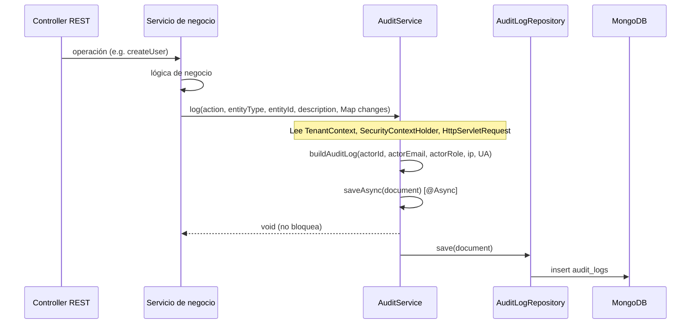

# Audit Log — Flujo y referencia

> **Audiencia:** integradores frontend/admin, compliance, QA.
> **Scope:** subsistema de Audit Log de `hanoit-api`. Cubre el modelo `AuditLog`, las 54 acciones, el servicio `AuditService`, los endpoints de consulta, las políticas de privacidad y la lista exacta de productores de eventos.
> **Fuente de verdad:** código en `src/main/java/com/hanoit/routing` (no este doc).

## 1. Modelo `AuditLog`

[`AuditLog.java`](../../src/main/java/com/hanoit/routing/model/AuditLog.java) — colección Mongo `audit_logs`.

| Campo | Tipo | Notas |
|---|---|---|
| `id` | `String` | `@Id` |
| `tenantId` | `ObjectId` | puede ser `null` (jobs/webhooks sin contexto tenant) |
| `actorId` | `ObjectId` | puede ser `null` (sin sesión: webhooks Stripe, jobs) |
| `actorEmail` | `String` | lookup síncrono a `RoutingUser` por `actorId` |
| `actorRole` | `String` | primera authority `ROLE_*` sin prefijo, en minúsculas |
| `action` | `String` | clave de [`AuditActions`](../../src/main/java/com/hanoit/routing/model/constants/AuditActions.java) |
| `actionCategory` | `String` | derivada con `AuditActions.categoryOf(action)` |
| `entityType` | `String` | `"user"`, `"tenant"`, `"package"`, etc. |
| `entityId` | `ObjectId` | puede ser `null` (operaciones masivas) |
| `description` | `String` | texto humano-legible |
| `changes` | `Map<String, Object>` | payload estructurado (equivalente a "details" en otros docs); sólo se asigna si el argumento pasado a `AuditService.log` es un `Map` |
| `ipAddress` | `String` | de `X-Forwarded-For` (primera IP) o `request.getRemoteAddr()` |
| `userAgent` | `String` | header HTTP `User-Agent`. **Persistido pero NO expuesto por API** (ver §8) |
| `metadata` | `Map<String, Object>` | reservado, **no usado por `AuditService`** (siempre `null` salvo escritura externa) |
| `createdAt` | `Instant` | `@CreatedDate` + `@Indexed`; además `AuditService` hace `setCreatedAt(Instant.now())` al construir |

### 1.1 Índices Mongo

Definidos en [`IndexInitializer.ensureAuditLogIndexes`](../../src/main/java/com/hanoit/routing/config/IndexInitializer.java):

- `(tenantId, createdAt desc)` — listado por tenant
- `(tenantId, actionCategory, createdAt desc)` — filtro por categoría
- `(actorId, createdAt desc)` — actividad de un usuario
- `(entityType, entityId, createdAt desc)` — historial de una entidad
- `(action, createdAt desc)` — filtro por acción

### 1.2 Inmutabilidad

El Javadoc dice "immutable / write-only" pero la clase usa Lombok `@Data` (hay setters). El contrato operativo es:

- No hay endpoints REST de actualización ni borrado.
- Único productor: `AuditService.log(...)`.
- El repositorio Spring Data permite borrado técnico (`AuditLogRepository`), pero la app no lo expone.

## 2. Catálogo de acciones

54 constantes públicas en [`AuditActions`](../../src/main/java/com/hanoit/routing/model/constants/AuditActions.java) + 5 categorías. Lista exhaustiva:

### 2.1 Admin (`tenant.*`, `user.*`)

| Constante Java | `action` string |
|---|---|
| `TENANT_REGISTER` | `tenant.register` |
| `TENANT_UPDATE` | `tenant.update` |
| `TENANT_DEACTIVATE` | `tenant.deactivate` |
| `TENANT_ACTIVATE` | `tenant.activate` |
| `TENANT_PLAN_CHANGE` | `tenant.plan.change` *(definida, no emitida)* |
| `USER_CREATE` | `user.create` |
| `USER_INVITE` | `user.invite` |
| `USER_INVITE_ACCEPT` | `user.invite.accept` |
| `USER_INVITE_REVOKE` | `user.invite.revoke` |
| `USER_UPDATE` | `user.update` |
| `USER_DEACTIVATE` | `user.deactivate` |
| `USER_ACTIVATE` | `user.activate` *(definida, no emitida)* |
| `USER_DELETE` | `user.delete` |
| `USER_PASSWORD_CHANGE` | `user.password.change` |
| `USER_PASSWORD_RESET` | `user.password.reset` |

### 2.2 Auth (`auth.*`)

| Constante | `action` |
|---|---|
| `AUTH_LOGIN` | `auth.login` |
| `AUTH_LOGIN_FAILED` | `auth.login.failed` |
| `AUTH_LOGOUT` | `auth.logout` |

### 2.3 Billing (`billing.*`)

| Constante | `action` |
|---|---|
| `BILLING_SUBSCRIPTION_CREATE` | `billing.subscription.create` |
| `BILLING_SUBSCRIPTION_UPDATE` | `billing.subscription.update` |
| `BILLING_SUBSCRIPTION_CANCEL` | `billing.subscription.cancel` |
| `BILLING_PAYMENT_SUCCESS` | `billing.payment.success` |
| `BILLING_PAYMENT_FAILED` | `billing.payment.failed` |
| `BILLING_TRIAL_START` | `billing.trial.start` |
| `BILLING_TRIAL_EXPIRING` | `billing.trial.expiring` |
| `BILLING_TRIAL_EXPIRED` | `billing.trial.expired` |
| `BILLING_TRIAL_CONVERTED` | `billing.trial.converted` |
| `BILLING_SEATS_INCREASE` | `billing.seats.increase` |
| `BILLING_SEATS_DECREASE` | `billing.seats.decrease` |

### 2.4 Notifications (`notification.*`)

| Constante | `action` |
|---|---|
| `NOTIFICATION_OTP_SENT` | `notification.otp.sent` *(definida, no emitida)* |
| `NOTIFICATION_OTP_VERIFIED` | `notification.otp.verified` *(definida, no emitida)* |
| `NOTIFICATION_PUSH_REGISTERED` | `notification.push.registered` |
| `NOTIFICATION_PREFERENCES_UPDATED` | `notification.preferences.updated` |

### 2.5 Operación

| Constante | `action` |
|---|---|
| `JOURNEY_PLAN` | `journey.plan` |
| `JOURNEY_DISPATCH` | `journey.dispatch` *(definida, no emitida)* |
| `JOURNEY_CANCEL` | `journey.cancel` *(definida, no emitida)* |
| `JOURNEY_DELETE` | `journey.delete` |
| `PACKAGE_CREATE` | `package.create` |
| `PACKAGE_UPLOAD` | `package.upload` |
| `PACKAGE_UPDATE` | `package.update` *(definida, no emitida)* |
| `PACKAGE_STATUS_CHANGE` | `package.status.change` |
| `PACKAGE_GEOCODE` | `package.geocode` *(definida, no emitida)* |
| `SETTINGS_CREATE` | `settings.create` |
| `SETTINGS_UPDATE` | `settings.update` |
| `SETTINGS_DELETE` | `settings.delete` |
| `RESOURCE_CREATE` | `resource.create` |
| `RESOURCE_UPDATE` | `resource.update` |
| `RESOURCE_DELETE` | `resource.delete` |
| `RESOURCE_ASSIGN_DRIVER` | `resource.assign.driver` |
| `RESOURCE_UNASSIGN_DRIVER` | `resource.unassign.driver` |
| `PLACE_CREATE` | `place.create` |
| `PLACE_UPDATE` | `place.update` |
| `PLACE_DELETE` | `place.delete` |

### 2.6 Categorías

| Constante | Valor |
|---|---|
| `CATEGORY_ADMIN` | `admin` |
| `CATEGORY_AUTH` | `auth` |
| `CATEGORY_BILLING` | `billing` |
| `CATEGORY_NOTIFICATION` | `notification` |
| `CATEGORY_OPERATION` | `operation` |

**Regla `categoryOf(action)`:**

| Prefijo | Categoría |
|---|---|
| `tenant.*`, `user.*` | `admin` |
| `auth.*` | `auth` |
| `billing.*` | `billing` |
| `notification.*` | `notification` |
| Cualquier otro (incluye `journey.*`, `package.*`, `place.*`, `resource.*`, `settings.*`) | `operation` |

## 3. `AuditService`

[`AuditService.java`](../../src/main/java/com/hanoit/routing/service/audit/AuditService.java) (no hay interfaz separada; es la clase concreta `@Service`).

### 3.1 Métodos públicos

```java
void log(String action, String entityType, ObjectId entityId, String description, Object changes);
void log(String action, String entityType, ObjectId entityId, String description);
void log(String action, ObjectId tenantId, String entityType, ObjectId entityId, String description, Object changes);
```

- El overload de 5 parámetros pasa `changes=null`.
- El overload de 6 parámetros permite forzar `tenantId` (útil para webhooks/jobs sin `TenantContext`).

### 3.2 Resolución de contexto

| Dato | Cómo se obtiene |
|---|---|
| `tenantId` | argumento explícito (overload 6 params) o [`TenantContext.getTenantId()`](../../src/main/java/com/hanoit/routing/context/TenantContext.java) |
| `actorId` | `SecurityContextHolder.getContext().getAuthentication().getName()` parseado como `ObjectId` (si no es hex válido → `null`) |
| `actorRole` | primera `GrantedAuthority` con prefijo `ROLE_`, recortada y en minúsculas |
| `actorEmail` | `userRepository.findById(actorId).map(RoutingUser::getEmail)` (puede ser `null`) |
| `ipAddress` | header `X-Forwarded-For` (primera IP de la lista) o `request.getRemoteAddr()` |
| `userAgent` | `request.getHeader("User-Agent")` |

> ⚠ El servicio inyecta `HttpServletRequest` directamente. Cuando se llama desde un job (`TrialExpirationJob`) o un webhook async sin request scope, `ipAddress` y `userAgent` quedan `null`.

### 3.3 Persistencia

- `log(...)` construye el documento **en el hilo de la petición** (necesario para capturar request, security, tenant).
- La escritura se delega a `@Async protected void saveAsync(AuditLog document)` → `auditLogRepository.save(...)`.
- `@EnableAsync` está en [`AppConfig`](../../src/main/java/com/hanoit/AppConfig.java).
- **Errores de build o save se loguean y se tragan**; nunca rompen el flujo de negocio.

### 3.4 Manejo de `changes`

- Si el argumento `changes` es `null` o no es `Map<?, ?>`, **NO se persiste** en el campo `changes` (queda `null`).
- Si es `Map`, se castea a `Map<String, Object>` y se asigna.

> Recomendación: pasar siempre `Map.of(...)` o `null`; no objetos POJO.

## 4. Endpoints de consulta

[`AuditLogController`](../../src/main/java/com/hanoit/routing/controller/AuditLogController.java) bajo `/api/v1/audit-logs`.

### 4.1 `GET /api/v1/audit-logs` — TENANT_ADMIN

| Query param | Tipo | Notas |
|---|---|---|
| `page` | int (default 0) | |
| `size` | int (default 20) | |
| `action` | string | filtra por action exacto |
| `category` | string | filtra por `actionCategory` (`admin`, `auth`, `billing`, `notification`, `operation`) |
| `actorId` | ObjectId hex | filtra por actor |
| `entityType` | string | filtra por tipo de entidad |

Response: `Page<AuditLogResponse>` ordenado por `createdAt` desc. **Incluye `ipAddress`**.

> ⚠ **No hay parámetros `dateFrom` / `dateTo`** en el controlador. El filtro temporal sólo es por paginación. Para rangos arbitrarios, consultar Mongo directamente o ampliar el controlador.

### 4.2 `GET /api/v1/audit-logs/me` — cualquier autenticado

Mismos filtros que `/api/v1/audit-logs` **excepto `actorId`**, que siempre se fuerza al usuario del JWT.

Response: usa `toSafeResponse` → **omite `ipAddress`** (campo aparece como `null` en el JSON gracias a `@JsonInclude(NON_NULL)` o queda ausente según la configuración del DTO).

### 4.3 `GET /api/v1/audit-logs/{id}` — TENANT_ADMIN

Detalle de un log. Valida que el `tenantId` del documento coincida con el del JWT. Usa `toResponse` (incluye `ipAddress`).

### 4.4 `GET /api/v1/audit-logs/admin` — SUPER_ADMIN

| Query param | Notas |
|---|---|
| `tenantId` | opcional; si null, retorna todos los tenants |
| `page`, `size`, `action`, `category` | igual que listado normal |

Response: `Page<AuditLogResponse>` con `ipAddress`.

### 4.5 `AuditLogResponse`

[`AuditLogResponse.java`](../../src/main/java/com/hanoit/routing/dto/AuditLogResponse.java).

```json
{
  "id": "65f6...",
  "action": "auth.login",
  "entityType": "user",
  "entityId": "65f4...",
  "description": "User logged in",
  "actorEmail": "founder@acme.com",
  "actorRole": "tenant_admin",
  "changes": { "email": "founder@acme.com" },
  "ipAddress": "200.115.78.123",
  "createdAt": "2026-04-23T12:00:00Z"
}
```

**Diferencias con `AuditLog` interno:**

| Campo de `AuditLog` | Expuesto en API |
|---|---|
| `tenantId` | ❌ |
| `actorId` | ❌ |
| `actorEmail` | ✅ |
| `actorRole` | ✅ |
| `action` | ✅ |
| `actionCategory` | ❌ (filtrable pero no devuelto) |
| `entityType`, `entityId`, `description`, `changes` | ✅ |
| `ipAddress` | ✅ (omitido en `/me`) |
| `userAgent` | ❌ (nunca expuesto, ningún endpoint) |
| `metadata` | ❌ (no usado) |
| `createdAt` | ✅ |

## 5. Matriz de seguridad

[`SecurityConfig`](../../src/main/java/com/hanoit/SecurityConfig.java):

| Patrón | Método | Acceso |
|---|---|---|
| `/api/v1/audit-logs/admin` | GET | `hasRole("SUPER_ADMIN")` |
| `/api/v1/audit-logs/me` | GET | `authenticated()` |
| `/api/v1/audit-logs/**` | * | `hasRole("TENANT_ADMIN")` |

Los matchers más específicos (`/admin`, `/me`) van **antes** del comodín. Sin esa precedencia un `AGENT` no podría leer su propio `/me`.

## 6. Productores de eventos por servicio

| Servicio | `AuditActions.*` emitidos |
|---|---|
| [`RoutingUserServiceImpl`](../../src/main/java/com/hanoit/routing/service/impl/RoutingUserServiceImpl.java) | `AUTH_LOGIN`, `AUTH_LOGIN_FAILED`, `AUTH_LOGOUT`, `USER_CREATE`, `USER_UPDATE`, `USER_DELETE` |
| [`RegistrationServiceImpl`](../../src/main/java/com/hanoit/routing/service/auth/impl/RegistrationServiceImpl.java) | `TENANT_REGISTER`, `BILLING_TRIAL_START` (si trial), `AUTH_LOGIN` (post-verify) |
| [`PasswordServiceImpl`](../../src/main/java/com/hanoit/routing/service/auth/impl/PasswordServiceImpl.java) | `USER_PASSWORD_CHANGE`, `USER_PASSWORD_RESET` |
| [`AccountLockoutService`](../../src/main/java/com/hanoit/routing/service/auth/AccountLockoutService.java) | `AUTH_LOGIN_FAILED` (con razones `bad_password` / `account_locked`) |
| [`InvitationServiceImpl`](../../src/main/java/com/hanoit/routing/service/user/impl/InvitationServiceImpl.java) | `USER_INVITE`, `USER_INVITE_REVOKE`, `USER_INVITE_ACCEPT` |
| [`TenantServiceImpl`](../../src/main/java/com/hanoit/routing/service/impl/TenantServiceImpl.java) | `TENANT_DEACTIVATE`, `TENANT_ACTIVATE`, `TENANT_UPDATE` |
| [`BillingServiceImpl`](../../src/main/java/com/hanoit/routing/service/billing/impl/BillingServiceImpl.java) | `BILLING_SUBSCRIPTION_CREATE`, `BILLING_SUBSCRIPTION_UPDATE`, `BILLING_SEATS_INCREASE`, `BILLING_SEATS_DECREASE`, `BILLING_SUBSCRIPTION_CANCEL` |
| [`StripeWebhookService`](../../src/main/java/com/hanoit/routing/service/billing/StripeWebhookService.java) | `BILLING_SUBSCRIPTION_CREATE`, `BILLING_TRIAL_CONVERTED`, `BILLING_SUBSCRIPTION_UPDATE`, `BILLING_SUBSCRIPTION_CANCEL`, `BILLING_PAYMENT_SUCCESS`, `BILLING_PAYMENT_FAILED` |
| [`TrialExpirationJob`](../../src/main/java/com/hanoit/routing/service/tenant/TrialExpirationJob.java) | `BILLING_TRIAL_EXPIRING`, `BILLING_TRIAL_EXPIRED` |
| [`SeatEnforcementServiceImpl`](../../src/main/java/com/hanoit/routing/service/seat/SeatEnforcementServiceImpl.java) | `USER_DEACTIVATE` (downgrade) |
| [`NotificationController`](../../src/main/java/com/hanoit/routing/controller/NotificationController.java) | `NOTIFICATION_PUSH_REGISTERED` |
| [`NotificationPreferenceService`](../../src/main/java/com/hanoit/routing/service/notification/NotificationPreferenceService.java) | `NOTIFICATION_PREFERENCES_UPDATED` |
| **`OtpService`** | **ninguna** (no inyecta `AuditService`; los otp.sent/otp.verified están definidos pero sin productor) |
| [`JourneyPlanningServiceImpl`](../../src/main/java/com/hanoit/routing/service/impl/JourneyPlanningServiceImpl.java) | `JOURNEY_PLAN` (modo normal y messenger) |
| [`JourneyServiceImpl`](../../src/main/java/com/hanoit/routing/service/impl/JourneyServiceImpl.java) | `JOURNEY_DELETE` |
| [`PackageServiceImpl`](../../src/main/java/com/hanoit/routing/service/impl/PackageServiceImpl.java) | `PACKAGE_UPLOAD`, `PACKAGE_CREATE`, `PACKAGE_STATUS_CHANGE` |
| [`PlaceServiceImpl`](../../src/main/java/com/hanoit/routing/service/impl/PlaceServiceImpl.java) | `PLACE_CREATE`, `PLACE_UPDATE`, `PLACE_DELETE` |
| [`SettingsServiceImpl`](../../src/main/java/com/hanoit/routing/service/impl/SettingsServiceImpl.java) | `SETTINGS_CREATE`, `SETTINGS_UPDATE`, `SETTINGS_DELETE` |
| [`ResourceServiceImpl`](../../src/main/java/com/hanoit/routing/service/impl/ResourceServiceImpl.java) | `RESOURCE_CREATE`, `RESOURCE_UPDATE`, `RESOURCE_DELETE`, `RESOURCE_ASSIGN_DRIVER`, `RESOURCE_UNASSIGN_DRIVER` |

**Constantes definidas pero sin productor en `src/main`:** `TENANT_PLAN_CHANGE`, `USER_ACTIVATE`, `JOURNEY_DISPATCH`, `JOURNEY_CANCEL`, `PACKAGE_UPDATE`, `PACKAGE_GEOCODE`, `NOTIFICATION_OTP_SENT`, `NOTIFICATION_OTP_VERIFIED`. Si necesitas estos eventos, hay que instrumentar el servicio correspondiente.

## 7. Esquema del campo `changes` por acción

Convención: claves y valores tal cual se persisten desde código.

### 7.1 Auth

| Acción | `changes` |
|---|---|
| `auth.login` (login normal) | `{ "email": "..." }` |
| `auth.login` (post-verify-email) | `null` (el `RegistrationServiceImpl` no pasa map) |
| `auth.login.failed` (email desconocido) | `{ "email": "...", "reason": "unknown_email" }` |
| `auth.login.failed` (cuenta inactiva) | `{ "email": "...", "reason": "inactive" }` |
| `auth.login.failed` (mala contraseña / lockout) | `{ "email": "...", "attempts": <int>, "reason": "bad_password" \| "account_locked", "lockedUntil": "<ISO>" }` |
| `auth.logout` | `null` |

### 7.2 Usuarios

| Acción | `changes` |
|---|---|
| `user.create` | `{ "email", "role" }` |
| `user.update` | sólo claves que cambiaron: `{ "email": {"old","new"}, "role": {"old","new"}, "passwordRotated": true }` |
| `user.delete` | `{ "email", "seatReleased": <bool> }` |
| `user.password.change` (reset por email) | `{ "resetVia": "email" }` |
| `user.password.change` (autenticado) | `{ "changedVia": "authenticated_change" }` |
| `user.password.reset` | `null` o `{ "admin": "<email del admin>" }` si fue forzado |
| `user.invite` (crear) | `{ "invitationId", "email", "role", "expiresAt" }` |
| `user.invite` (resend) | `{ "email", "expiresAt" }` |
| `user.invite.revoke` | `{ "email" }` |
| `user.invite.accept` | `{ "invitationId", "userId", "email", "role" }` |
| `user.deactivate` (downgrade seats) | `{ "isActive": false, "reason": "seatLimitDowngrade", "newSeatLimit": <int> }` |

### 7.3 Tenant

| Acción | `changes` |
|---|---|
| `tenant.register` | `{ "tenantName", "plan" }` |
| `tenant.deactivate` | `{ "isActive": false, "reason", "usersDeactivated": <int> }` |
| `tenant.activate` | `{ "isActive": true, "adminsReactivated": <int> }` |
| `tenant.update` (perfil) | por campo modificado: `{ "<field>": { "from": ..., "to": ... } }` (campos: `name`, `country`, `timezone`, `companySize`, `industry`) |
| `tenant.update` (billing) | mismo shape para `billingEmail`, `billingAddress`, `taxId` |

### 7.4 Billing

| Acción | `changes` |
|---|---|
| `billing.subscription.create` (checkout sesión) | `{ "plan", "billingInterval", "initialQuantity", "sessionId" }` |
| `billing.subscription.create` (webhook sync) | `{ "stripeSubscriptionId", "plan", "quantity" }` |
| `billing.subscription.update` (upgrade) | `{ "before": {plan, interval}, "after": {plan, interval} }` |
| `billing.subscription.update` (webhook) | `{ "status", "quantity", "plan" }` |
| `billing.subscription.cancel` (portal) | `{ "cancelAtPeriodEnd", "currentPeriodEnd" }` |
| `billing.subscription.cancel` (webhook deleted) | `{ "plan": "free", "seatLimit": 2, "previousStripeSubscriptionId" }` |
| `billing.payment.success` | `{ "invoiceId", "amountPaid", "currency" }` |
| `billing.payment.failed` | `{ "invoiceId", "consecutivePaymentFailures": <int> }` |
| `billing.trial.start` | `{ "trialPlan", "trialEndsAt" }` |
| `billing.trial.expiring` | `null` |
| `billing.trial.expired` | `{ "previousTrialPlan", "plan", "seatLimit" }` |
| `billing.trial.converted` | `{ "trialPlan", "trialStartedAt", "trialEndsAt", "trialSeatLimit", "convertedTo" }` |
| `billing.seats.increase` / `decrease` | `{ "before": <int>, "after": <int> }` |

### 7.5 Notifications

| Acción | `changes` |
|---|---|
| `notification.push.registered` | `{ "platform", "deviceCount" }` |
| `notification.preferences.updated` | sólo claves modificadas: `email.billing`, `email.security`, `email.product`, `email.invitations`, `sms.alerts`, `push.routeUpdates`, `push.journeyCompleted`, `push.billing`. **Nunca** `sms.otp` (forzado a `true` por API y no auditable como toggle). |

### 7.6 Operación

| Acción | `changes` |
|---|---|
| `journey.plan` (estándar) | `{ "settingsId", "packageCount", "invalidPackageCount" }` |
| `journey.plan` (messenger) | `{ "settingsId", "mode": "messenger" }` |
| `journey.delete` | `null` |
| `package.upload` | `{ "fileName", "totalRows", "successCount", "errorCount" }` |
| `package.create` | `null` |
| `package.status.change` | `{ "before": {status}, "after": {status} }` |
| `place.create` / `place.delete` | `null` |
| `place.update` | `{ "before": {...}, "after": {...} }` con `name`, `type`, `address` |
| `settings.create` | `null` |
| `settings.update` | `{ "before": {...}, "after": {...} }` con `routeTopology`, `restrictionType`, `fixedRoutes`, `lengthOfStay` |
| `settings.delete` | `{ "isActive": false }` |
| `resource.create` / `resource.delete` | `null` |
| `resource.update` | `{ "before": {...}, "after": {...} }` con `name`, `licensePlate`, `driverId`, `quantity` |
| `resource.assign.driver` / `unassign.driver` | `{ "before": {driverId}, "after": {driverId} }` (hex string o `""`) |

## 8. Privacidad

### 8.1 Política

- `/api/v1/audit-logs/me` no expone `ipAddress` (omite el setter en `toSafeResponse`).
- `userAgent` **NUNCA** se expone en ningún endpoint, ni siquiera al SUPER_ADMIN. Está disponible sólo via consulta directa a Mongo.
- `tenantId` y `actorId` (ObjectId raw) no se exponen; el cliente sólo ve `actorEmail` y `actorRole`.

### 8.2 Implementación

```java
// AuditLogController#toSafeResponse (no asigna ipAddress al builder)
return AuditLogResponse.builder()
    .id(log.getId())
    .action(log.getAction())
    .entityType(log.getEntityType())
    // ... NO .ipAddress(log.getIpAddress())
    .createdAt(log.getCreatedAt())
    .build();
```

## 9. Retención

**No hay un job de retención implementado** en `src/main/java`. La colección `audit_logs` crece indefinidamente. Para entornos productivos, considera:

- Configurar TTL Mongo en la colección (`db.audit_logs.createIndex({createdAt: 1}, {expireAfterSeconds: 31536000})` → 1 año).
- Crear un script operativo para archivar logs viejos a almacenamiento frío.
- O añadir un `@Scheduled` job análogo a `TrialExpirationJob`.

Comparar con: `StripeWebhookEvent` sí tiene TTL 30 días en código.

## 10. Diagrama de flujo



> Webhooks Stripe y jobs no tienen `HttpServletRequest`/`SecurityContext`/`TenantContext` → `actorId`, `actorEmail`, `ipAddress`, `userAgent` quedan `null`. Para forzar `tenantId`, los handlers usan el overload de 6 parámetros pasando `tenantId` explícito.

## 11. Tabla resumen (dominio → acción → cuándo)

| Dominio | Acción | Cuándo se emite |
|---|---|---|
| Auth | `auth.login` | login OK / post verify-email |
| Auth | `auth.login.failed` | email inválido, lock, password mala, cuenta inactiva |
| Auth | `auth.logout` | logout |
| Admin | `user.create/update/delete` | CRUD usuarios tenant |
| Admin | `user.invite/accept/revoke` | invitaciones |
| Admin | `user.password.change/reset` | reset / change password |
| Admin | `user.deactivate` | downgrade automático por seats |
| Admin | `tenant.register` | self-signup |
| Admin | `tenant.update` | PUT /me, /me/billing |
| Admin | `tenant.activate/deactivate` | SUPER_ADMIN lifecycle |
| Billing | `billing.trial.start` | signup con trial |
| Billing | `billing.trial.expiring/expired` | job horario |
| Billing | `billing.trial.converted` | webhook tras trial |
| Billing | `billing.subscription.create/update/cancel` | checkout / upgrade / cancel + webhooks |
| Billing | `billing.payment.success/failed` | webhooks invoice |
| Billing | `billing.seats.increase/decrease` | PUT /billing/seats |
| Notification | `notification.push.registered` | POST /notifications/push |
| Notification | `notification.preferences.updated` | PUT /notifications/preferences |
| Operation | `journey.plan` | planificación VRPTW / messenger |
| Operation | `journey.delete` | soft delete journey |
| Operation | `package.create/upload/status.change` | CSV upload, alta, cambio de estado |
| Operation | `place.*`, `settings.*`, `resource.*` | CRUD entidades operativas |

## 12. Casos de uso típicos

### Caso A: TENANT_ADMIN audita actividad de un usuario

```bash
curl -H "Authorization: Bearer <jwt-tenant-admin>" \
  "https://api.hanoit.com/api/v1/audit-logs?actorId=65f4...&page=0&size=50"
```

Response: `Page<AuditLogResponse>` con `ipAddress` visible. Filtrar por `category=admin` o `action=user.update` para refinar.

### Caso B: AGENT consulta su propia actividad

```bash
curl -H "Authorization: Bearer <jwt-agent>" \
  "https://api.hanoit.com/api/v1/audit-logs/me?page=0&size=20&category=operation"
```

Response sin `ipAddress`. `actorId` se fuerza al usuario del JWT (no se puede falsear).

### Caso C: Auditar logins fallidos del último mes

API sólo permite filtrar por `action`. Para rangos temporales:

```bash
curl -H "Authorization: Bearer <jwt-tenant-admin>" \
  "https://api.hanoit.com/api/v1/audit-logs?action=auth.login.failed&page=0&size=100"
```

Y filtrar `createdAt` en cliente, **o** consultar Mongo directo:

```js
db.audit_logs.find({
  action: "auth.login.failed",
  tenantId: ObjectId("..."),
  createdAt: { $gte: ISODate("2026-03-23T00:00:00Z") }
}).sort({ createdAt: -1 })
```

### Caso D: Auditar cambios de suscripción de un tenant

Como TENANT_ADMIN:

```bash
curl -H "Authorization: Bearer <jwt>" \
  "https://api.hanoit.com/api/v1/audit-logs?category=billing&page=0&size=50"
```

Como SUPER_ADMIN (cross-tenant):

```bash
curl -H "Authorization: Bearer <jwt-super>" \
  "https://api.hanoit.com/api/v1/audit-logs/admin?tenantId=65f3...&category=billing"
```

### Caso E: Forensics tras incidente de seguridad

1. Logs de login: `?action=auth.login&actorId=<sospechoso>`.
2. Cambios de password: `?action=user.password.change`.
3. Invitaciones nuevas (¿escaló privilegios?): `?action=user.invite.accept`.
4. IP del usuario en cada acción (sólo SUPER_ADMIN o TENANT_ADMIN, NO en `/me`).

## 13. Archivos relevantes

- Modelo: [`AuditLog`](../../src/main/java/com/hanoit/routing/model/AuditLog.java)
- Constantes: [`AuditActions`](../../src/main/java/com/hanoit/routing/model/constants/AuditActions.java)
- Servicio: [`AuditService`](../../src/main/java/com/hanoit/routing/service/audit/AuditService.java)
- Repositorio: [`AuditLogRepository`](../../src/main/java/com/hanoit/routing/repository/AuditLogRepository.java)
- Controlador: [`AuditLogController`](../../src/main/java/com/hanoit/routing/controller/AuditLogController.java)
- DTO: [`AuditLogResponse`](../../src/main/java/com/hanoit/routing/dto/AuditLogResponse.java)
- Seguridad: [`SecurityConfig`](../../src/main/java/com/hanoit/SecurityConfig.java)
- Índices: [`IndexInitializer`](../../src/main/java/com/hanoit/routing/config/IndexInitializer.java)
- Async: [`AppConfig`](../../src/main/java/com/hanoit/AppConfig.java)
- Tests E2E: [`Flow12AuditOperationalTest`](../../src/test/java/com/hanoit/routing/e2e/Flow12AuditOperationalTest.java)
