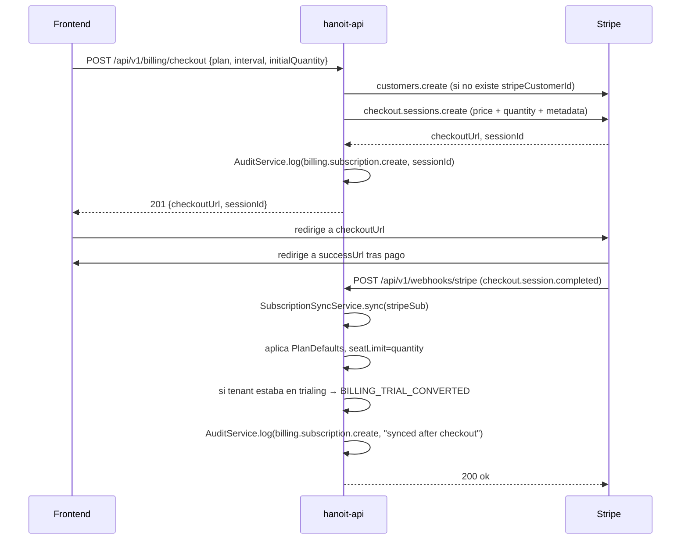
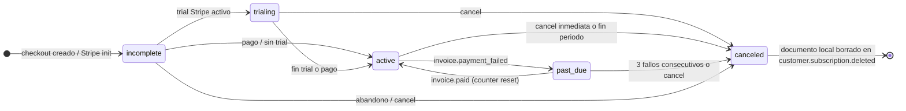

# Billing & Suscripciones — Flujo completo

> **Audiencia:** integradores frontend, finance/ops, QA.
> **Scope:** módulo `Billing` de `hanoit-api`. Incluye planes, defaults, ciclo de vida de suscripción, integración Stripe (checkout, portal, webhooks), trial, gestión de seats y matriz de errores.
> **Fuente de verdad:** código en `src/main/java/com/hanoit/routing` (no este doc). Cada afirmación cita el archivo concreto.

## 1. Catálogo de planes

### 1.1 Defaults por plan ([`PlanDefaults`](../../src/main/java/com/hanoit/routing/service/tenant/PlanDefaults.java))

`PlanDefaults.forPlan(plan)` produce un `TenantConfig` que se asigna al campo `tenant.config`:

| Plan | `maxDeposits` | `maxDrivers` | `maxRoutesMonthly` | `maxAdmins` | `maxAddressesPerFile` |
|---|---|---|---|---|---|
| `free` | 1 | 1 | 5 | 1 | 100 |
| `basic` | 10 | 100 | 10000 | 3 | 5000 |
| `standard` | 50 | 300 | 100000 | 10 | 10000 |
| `premium` | 100 | 1000 | 500000 | 30 | 20000 |
| `enterprise` | 9999 | 9999 | 9999 | 9999 | 9999 |

Cualquier otro valor: `IllegalArgumentException`.

### 1.2 Seats por plan

`PlanDefaults.seatLimitForPlan(plan)`:

| Plan | Valor |
|---|---|
| `free` | 2 |
| `basic`, `standard`, `premium`, `enterprise` | -1 (= ilimitado, convención de [`SeatEnforcementService`](../../src/main/java/com/hanoit/routing/service/seat/SeatEnforcementServiceImpl.java)) |
| desconocido | 2 |

> ⚠ **Importante:** `seatLimitForPlan` define el ideal por plan, pero **el `tenant.seatLimit` real en runtime se sincroniza con `subscription.quantity` en planes pagos** (ver §8). Para planes pagos la BD termina con un número positivo (cantidad comprada) y `SeatEnforcementService` lo respeta como tope, no como ilimitado. Sólo trial/free guardan `seatLimit=2`.

### 1.3 Resumen de qué cambia al cambiar de plan

| Campo de `Tenant` | Free / Trial expirado | Trial activo | Plan pago tras checkout | Cancelación / `customer.subscription.deleted` |
|---|---|---|---|---|
| `plan` | `free` | `free` | plan elegido | `free` |
| `subscriptionStatus` | `free` | `trialing` | `active` (espejo Stripe) | `free` |
| `config` | FREE defaults | defaults del `trialPlan` | defaults del plan elegido | FREE defaults |
| `seatLimit` | 2 | 2 | `quantity` (Stripe) | 2 |
| `trialPlan` | `null` | plan trial | se limpia tras conversión | — |
| `trialEndsAt` | `null` | `now+14d` | se limpia tras conversión | — |

## 2. Modelos

### 2.1 [`Tenant`](../../src/main/java/com/hanoit/routing/model/Tenant.java)

Campos relevantes a billing:

| Campo | Notas |
|---|---|
| `plan` | string (`free`, `basic`, `standard`, `premium`, `enterprise`) |
| `subscriptionStatus` | `free \| trialing \| active \| past_due \| canceled \| unpaid \| incomplete` |
| `config` | embedded `TenantConfig` (límites operativos) |
| `seatLimit`, `seatUsed` | tope y uso denormalizado |
| `trialPlan`, `trialStartedAt`, `trialEndsAt`, `trialSeatLimit`, `trialExpired`, `trialReminderSentAt` | trial state |
| `stripeCustomerId`, `stripeSubscriptionId` | espejo de Stripe |
| `billingEmail`, `billingAddress`, `taxId` | datos de facturación |
| `isActive`, `deactivatedAt`, `deactivatedBy`, `deactivationReason` | lifecycle del tenant |
| `canceledAt` | rellenado por webhook `customer.subscription.deleted` |

### 2.2 [`Subscription`](../../src/main/java/com/hanoit/routing/model/Subscription.java)

Documento por tenant (índice único en `tenantId` y `stripeSubscriptionId`):

| Campo | Notas |
|---|---|
| `stripeSubscriptionId`, `stripeCustomerId` | IDs Stripe |
| `stripePriceId`, `plan`, `billingInterval` (`monthly` / `annual`) | producto activo |
| `status` | espejo Stripe (`trialing \| active \| past_due \| canceled \| unpaid \| incomplete`) |
| `currentPeriodStart`, `currentPeriodEnd` | periodo |
| `quantity` | seats comprados (= `tenant.seatLimit`) |
| `unitAmount`, `amount`, `currency` | importes |
| `trialStart`, `trialEnd` | trial Stripe |
| `cancelAtPeriodEnd`, `canceledAt` | cancelación |
| `latestInvoiceId`, `latestInvoiceStatus`, `latestInvoicePdfUrl` | última factura |
| `consecutivePaymentFailures` | incrementa con `invoice.payment_failed`; reset con `invoice.paid`; **3 → cancelación inmediata en Stripe** |
| `metadata` | metadatos Stripe |

### 2.3 [`StripeWebhookEvent`](../../src/main/java/com/hanoit/routing/model/StripeWebhookEvent.java)

Idempotencia: `id = event.id` Stripe, `processedAt`, índice TTL **30 días**. Si ya existe o lanza `DuplicateKeyException`, el evento se considera duplicado y no se reprocesa.

## 3. Endpoints

Todas las rutas bajo `/api/v1/billing/**` requieren rol **TENANT_ADMIN** ([`SecurityConfig`](../../src/main/java/com/hanoit/SecurityConfig.java) líneas 111-112). El webhook `POST /api/v1/webhooks/stripe` es **público** con verificación de firma.

### 3.1 `GET /api/v1/billing/subscription` — TENANT_ADMIN

Devuelve `SubscriptionResponse` con el estado actual.

```json
{
  "stripeSubscriptionId": "sub_1Xxx...",
  "plan": "premium",
  "billingInterval": "monthly",
  "status": "active",
  "quantity": 5,
  "unitAmount": 4900,
  "amount": 24500,
  "currency": "usd",
  "currentPeriodStart": "2026-04-01T00:00:00Z",
  "currentPeriodEnd": "2026-05-01T00:00:00Z",
  "cancelAtPeriodEnd": false,
  "trialEnd": null,
  "latestInvoiceStatus": "paid",
  "latestInvoicePdfUrl": "https://..."
}
```

**Errores:** `404 SUBSCRIPTION_NOT_FOUND` si no hay documento.

### 3.2 `POST /api/v1/billing/checkout` — TENANT_ADMIN

Inicia un Stripe Checkout para nueva suscripción.

```json
{
  "plan": "basic",
  "billingInterval": "monthly",
  "initialQuantity": 5,
  "successUrl": "https://app.hanoit.com/billing/success",
  "cancelUrl": "https://app.hanoit.com/billing/cancel"
}
```

`CheckoutResponse` (HTTP 201):

```json
{ "checkoutUrl": "https://checkout.stripe.com/c/pay/...", "sessionId": "cs_test_..." }
```

**Validaciones:**

1. `plan ∈ {basic, standard, premium}` (no `enterprise`, no `free`) → `EnterprisePlanSelfServiceException` si falla.
2. `initialQuantity >= 1` y `>= tenant.seatUsed` → `SeatQuantityInvalidException` si falla.
3. No debe existir suscripción con status ∈ `{active, past_due, trialing}` → `ActiveSubscriptionConflictException`.
4. Si no hay `stripeCustomerId`, crea Stripe Customer y persiste.
5. Si `tenant.trialEndsAt > now`, pasa `trial_end` epoch a `subscription_data`.
6. Audit `BILLING_SUBSCRIPTION_CREATE` con `{plan, billingInterval, initialQuantity, sessionId}`.

**Errores:**

| Condición | HTTP | `error` |
|---|---|---|
| `plan ∉ {basic, standard, premium}` | 422 | `ENTERPRISE_PLAN_SELF_SERVICE` |
| `initialQuantity < 1` o `< seatUsed` | 422 | `SEAT_QUANTITY_INVALID` |
| Sub ya activa/past_due/trialing | 409 | `ACTIVE_SUBSCRIPTION_CONFLICT` |
| Falta `stripe.prices.<plan>.<interval>` en config | 500 | `MISSING_STRIPE_PRICE` |
| Stripe API falla | 502 | `STRIPE_INTEGRATION_ERROR` |
| Validación DTO | 400 | `VALIDATION_ERROR` |

### 3.3 `POST /api/v1/billing/portal` — TENANT_ADMIN

Genera URL al Customer Portal de Stripe (gestión de tarjetas, descarga facturas, autocancelación).

```json
{ "returnUrl": "https://app.hanoit.com/billing" }
```

Respuesta:

```json
{ "portalUrl": "https://billing.stripe.com/p/session/..." }
```

**Errores:** sin `stripeCustomerId` → `404 SUBSCRIPTION_NOT_FOUND` con mensaje "Complete checkout primero".

### 3.4 `POST /api/v1/billing/upgrade` — TENANT_ADMIN

Cambia plan o intervalo de la suscripción activa, con prorrateo Stripe.

```json
{ "plan": "premium", "billingInterval": "annual" }
```

Respuesta `UpgradeResponse` con `previousPlan`, `newPlan`, `tenant.plan`, `tenant.seatLimit`, `tenant.config`.

- Aplica `PlanDefaults.forPlan(newPlan)` al `tenant.config`.
- Audit `BILLING_SUBSCRIPTION_UPDATE` con `{before:{plan,interval}, after:{plan,interval}}`.
- Email Brevo template `plan-change`.

**Errores:** `404 SUBSCRIPTION_NOT_FOUND` (sin sub activa), `422 ENTERPRISE_PLAN_SELF_SERVICE`, `502 STRIPE_INTEGRATION_ERROR`.

### 3.5 `PUT /api/v1/billing/seats` — TENANT_ADMIN

Cambia la cantidad de seats (Stripe subscription item quantity).

```json
{ "op": "increase", "quantity": 3 }
```

`op ∈ {increase, decrease}`, `quantity >= 1`. La operación calcula `newQuantity = previous ± quantity`.

**Validaciones extra (decrease):**

- `newQuantity >= 1`
- `newQuantity >= tenant.seatUsed`

Si falla cualquiera → `SeatDecreaseBlockedException` → **422 `SEAT_DECREASE_BLOCKED`** con `details.seatUsed`, `details.requested`.

Audit `BILLING_SEATS_INCREASE` o `BILLING_SEATS_DECREASE` con `{before, after}`. Email `seat-change`.

### 3.6 `POST /api/v1/billing/cancel` — TENANT_ADMIN

Programa cancelación al final del periodo actual (`cancel_at_period_end=true` en Stripe). El downgrade real a FREE ocurre cuando Stripe emite `customer.subscription.deleted`.

```json
{ "cancelAtPeriodEnd": true, "currentPeriodEnd": "2026-05-01T00:00:00Z", "message": "Subscription cancellation scheduled" }
```

Audit `BILLING_SUBSCRIPTION_CANCEL` con `{cancelAtPeriodEnd, currentPeriodEnd}`.

### 3.7 `GET /api/v1/billing/invoices` — TENANT_ADMIN

Lista hasta 100 facturas Stripe del customer. Si no hay `stripeCustomerId`, devuelve lista vacía. Errores Stripe → 502.

### 3.8 `GET /api/v1/billing/usage` — TENANT_ADMIN

`BillingUsageResponse` con conteos reales:

```json
{
  "plan": "free",
  "trial": {
    "active": true,
    "plan": "premium",
    "startedAt": "2026-04-09T...",
    "endsAt": "2026-04-23T...",
    "daysRemaining": 0
  },
  "seats": { "limit": 2, "used": 2 },
  "limits": {
    "deposits": { "limit": 100, "used": 1, "percentage": 1.0 },
    "drivers": { "limit": 1000, "used": 0, "percentage": 0.0 },
    "routesMonthly": { "limit": 500000, "used": 0, "percentage": 0.0 },
    "admins": { "limit": 30, "used": 1, "percentage": 3.3 }
  },
  "subscription": null
}
```

> 💡 Durante un **trial**, `plan` permanece `"free"` (campo de facturación) pero `limits` reflejan los defaults del `trialPlan`. Esto es la causa del bug detectado en `Flow02SignupWithTrialTest` durante F4-11.

### 3.9 `POST /api/v1/webhooks/stripe` — público

- Body: **bytes raw** (no JSON parseado por Spring) + header `Stripe-Signature`.
- Verificación: `Webhook.constructEvent(payload, sig, secret)`.
- Idempotencia: `recordEvent` (insert con `id=event.id`).
- Despacho según `event.type` (ver §6).
- Excepciones internas se loguean y NO se propagan a Stripe (devolvemos 200 igual tras `recordEvent`).

Errores:

| Condición | HTTP |
|---|---|
| Falta header `Stripe-Signature` | 400 |
| Firma inválida | 400 |
| Evento ya procesado | 200 (no-op) |

## 4. Matriz de roles

| Endpoint | Rol requerido |
|---|---|
| `POST /api/v1/billing/**` | `TENANT_ADMIN` |
| `GET /api/v1/billing/**` | `TENANT_ADMIN` |
| `PUT /api/v1/billing/**` | `TENANT_ADMIN` |
| `POST /api/v1/webhooks/stripe` | `permitAll` (verificación de firma) |
| Otros endpoints relacionados (`/api/v1/tenants/**` PATCH activate/deactivate) | `SUPER_ADMIN` |

> Un `SUPER_ADMIN` que NO tenga también `TENANT_ADMIN` recibe **403** en `/api/v1/billing/**`.

## 5. Flujo Stripe Checkout — secuencia



## 6. Webhooks Stripe soportados

| `event.type` | Handler | Efectos en BD |
|---|---|---|
| `checkout.session.completed` | `handleCheckoutCompleted` | `SubscriptionSyncService.sync` (upsert `Subscription`, aplica `PlanDefaults`, `seatLimit=quantity`); audit `BILLING_SUBSCRIPTION_CREATE`; si tenant estaba `trialing` → audit `BILLING_TRIAL_CONVERTED` |
| `customer.subscription.updated` | `handleSubscriptionUpdated` | sync completo; audit `BILLING_SUBSCRIPTION_UPDATE` |
| `customer.subscription.deleted` | `handleSubscriptionDeleted` | tenant `plan=free`, `subscriptionStatus=free`, `config=PlanDefaults.forPlan("free")`, `seatLimit=2`, limpia `stripeSubscriptionId`, `canceledAt=now`; borra doc `Subscription`; `enforceDowngrade(tenant, 2)` (desactiva no-admin, libera seats); audit `BILLING_SUBSCRIPTION_CANCEL`; email `subscription-canceled` |
| `invoice.paid` | `handleInvoicePaid` | localiza sub por customer; actualiza `latestInvoice*`; `consecutivePaymentFailures=0`; audit `BILLING_PAYMENT_SUCCESS` |
| `invoice.payment_failed` | `handleInvoicePaymentFailed` | sub `status=past_due`, `consecutivePaymentFailures++`; tenant `subscriptionStatus=past_due`; email `payment-failed`; audit `BILLING_PAYMENT_FAILED`; **si fallos ≥ 3 → `cancelImmediately` en Stripe** (espera webhook `deleted`) |
| Cualquier otro | log debug "ignoring" | — |

## 7. Trial lifecycle

### 7.1 Inicio (en signup)

[`RegistrationServiceImpl.buildTenant`](../../src/main/java/com/hanoit/routing/service/auth/impl/RegistrationServiceImpl.java) crea el tenant con trial si `request.getTrialPlan()` es válido (`basic`, `standard`, `premium`, `enterprise`):

| Campo Tenant | Sin trial | Con trial |
|---|---|---|
| `plan` | `free` | `free` |
| `trialPlan` | `null` | requested |
| `trialStartedAt` | — | `now` |
| `trialEndsAt` | — | `now + 14 días` |
| `trialSeatLimit` | — | 2 |
| `trialExpired` | `false` | `false` |
| `subscriptionStatus` | `free` | `trialing` |
| `config` | FREE defaults | `PlanDefaults.forPlan(trialPlan)` |
| `seatLimit` | 2 | 2 |

Audit `BILLING_TRIAL_START` con `{trialPlan, trialEndsAt}`.

### 7.2 Job [`TrialExpirationJob`](../../src/main/java/com/hanoit/routing/service/tenant/TrialExpirationJob.java)

Cron `"0 0 * * * *"` → **cada hora en el minuto 0**.

**Recordatorios:** tenants `trialing` con `trialEndsAt` en `(now+2d, now+3d]` y `trialReminderSentAt == null`.

- Email Brevo `trial-expiring` con `daysLeft=3`.
- Audit `BILLING_TRIAL_EXPIRING`.
- Setea `trialReminderSentAt = now` (idempotencia: garantiza un solo recordatorio por tenant aunque el job corra cada hora).

**Expirados:** tenants `trialing` con `trialEndsAt <= now`:

- `trialExpired=true`, `subscriptionStatus=free`, `plan=free`, `config=PlanDefaults.forPlan("free")`, `seatLimit=2`.
- `seatEnforcementService.enforceDowngrade(tenantId, 2)` (mantiene `TENANT_ADMIN`s, desactiva no-admin LIFO por `createdAt`, revoca refresh tokens, audit `USER_DEACTIVATE` por usuario afectado).
- Email Brevo `trial-expired`.
- Audit `BILLING_TRIAL_EXPIRED` con `{previousTrialPlan, plan, seatLimit}`.

### 7.3 Conversión trial → paid

Cuando el cliente abre `POST /api/v1/billing/checkout` con `trialEndsAt > now`, el `BillingService` pasa `trial_end` a Stripe. Tras `checkout.session.completed`, si `tenant.subscriptionStatus == trialing`, el handler:

1. Limpia `trialPlan`, `trialStartedAt`, `trialEndsAt`, `trialSeatLimit`.
2. Audit `BILLING_TRIAL_CONVERTED` con snapshot del trial y `convertedTo=<plan>`.

## 8. Seats

### 8.1 Lógica core ([`SeatEnforcementServiceImpl`](../../src/main/java/com/hanoit/routing/service/seat/SeatEnforcementServiceImpl.java))

- **`checkSeatAvailability(tenantId)`**: cuenta `RoutingUser` activos no soft-deleted del tenant. Si `seatLimit` es `null` o `< 0` retorna sin checar (ilimitado). Si `count >= seatLimit` lanza `SeatLimitExceededException` → **409 `SEAT_LIMIT_EXCEEDED`**.
- **`incrementSeatUsed` / `decrementSeatUsed`**: `$inc` atómico Mongo en `tenant.seatUsed`.
- **`enforceDowngrade(tenantId, newLimit)`**: ordena usuarios no-admin por `createdAt` desc, desactiva los que excedan `newLimit`, revoca refresh tokens, audit `USER_DEACTIVATE`.

> Importante: `checkSeatAvailability` usa el conteo **real de usuarios activos**, no el campo denormalizado `seatUsed`. El campo `seatUsed` se mantiene atómicamente y se expone en `/billing/usage`.

### 8.2 Sincronización con Stripe

- Tras `checkout.session.completed`: `tenant.seatLimit = subscription.quantity` (vía `SubscriptionSyncService.applySubscriptionToTenant`).
- En `PUT /api/v1/billing/seats`: `StripeService.updateSubscriptionItem` con misma `price` y nueva `quantity`, `proration_behavior=create_prorations`. Tras éxito Stripe, persiste `Subscription.quantity` y `tenant.seatLimit = newQuantity`.
- Tras `customer.subscription.deleted`: `tenant.seatLimit = 2` (FREE_SEAT_LIMIT).

## 9. Excepciones billing → HTTP

[`RoutingExceptionHandler`](../../src/main/java/com/hanoit/routing/exception/RoutingExceptionHandler.java):

| Excepción | HTTP | `error` |
|---|---|---|
| `ActiveSubscriptionConflictException` | 409 | `ACTIVE_SUBSCRIPTION_CONFLICT` |
| `SubscriptionNotFoundException` | 404 | `SUBSCRIPTION_NOT_FOUND` |
| `EnterprisePlanSelfServiceException` | **422** | `ENTERPRISE_PLAN_SELF_SERVICE` |
| `MissingStripePriceException` | 500 | `MISSING_STRIPE_PRICE` |
| `StripeIntegrationException` | 502 | `STRIPE_INTEGRATION_ERROR` |
| `SeatLimitExceededException` | 409 | `SEAT_LIMIT_EXCEEDED` |
| `SeatDecreaseBlockedException` | 422 | `SEAT_DECREASE_BLOCKED` |
| `SeatQuantityInvalidException` | 422 | `SEAT_QUANTITY_INVALID` |
| `ResourceNotFoundException` (tenant) | 404 | `NOT_FOUND` |
| Validación Bean | 400 | `VALIDATION_ERROR` (con `details` por campo) |

## 10. Auditoría billing

| Acción | Cuándo |
|---|---|
| `billing.subscription.create` | `BillingServiceImpl.createCheckout` (sesión); `StripeWebhookService.handleCheckoutCompleted` (sync) |
| `billing.subscription.update` | `BillingServiceImpl.upgrade`; `StripeWebhookService.handleSubscriptionUpdated` |
| `billing.subscription.cancel` | `BillingServiceImpl.cancel` (programada); `StripeWebhookService.handleSubscriptionDeleted` (real + downgrade) |
| `billing.payment.success` | `handleInvoicePaid` |
| `billing.payment.failed` | `handleInvoicePaymentFailed` |
| `billing.trial.start` | `RegistrationServiceImpl` con trial válido |
| `billing.trial.expiring` | `TrialExpirationJob.sendReminders` |
| `billing.trial.expired` | `TrialExpirationJob.downgradeExpired` |
| `billing.trial.converted` | `StripeWebhookService.handleCheckoutCompleted` cuando aplica |
| `billing.seats.increase` / `decrease` | `BillingServiceImpl.changeSeats` |

## 11. Diagrama de estados (Subscription espejo Stripe)



## 12. Tabla de errores frecuentes

| Escenario | HTTP | `error` |
|---|---|---|
| Checkout con `enterprise` o plan inexistente | 422 | `ENTERPRISE_PLAN_SELF_SERVICE` |
| Checkout con `initialQuantity < seatUsed` o `< 1` | 422 | `SEAT_QUANTITY_INVALID` |
| Checkout con sub activa/past_due/trialing | 409 | `ACTIVE_SUBSCRIPTION_CONFLICT` |
| `stripe.prices.<plan>.<interval>` no configurado | 500 | `MISSING_STRIPE_PRICE` |
| Falla Stripe API | 502 | `STRIPE_INTEGRATION_ERROR` |
| `GET subscription` sin documento | 404 | `SUBSCRIPTION_NOT_FOUND` |
| `POST portal` sin `stripeCustomerId` | 404 | `SUBSCRIPTION_NOT_FOUND` |
| `upgrade/cancel/seats` sin sub activa | 404 | `SUBSCRIPTION_NOT_FOUND` |
| Reducir seats por debajo de `seatUsed` o `< 1` | 422 | `SEAT_DECREASE_BLOCKED` |
| Crear invitación con seats llenos | 409 | `SEAT_LIMIT_EXCEEDED` |
| Webhook firma inválida | 400 | (cuerpo texto) |

## 13. Configuración

```91:99:src/main/resources/application.properties
# Stripe configuration
stripe.secret-key=${STRIPE_SECRET_KEY:sk_test_placeholder}
stripe.webhook-secret=${STRIPE_WEBHOOK_SECRET:whsec_placeholder}
stripe.prices.basic.monthly=${STRIPE_PRICE_BASIC_MONTHLY:price_basic_monthly}
stripe.prices.basic.annual=${STRIPE_PRICE_BASIC_ANNUAL:price_basic_annual}
stripe.prices.standard.monthly=${STRIPE_PRICE_STANDARD_MONTHLY:price_standard_monthly}
stripe.prices.standard.annual=${STRIPE_PRICE_STANDARD_ANNUAL:price_standard_annual}
stripe.prices.premium.monthly=${STRIPE_PRICE_PREMIUM_MONTHLY:price_premium_monthly}
stripe.prices.premium.annual=${STRIPE_PRICE_PREMIUM_ANNUAL:price_premium_annual}
```

Brevo templates billing relevantes (`brevo.templates.*`):

| Clave | Default ID | Uso |
|---|---|---|
| `payment-failed` | 5 | aviso pago fallido |
| `plan-change` | 6 | upgrade/downgrade |
| `trial-expiring` | 7 | recordatorio 3 días |
| `trial-expired` | 8 | trial caducado |
| `subscription-canceled` | 10 | cancelación efectiva |
| `seat-change` | 11 | cambio de seats |

## 14. Casos de uso end-to-end

### Caso A: Tenant nuevo se queda en FREE

1. `POST /api/v1/auth/register` (sin `trialPlan`).
2. Tenant queda con `plan=free`, `subscriptionStatus=free`, `seatLimit=2`.
3. Usuario admin se registra como TENANT_ADMIN (1 seat de 2 ocupado).
4. Puede invitar 1 usuario más (total 2/2). Tercera invitación → **409 SEAT_LIMIT_EXCEEDED**.
5. `GET /api/v1/billing/usage` muestra límites FREE (`maxRoutesMonthly=5`, etc.).

### Caso B: Tenant nuevo entra a trial premium

1. `POST /api/v1/auth/register` con `"trialPlan": "premium"`.
2. Tenant queda con `plan=free`, `trialPlan=premium`, `subscriptionStatus=trialing`, `trialEndsAt=now+14d`, `config=PlanDefaults.forPlan("premium")`, `seatLimit=2`.
3. Usuario disfruta de límites premium (rutas, depots, etc.) pero solo 2 seats.
4. Día 11: job envía `trial-expiring`. `trialReminderSentAt` se setea.
5. Día 14: job ejecuta downgrade → `plan=free`, `config=PlanDefaults.forPlan("free")`, `seatLimit=2`. Usuarios no-admin desactivados (LIFO). Audit `BILLING_TRIAL_EXPIRED`.

### Caso C: Conversión trial → premium pagado

1. Día 7 del trial el TENANT_ADMIN abre `POST /api/v1/billing/checkout` con `plan=premium`, `billingInterval=monthly`, `initialQuantity=10`.
2. Cliente paga en Stripe Checkout.
3. Webhook `checkout.session.completed`:
   - Crea `Subscription` con `quantity=10`, `status=active`.
   - `tenant.plan=premium`, `subscriptionStatus=active`, `config=PlanDefaults.forPlan("premium")`, `seatLimit=10`.
   - Limpia `trialPlan`, `trialEndsAt`, `trialSeatLimit`.
   - Audit `BILLING_SUBSCRIPTION_CREATE` y `BILLING_TRIAL_CONVERTED`.
4. Tenant ahora puede invitar hasta 10 usuarios.

### Caso D: Pago falla 3 veces

1. Stripe emite `invoice.payment_failed` 3 veces consecutivas.
2. En cada uno: `consecutivePaymentFailures++`, `subscriptionStatus=past_due`, email al `billingEmail`.
3. Tras el 3.º: `cancelImmediately` en Stripe.
4. Stripe responde con `customer.subscription.deleted`.
5. Tenant se downgradea a `free`, seats se ajustan a 2, no-admin son desactivados, doc `Subscription` se borra.

### Caso E: Reducción de seats bloqueada

Tenant tiene `seatLimit=10`, `seatUsed=8`. Llama `PUT /api/v1/billing/seats` con `op=decrease, quantity=5` (newQuantity = 5).

```json
HTTP/1.1 422 Unprocessable Entity
{
  "error": "SEAT_DECREASE_BLOCKED",
  "message": "Cannot reduce seats below current usage",
  "details": { "seatUsed": 8, "requested": 5 },
  "timestamp": "...",
  "path": "/api/v1/billing/seats"
}
```

Para reducir, primero debe desactivar/eliminar 3 usuarios.

## 15. Archivos relevantes

- Catálogo: [`PlanDefaults`](../../src/main/java/com/hanoit/routing/service/tenant/PlanDefaults.java), [`TenantConfig`](../../src/main/java/com/hanoit/routing/model/embedded/TenantConfig.java)
- Modelos: [`Tenant`](../../src/main/java/com/hanoit/routing/model/Tenant.java), [`Subscription`](../../src/main/java/com/hanoit/routing/model/Subscription.java), [`StripeWebhookEvent`](../../src/main/java/com/hanoit/routing/model/StripeWebhookEvent.java)
- Endpoints: [`BillingController`](../../src/main/java/com/hanoit/routing/controller/BillingController.java), [`StripeWebhookController`](../../src/main/java/com/hanoit/routing/controller/StripeWebhookController.java)
- Lógica: [`BillingServiceImpl`](../../src/main/java/com/hanoit/routing/service/billing/impl/BillingServiceImpl.java), [`StripeService`](../../src/main/java/com/hanoit/routing/service/billing/StripeService.java), [`StripeWebhookService`](../../src/main/java/com/hanoit/routing/service/billing/StripeWebhookService.java), [`SubscriptionSyncService`](../../src/main/java/com/hanoit/routing/service/billing/SubscriptionSyncService.java)
- Trial: [`TrialExpirationJob`](../../src/main/java/com/hanoit/routing/service/tenant/TrialExpirationJob.java)
- Seats: [`SeatEnforcementServiceImpl`](../../src/main/java/com/hanoit/routing/service/seat/SeatEnforcementServiceImpl.java)
- Handler: [`RoutingExceptionHandler`](../../src/main/java/com/hanoit/routing/exception/RoutingExceptionHandler.java)
- Config: [`StripeConfig`](../../src/main/java/com/hanoit/routing/config/StripeConfig.java), [`application.properties`](../../src/main/resources/application.properties)
- Tests E2E: [`Flow02SignupWithTrialTest`](../../src/test/java/com/hanoit/routing/e2e/Flow02SignupWithTrialTest.java), [`Flow03TrialExpirationTest`](../../src/test/java/com/hanoit/routing/e2e/Flow03TrialExpirationTest.java), [`Flow04SeatLimitEnforcementTest`](../../src/test/java/com/hanoit/routing/e2e/Flow04SeatLimitEnforcementTest.java), [`Flow07PaymentFailedRecoveryTest`](../../src/test/java/com/hanoit/routing/e2e/Flow07PaymentFailedRecoveryTest.java), [`Flow08SeatChangeTest`](../../src/test/java/com/hanoit/routing/e2e/Flow08SeatChangeTest.java)
