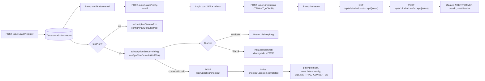

# Tenant Onboarding — Flujo completo

> **Audiencia:** integradores frontend, growth/ops, QA.
> **Scope:** desde `POST /api/v1/auth/register` hasta tenant operativo con suscripción y equipo invitado. Cubre signup, verificación de email, trial, primera suscripción, invitaciones y gestión de seats.
> **Fuente de verdad:** código en `src/main/java/com/hanoit/routing` (no este doc).

## 1. Visión general



## 2. `POST /api/v1/auth/register`

Endpoint público en [`RoutingAuthController`](../../src/main/java/com/hanoit/routing/controller/RoutingAuthController.java) → [`RegistrationServiceImpl`](../../src/main/java/com/hanoit/routing/service/auth/impl/RegistrationServiceImpl.java).

### 2.1 Request — [`RegisterRequest`](../../src/main/java/com/hanoit/routing/dto/RegisterRequest.java)

```json
{
  "email": "founder@acme.com",
  "password": "Reallystrongpassw0rd!",
  "firstName": "Ana",
  "lastName": "García",
  "phone": "+573001112233",
  "tenantName": "ACME Logistics",
  "country": "CO",
  "timezone": "America/Bogota",
  "companySize": "10-50",
  "industry": "logistics",
  "trialPlan": "premium"
}
```

| Campo | Validación | Notas |
|---|---|---|
| `email` | `@NotBlank` + único en BD | normalizado con `EmailUtils.normalize` (lowercase + trim) |
| `password` | `@NotBlank` + política F4 ([`PasswordValidator`](../../src/main/java/com/hanoit/routing/service/auth/PasswordValidator.java)): mínimo 16 caracteres, mayúsc/minúsc/dígito/especial `@$!%*?&`, distinto del email |
| `firstName`, `lastName` | `@NotBlank` | |
| `phone` | opcional | |
| `tenantName` | `@NotBlank` | |
| `country` | `@NotBlank` | código ISO; usado para timezone por defecto si falta |
| `timezone` | opcional | si `null`: mapa por país (e.g. `CO → America/Bogota`) o `UTC` |
| `companySize` / `industry` | opcional | |
| `trialPlan` | opcional | valores aceptados en código: `basic \| standard \| premium \| enterprise`; cualquier otro string se ignora silenciosamente y queda sin trial |

### 2.2 Lógica del servicio

1. Normaliza email; si `existsByEmail` → `EmailAlreadyExistsException` → **409 `EMAIL_ALREADY_EXISTS`**.
2. `passwordValidator.validate(password, email)` → si falla `PasswordPolicyViolationException` → **400 `PASSWORD_POLICY_VIOLATION`** con `details.errors[]`.
3. **Crear `Tenant`** ([`buildTenant`](../../src/main/java/com/hanoit/routing/service/auth/impl/RegistrationServiceImpl.java)). Diferencias:

| Campo | Sin `trialPlan` válido | Con `trialPlan` válido |
|---|---|---|
| `plan` | `"free"` | `"free"` (el trial NO modifica el plan base) |
| `subscriptionStatus` | `"free"` | `"trialing"` |
| `config` | `PlanDefaults.forPlan("free")` | `PlanDefaults.forPlan(trialPlan)` |
| `seatLimit` | `2` | `2` |
| `trialPlan` | `null` | requested |
| `trialStartedAt` / `trialEndsAt` | `null` | `now` / `now + 14 días` |
| `trialSeatLimit` | `null` | `2` |
| `trialExpired` | `false` | `false` |

4. **Crear `RoutingUser`** TENANT_ADMIN: `passwordHash` (BCrypt), `emailVerified=false`, `emailVerificationToken=UUID`, `emailVerificationExpiresAt=now+24h`, `notificationPreferences` con defaults, `isActive=true`, `loginAttempts=0`.
5. `seatEnforcementService.incrementSeatUsed(tenantId)` → `tenant.seatUsed = 1`.
6. Construye `verificationLink`: si `app.email-verification-link-base` tiene valor (perfil `dev`), `{base}/api/v1/auth/verify-email?token=` (el backend responde HTML); si no, `app.frontend-url + "/verify-email?token=" + token`.
7. `brevoService.sendVerificationEmail(email, firstName, verificationLink)` (template `verification-email`, ID 1).
8. `brevoService.upsertContact` (atributos tenant, role, nombre).
9. **Audits**:
   - Siempre: `tenant.register` con `{tenantName, plan}`.
   - Si trial válido: `billing.trial.start` con `{trialPlan, trialEndsAt}`.

### 2.3 Constantes en código

```java
private static final long VERIFICATION_TOKEN_TTL_HOURS = 24L;
private static final int  TRIAL_DAYS = 14;
private static final int  TRIAL_SEAT_LIMIT = 2;
```

### 2.4 Response — [`RegisterResponse`](../../src/main/java/com/hanoit/routing/dto/RegisterResponse.java)

```json
{
  "tenantId": "65f3...",
  "userId": "65f4...",
  "message": "Verification email sent. Check your inbox."
}
```

HTTP **201 Created**.

## 3. `POST /api/v1/auth/verify-email`

Endpoint público.

### 3.1 Request

```json
{ "token": "uuid-from-email" }
```

### 3.2 Lógica

1. `userRepository.findByEmailVerificationToken(token)` → si vacío: `InvalidTokenException` → **400 `INVALID_TOKEN`**.
2. Si `emailVerificationExpiresAt < now` o `null` → `TokenExpiredException` → **400 `TOKEN_EXPIRED`**.
3. `emailVerified=true`, limpia token y expiración.
4. Genera JWT (`jwtTokenProvider.generateToken(userId, tenantId, role)`) y refresh token nuevo.
5. Audit `auth.login` con descripción "User logged in after email verification".

### 3.3 Response — `LoginResponse`

```json
{
  "message": "Email verified successfully. You're logged in.",
  "accessToken": "eyJhbGciOi...",
  "refreshToken": "rt_a1b2c3...",
  "expiresIn": 3600,
  "user": {
    "id": "65f4...",
    "email": "founder@acme.com",
    "firstName": "Ana",
    "role": "tenant_admin"
  }
}
```

## 4. Login y gestión de sesión

### 4.1 `POST /api/v1/auth/login`

Request: `LoginRequest { email, password }` (`@NotBlank`, `@Email`).

Lógica ([`RoutingUserServiceImpl.login`](../../src/main/java/com/hanoit/routing/service/impl/RoutingUserServiceImpl.java)):

1. `userRepository.findByEmailAndDeletedAtIsNull(emailNormalizado)`. Si vacío → **`BadCredentialsException`** → **401 `INVALID_CREDENTIALS`** (anti enumeración: mismo error que password incorrecto).
2. `accountLockoutService.assertNotLocked(user)` → si bloqueado: **423 `ACCOUNT_LOCKED`** con `details.lockedUntil`, `details.attempts`.
3. Si `passwordEncoder.matches(password, user.passwordHash) == false`:
   - `accountLockoutService.registerFailedAttempt(user)`.
   - `BadCredentialsException` → **401 `INVALID_CREDENTIALS`**.
4. Si `!user.isActive()`:
   - audit `auth.login.failed` con `{email, reason: "inactive"}`.
   - `IllegalStateException("Account is disabled")` → **401 `ACCOUNT_DISABLED`** (handler especial para mensajes con "disabled"/"inactive").
5. Éxito:
   - `lastLoginAt = now`, reset lockout (`loginAttempts=0`, `lockedUntil=null`).
   - Genera JWT + refresh.
   - Audit `auth.login` con `{email}`.

> ⚠ El login **no** comprueba `emailVerified` ni `tenant.isActive` directamente. El control de tenant inactivo se hace por cascada al desactivar (todos los usuarios pasan a `isActive=false`).

### 4.2 `POST /api/v1/auth/refresh`

Request: `RefreshRequest { refreshToken }`.

- Valida refresh: inexistente, revocado o ya rotado → **401 `INVALID_TOKEN`**; caducado → **401 `TOKEN_EXPIRED`** (`RefreshTokenRejectedException`, cuerpo `ErrorResponse`).
- **Rota:** emite un refresh nuevo, borra el usado y devuelve `LoginResponse` con el nuevo `accessToken` y el nuevo `refreshToken`. Reusar el anterior da 401 `INVALID_TOKEN`.
- Un refresh por usuario: un login en otro dispositivo invalida el anterior. El cliente debe hacer *single-flight* (una sola petición de refresh en curso).

### 4.3 `POST /api/v1/auth/logout`

Request: `RefreshRequest { refreshToken }`. Revoca el refresh y audit `auth.logout`.

### 4.4 `POST /api/v1/auth/forgot-password`

Public. Request: `ForgotPasswordRequest { email }`.

- Sin usuario: respuesta genérica 200 (anti-enumeración).
- Con usuario: token reset 1 h, email Brevo `password-reset` con `{app.frontend-url}/reset-password?token=`, audit `user.password.reset`.
- Rate limit: 3/hora por email vía `RateLimitFilter` (`FORGOT_PASSWORD`).

### 4.5 `POST /api/v1/auth/reset-password`

Public. Request: `ResetPasswordRequest { token, newPassword }`.

- Token inexistente o ya usado → **400 `INVALID_TOKEN`**; expirado → **400 `TOKEN_EXPIRED`**.
- Valida política, guarda hash, limpia tokens reset, revoca todos los refresh tokens del usuario.
- Audit `user.password.change` con `{resetVia: "email"}`.

### 4.6 `PUT /api/v1/auth/change-password`

Autenticado. Request: `ChangePasswordRequest { currentPassword, newPassword }`.

- Si `currentPassword` no coincide → **`INCORRECT_PASSWORD`**.
- Si `newPassword == currentPassword` → **400 `PASSWORD_REUSE`**.
- Política → **400 `PASSWORD_POLICY_VIOLATION`**.
- Revoca todos los refresh tokens.
- Audit `user.password.change` con `{changedVia: "authenticated_change"}`.

## 5. Estado del tenant tras signup

### 5.1 Tabla del documento `Tenant` recién creado

| Campo | Sin trial | Con trial premium |
|---|---|---|
| `name` | `tenantName` | `tenantName` |
| `slug` | derivado único de `tenantName` | id |
| `country`, `timezone`, `companySize`, `industry` | request | request |
| `isActive` | `true` | `true` |
| `plan` | `"free"` | `"free"` |
| `config` | `PlanDefaults.forPlan("free")` | `PlanDefaults.forPlan("premium")` |
| `subscriptionStatus` | `"free"` | `"trialing"` |
| `seatLimit` | `2` | `2` |
| `seatUsed` | tras `incrementSeatUsed` → `1` | `1` |
| `trialPlan` | `null` | `"premium"` |
| `trialStartedAt` / `trialEndsAt` | `null` | `now` / `now+14d` |
| `trialSeatLimit` | `null` | `2` |
| `trialExpired` | `false` | `false` |
| `trialReminderSentAt` | `null` | `null` |
| `stripeCustomerId`, `stripeSubscriptionId` | `null` | `null` |
| `billingEmail`, `billingAddress`, `taxId` | `null` | `null` |
| `deactivatedAt`, `deactivatedBy`, `canceledAt` | `null` | `null` |
| `createdAt`, `updatedAt` | now | now |

### 5.2 Documento `RoutingUser` admin

```json
{
  "tenantId": "65f3...",
  "email": "founder@acme.com",
  "passwordHash": "$2a$10$...",
  "firstName": "Ana",
  "lastName": "García",
  "phone": "+573001112233",
  "role": "TENANT_ADMIN",
  "emailVerified": false,
  "emailVerificationToken": "uuid...",
  "emailVerificationExpiresAt": "now+24h",
  "isActive": true,
  "loginAttempts": 0,
  "notificationPreferences": { ... defaults ... }
}
```

Roles disponibles ([`Role`](../../src/main/java/com/hanoit/routing/model/enums/Role.java)): `SUPER_ADMIN`, `TENANT_ADMIN`, `AGENT`, `DRIVER`. La serialización JSON usa `getKey()` (lowercase: `tenant_admin`, etc.).

## 6. Trial lifecycle

### 6.1 Estados

| Estado | `subscriptionStatus` | `plan` | `trialExpired` |
|---|---|---|---|
| Trial activo | `trialing` | `free` | `false` |
| Trial expirado (post-job) | `free` | `free` | `true` |
| Convertido a paid | `active` | `basic\|standard\|premium` | `false` (campos trial limpiados) |

### 6.2 Job [`TrialExpirationJob`](../../src/main/java/com/hanoit/routing/service/tenant/TrialExpirationJob.java)

Cron `"0 0 * * * *"` (cada hora minuto 0).

**Recordatorios:** ver §7 de `BILLING_SUBSCRIPTIONS_FLOW.md`. Idempotente vía `trialReminderSentAt`.

**Expiración:** downgrade a FREE + `enforceDowngrade(tenantId, 2)` que mantiene admins, desactiva no-admin LIFO, revoca refresh tokens y audita cada `user.deactivate`.

### 6.3 Conversión paid

Ver §7.3 de `BILLING_SUBSCRIPTIONS_FLOW.md`.

## 7. Invitaciones

### 7.1 `POST /api/v1/invitations` — TENANT_ADMIN

[`InvitationController`](../../src/main/java/com/hanoit/routing/controller/InvitationController.java) → [`InvitationServiceImpl`](../../src/main/java/com/hanoit/routing/service/user/impl/InvitationServiceImpl.java).

```json
{ "email": "agent@acme.com", "role": "agent", "metadata": { "department": "ops" } }
```

| Campo | Validación |
|---|---|
| `email` | `@NotBlank` + `@Email` |
| `role` | `@Pattern(^(agent\|driver)$)` |
| `metadata` | opcional, `Map<String, Object>` |

**Lógica:**

1. Tenant del JWT debe estar activo.
2. Email no debe existir como `RoutingUser` activo en tenant → si existe: `EmailAlreadyExistsException` → **409 `EMAIL_ALREADY_EXISTS`**.
3. No debe haber `Invitation` PENDING para ese email → **409 `EMAIL_ALREADY_EXISTS`**.
4. `seatEnforcementService.checkSeatAvailability(tenantId)` → si llena: **409 `SEAT_LIMIT_EXCEEDED`** con `details.seatLimit`, `details.seatUsed`.
5. Crea `Invitation` con `status=PENDING`, `token=UUID`, `expiresAt=now+7d`, `deleteAt=expiresAt`.
6. Email Brevo template `invitation` con link `app.frontend-url + "/accept-invite?token=" + token`.
7. Audit `user.invite` con `{invitationId, email, role, expiresAt}`.

Constante: `INVITATION_TTL_DAYS = 7`.

### 7.2 `GET /api/v1/invitations?status=PENDING` — TENANT_ADMIN

Lista invitaciones del tenant ordenadas por `createdAt` desc. Filtro opcional por estado (`PENDING`, `ACCEPTED`, `REVOKED`, `EXPIRED`).

### 7.3 `DELETE /api/v1/invitations/{id}` — TENANT_ADMIN

Revoca una invitación PENDING. Status pasa a `REVOKED`, `deleteAt=null`. Audit `user.invite.revoke`. Si la invitación no es PENDING → 400 `BAD_REQUEST`.

### 7.4 `POST /api/v1/invitations/{token}/resend` — TENANT_ADMIN

Rota el `token`, renueva TTL, reenvía email. Audit `user.invite` con descripción "resent".

### 7.5 `GET /api/v1/invitations/accept/{token}` — público

Preview de la invitación (frontend muestra "te invitan a unirte a ACME"). Si no PENDING o expirada (con `expiresAt < now`):

- Marca como `EXPIRED` si aplica.
- `InvitationTokenGoneException` → **410 `INVITATION_TOKEN_GONE`**.

### 7.6 `POST /api/v1/invitations/accept/{token}` — público

```json
{
  "password": "Reallystrongpassw0rd!",
  "firstName": "Bob",
  "lastName": "Smith",
  "phone": "+573009998877"
}
```

**Lógica:**

1. Valida token (mismo check que preview).
2. Tenant debe estar activo.
3. `seatEnforcementService.checkSeatAvailability(tenantId)` (re-check por race conditions).
4. Valida `password` (política F4).
5. Crea `RoutingUser` con rol del invite, `emailVerified=true`, `isActive=true`.
6. `incrementSeatUsed(tenantId)`.
7. Marca `Invitation.status=ACCEPTED`.
8. Welcome email + Brevo upsertContact.
9. Genera JWT + refresh.
10. Audit `user.invite.accept` con `{invitationId, userId, email, role}`.

Response **201** con `LoginResponse` (mismo shape que login normal).

### 7.7 Errores resumen

| Escenario | HTTP | `error` |
|---|---|---|
| Email ya existe (usuario o invitación pendiente) | 409 | `EMAIL_ALREADY_EXISTS` |
| Seats llenos en `POST /api/v1/invitations` o `accept` | 409 | `SEAT_LIMIT_EXCEEDED` |
| Token desconocido / no PENDING / expirado | 410 | `INVITATION_TOKEN_GONE` |
| Tenant inactivo | 400 | `BAD_REQUEST` ("Tenant is inactive") |
| Rol inválido | 400 | `BAD_REQUEST` |
| Revocar invitación que no está PENDING | 400 | `BAD_REQUEST` |
| Validación DTO | 400 | `VALIDATION_ERROR` |
| Política de password | 400 | `PASSWORD_POLICY_VIOLATION` |

## 8. Seat enforcement

### 8.1 Mecánica

[`SeatEnforcementServiceImpl`](../../src/main/java/com/hanoit/routing/service/seat/SeatEnforcementServiceImpl.java):

- **`checkSeatAvailability(tenantId)`**: cuenta `RoutingUser` activos no soft-deleted del tenant (sin filtrar por rol; el admin inicial cuenta como seat). Si `seatLimit` es `null` o `< 0` retorna sin checar (ilimitado, convención `seatLimitForPlan` planes pagos). Si `count >= seatLimit` → **409 `SEAT_LIMIT_EXCEEDED`**.
- **`incrementSeatUsed`** / **`decrementSeatUsed`**: `$inc` atómico Mongo en `tenant.seatUsed`.
- **`enforceDowngrade(tenantId, newLimit)`**: invocado tras downgrade a FREE (trial expirado o cancelación). Mantiene todos los `TENANT_ADMIN`, ordena no-admin por `createdAt` desc, desactiva los excedentes, revoca refresh tokens, audit `user.deactivate` con `{reason: "seatLimitDowngrade", newSeatLimit}`.

### 8.2 Liberación de seats

- `RoutingUserServiceImpl.softDelete`: si el usuario estaba activo, decrementa `seatUsed`. Si ya estaba inactivo, no decrementa.
- Tenant deactivate: cascada `isActive=false` a todos los users, decrementa `seatUsed` por cada usuario que pasó de activo a inactivo.

## 9. Tenant lifecycle (SUPER_ADMIN)

Las dos operaciones usan un único endpoint, `PATCH /api/v1/tenants/{id}` con
`TenantActiveRequest { active, reason }` (ADR-004).

### 9.1 Desactivar — `PATCH /api/v1/tenants/{id}` `{active: false}` — SUPER_ADMIN

```json
{ "active": false, "reason": "Cliente abandonó el servicio." }
```

`reason` se audita. Si se omite, el backend usa un texto fijo (`Deactivated via PATCH /api/v1/tenants/{id}`).

**Lógica** ([`TenantServiceImpl`](../../src/main/java/com/hanoit/routing/service/impl/TenantServiceImpl.java)):

1. `tenant.isActive=false`, `deactivatedAt=now`, `deactivatedBy=actorId`, `deactivationReason=reason`.
2. Para cada `RoutingUser` no soft-deleted del tenant: si estaba activo, `isActive=false`, revoca todos sus refresh tokens, decrementa `seatUsed`.
3. Audit `tenant.deactivate` con `{isActive: false, reason, usersDeactivated}`.

Errores: si tenant ya inactivo → **400 `BAD_REQUEST`**.

### 9.2 Reactivar — `PATCH /api/v1/tenants/{id}` `{active: true}` — SUPER_ADMIN

1. `tenant.isActive=true`, limpia `deactivatedAt`, `deactivatedBy`, `deactivationReason`.
2. Para cada `RoutingUser` con role `TENANT_ADMIN` que esté inactivo: `isActive=true`, `incrementSeatUsed`.
3. **Agentes/conductores quedan inactivos** hasta reactivación manual.
4. Audit `tenant.activate` con `{isActive: true, adminsReactivated}`.

Errores: si tenant ya activo → **400 `BAD_REQUEST`**.

### 9.3 Comportamiento de login con tenant inactivo

El login **no** consulta `tenant.isActive` aisladamente. La cascada de desactivación garantiza que **todos** los usuarios tengan `isActive=false` cuando el tenant está inactivo, así que el login devuelve **401 `ACCOUNT_DISABLED`** (vía `IllegalStateException`).

## 10. Endpoints `TenantController` (resumen)

[`TenantController`](../../src/main/java/com/hanoit/routing/controller/TenantController.java):

| Método | Ruta | Rol |
|---|---|---|
| POST | `/api/v1/tenants` | SUPER_ADMIN |
| GET | `/api/v1/tenants` | SUPER_ADMIN |
| GET | `/api/v1/tenants/me` | TENANT_ADMIN |
| PUT | `/api/v1/tenants/me` | TENANT_ADMIN |
| PUT | `/api/v1/tenants/me/billing` | TENANT_ADMIN |
| GET | `/api/v1/tenants/{id}` | SUPER_ADMIN |
| GET | `/api/v1/tenants/slug/{slug}` | SUPER_ADMIN |
| PUT | `/api/v1/tenants/{id}` | SUPER_ADMIN |
| PATCH | `/api/v1/tenants/{id}` `{active, reason}` | SUPER_ADMIN |

`GET /tenants/me` incluye `config` con los límites del plan. Las unidades de medida no son del
tenant: son fijas de la plataforma y se leen en `GET /api/v1/units` (g, cm³, cm, m, s). Enviar
`config.defaultWeightUnit` o `defaultVolumeUnit` a `POST`/`PUT /tenants` responde 400. Las rutas `/{id}/deactivate`, `/{id}/activate` y `/{id}/toggle-active` ya no existen:
la activación se unificó en `PATCH /tenants/{id}` (ADR-004).

## 11. Diagrama de secuencia: signup con trial → invite → conversión

```mermaid
sequenceDiagram
    autonumber
    participant U as Usuario admin
    participant FE as Frontend
    participant API as hanoit-api
    participant Brevo as Brevo
    participant DB as MongoDB
    participant Stripe as Stripe
    U->>FE: completa formulario signup (trialPlan=premium)
    FE->>API: POST /api/v1/auth/register
    API->>DB: save Tenant (trialing, premium config)
    API->>DB: save User TENANT_ADMIN
    API->>DB: incrementSeatUsed → seatUsed=1
    API->>Brevo: verification-email (token UUID 24h)
    API->>API: audit tenant.register, billing.trial.start
    API-->>FE: 201 {tenantId, userId, message}
    U->>FE: clic enlace verificación
    FE->>API: POST /api/v1/auth/verify-email {token}
    API->>DB: emailVerified=true; clear token
    API->>API: JWT + refresh; audit auth.login
    API-->>FE: 200 LoginResponse
    U->>FE: invita agent
    FE->>API: POST /api/v1/invitations {email, role:agent}
    API->>API: checkSeatAvailability (1<2)
    API->>DB: save Invitation PENDING (TTL 7d)
    API->>Brevo: invitation
    API->>API: audit user.invite
    API-->>FE: 201 InvitationResponse
    Note over U,Stripe: Día 7 del trial
    U->>FE: actualizar a premium pagado
    FE->>API: POST /api/v1/billing/checkout {plan:premium, qty:10}
    API->>Stripe: customers.create + checkout.sessions.create
    Stripe-->>API: checkoutUrl
    API-->>FE: 201 {checkoutUrl}
    FE->>Stripe: redirige al checkout
    Stripe->>API: webhook checkout.session.completed
    API->>API: SubscriptionSyncService.sync (quantity=10)
    API->>DB: tenant.plan=premium, seatLimit=10, limpia trial
    API->>API: audit billing.subscription.create + billing.trial.converted
    API-->>Stripe: 200 ok
```

## 12. Auditoría del flujo

Constantes en [`AuditActions`](../../src/main/java/com/hanoit/routing/model/constants/AuditActions.java):

| Acción | Cuándo |
|---|---|
| `tenant.register` | self-signup |
| `billing.trial.start` | signup con trial válido |
| `auth.login` | login normal o post-verify-email |
| `auth.login.failed` | email desconocido, lock, password mal, cuenta inactiva |
| `auth.logout` | logout |
| `user.invite` | crear y reenviar invitación |
| `user.invite.accept` | aceptar invitación |
| `user.invite.revoke` | revocar |
| `user.delete` | soft-delete usuario (libera seat) |
| `user.deactivate` | downgrade automático por seats (job) |
| `user.password.reset` | emisión de enlace reset (o admin force) |
| `user.password.change` | reset completado o change-password |
| `tenant.update` | PUT `/me` o `/me/billing` |
| `tenant.deactivate` / `tenant.activate` | SUPER_ADMIN |
| `billing.trial.expiring` / `expired` | job |
| `billing.trial.converted` | tras `checkout.session.completed` cuando aplica |
| `billing.subscription.create` | checkout (sesión) y webhook sync |

## 13. Configuración relevante

| Propiedad | Default | Uso |
|---|---|---|
| `app.frontend-url` | `https://app.hanoit.com` | base de enlaces verificación, reset, invitación |
| `app.jwt.expiration` | `3600000` (1 h) | TTL access token |
| `app.jwt.refresh-expiration` | `604800000` (7 d) | TTL refresh token |
| (constantes en código) | 24 h | TTL token verificación email |
| (constantes en código) | 1 h | TTL token reset password |
| (constantes en código) | 14 d | duración trial |
| (constantes en código) | 2 | seat limit trial / FREE |
| (constantes en código) | 7 d | TTL invitación |
| (constantes en código) | 3 d antes | recordatorio trial |
| (cron) | `"0 0 * * * *"` | TrialExpirationJob horario |

Brevo templates onboarding ([`brevo.properties`](../../src/main/resources/brevo.properties)):

| Clave | ID | Uso |
|---|---|---|
| `verification-email` | 1 | enlace verificación signup |
| `password-reset` | 2 | reset password |
| `invitation` | 3 | invitar usuario |
| `welcome` | 4 | tras aceptar invite |
| `trial-expiring` | 7 | recordatorio 3 d |
| `trial-expired` | 8 | downgrade post-trial |
| `account-locked-admin` | 12 | aviso admin tras 20 fallos login |

## 14. Casos de uso típicos

### Caso A: Signup → primer invite (FREE)

1. `POST /api/v1/auth/register` sin `trialPlan`. Tenant FREE (`seatLimit=2`).
2. `POST /api/v1/auth/verify-email` con token del correo.
3. Login automático con `LoginResponse`.
4. `POST /api/v1/invitations` con `email=agent@acme.com, role=agent`. **OK** (1/2 → 2/2 cuando acepte).
5. Segunda invitación → **409 SEAT_LIMIT_EXCEEDED**. Para invitar más, hay que pasar a plan pago vía `POST /api/v1/billing/checkout`.

### Caso B: Signup con trial premium → conversión

1. `POST /api/v1/auth/register` con `trialPlan=premium`.
2. Tenant trial: `config` = límites premium (500k rutas/mes), pero `seatLimit=2`.
3. Día 7: TENANT_ADMIN abre `POST /api/v1/billing/checkout` con `quantity=10`.
4. Tras pago Stripe, webhook hace sync: `seatLimit=10`, `plan=premium`, `subscriptionStatus=active`.
5. Audit `BILLING_TRIAL_CONVERTED` registra el snapshot del trial.

### Caso C: Trial expira sin conversión

1. Día 11: job `TrialExpirationJob` envía recordatorio (`trial-expiring`).
2. Día 14: job hace downgrade. `plan=free`, `config=PlanDefaults.forPlan("free")`, `seatLimit=2`.
3. Si tenant tenía 5 usuarios, los 3 más nuevos no-admin son desactivados (audit `USER_DEACTIVATE`).
4. Email `trial-expired` al admin.

### Caso D: TENANT_ADMIN olvida password

1. `POST /api/v1/auth/forgot-password` con email. Respuesta genérica (anti enumeración).
2. Si email existe: usuario recibe enlace con token (TTL 1 h).
3. `POST /api/v1/auth/reset-password` con `token` + `newPassword`.
4. Todos los refresh tokens del usuario son revocados.
5. Audit `user.password.change` con `{resetVia: "email"}`.

### Caso E: Cuenta bloqueada

1. 5 logins fallidos consecutivos: `lockedUntil = now + 15 min`. Login devuelve **423 `ACCOUNT_LOCKED`**.
2. 10 fallidos: lock 1 hora.
3. 20 fallidos: lock 24 horas + email `account-locked-admin` al TENANT_ADMIN del tenant.
4. Login posterior dentro de la ventana: 423.
5. Tras expirar lock, contador se resetea con un login exitoso.

### Caso F: SUPER_ADMIN desactiva un tenant moroso

1. `PATCH /api/v1/tenants/{id}/deactivate` con `{reason}`.
2. Tenant `isActive=false`, todos los usuarios desactivados, refresh tokens revocados, `seatUsed` ajustado a 0 (cada user activo decrementa).
3. Cualquier login en ese tenant devuelve **401 `ACCOUNT_DISABLED`**.
4. Más tarde `PATCH /activate`: solo TENANT_ADMINs son reactivados (necesario para que el cliente pueda volver). Agents/drivers requieren reactivación manual o nueva invitación.

## 15. Archivos relevantes

- Auth/Registro: [`RoutingAuthController`](../../src/main/java/com/hanoit/routing/controller/RoutingAuthController.java), [`RegistrationServiceImpl`](../../src/main/java/com/hanoit/routing/service/auth/impl/RegistrationServiceImpl.java)
- Auth Service: [`RoutingUserServiceImpl`](../../src/main/java/com/hanoit/routing/service/impl/RoutingUserServiceImpl.java), [`PasswordServiceImpl`](../../src/main/java/com/hanoit/routing/service/auth/impl/PasswordServiceImpl.java), [`PasswordValidator`](../../src/main/java/com/hanoit/routing/service/auth/PasswordValidator.java), [`AccountLockoutService`](../../src/main/java/com/hanoit/routing/service/auth/AccountLockoutService.java)
- Modelos: [`Tenant`](../../src/main/java/com/hanoit/routing/model/Tenant.java), [`RoutingUser`](../../src/main/java/com/hanoit/routing/model/RoutingUser.java), [`Invitation`](../../src/main/java/com/hanoit/routing/model/Invitation.java), [`Role`](../../src/main/java/com/hanoit/routing/model/enums/Role.java)
- Tenant: [`TenantController`](../../src/main/java/com/hanoit/routing/controller/TenantController.java), [`TenantServiceImpl`](../../src/main/java/com/hanoit/routing/service/impl/TenantServiceImpl.java)
- Invitaciones: [`InvitationController`](../../src/main/java/com/hanoit/routing/controller/InvitationController.java), [`InvitationServiceImpl`](../../src/main/java/com/hanoit/routing/service/user/impl/InvitationServiceImpl.java)
- Seats: [`SeatEnforcementServiceImpl`](../../src/main/java/com/hanoit/routing/service/seat/SeatEnforcementServiceImpl.java)
- Trial: [`TrialExpirationJob`](../../src/main/java/com/hanoit/routing/service/tenant/TrialExpirationJob.java), [`PlanDefaults`](../../src/main/java/com/hanoit/routing/service/tenant/PlanDefaults.java)
- Brevo: [`BrevoNotificationServiceImpl`](../../src/main/java/com/hanoit/routing/service/notification/BrevoNotificationServiceImpl.java)
- Tests E2E: [`Flow01SignupFreeTest`](../../src/test/java/com/hanoit/routing/e2e/Flow01SignupFreeTest.java), [`Flow02SignupWithTrialTest`](../../src/test/java/com/hanoit/routing/e2e/Flow02SignupWithTrialTest.java), [`Flow03TrialExpirationTest`](../../src/test/java/com/hanoit/routing/e2e/Flow03TrialExpirationTest.java), [`Flow04SeatLimitEnforcementTest`](../../src/test/java/com/hanoit/routing/e2e/Flow04SeatLimitEnforcementTest.java), [`Flow05PasswordRecoveryTest`](../../src/test/java/com/hanoit/routing/e2e/Flow05PasswordRecoveryTest.java), [`Flow06AccountLockoutTest`](../../src/test/java/com/hanoit/routing/e2e/Flow06AccountLockoutTest.java), [`Flow09TenantDeactivationTest`](../../src/test/java/com/hanoit/routing/e2e/Flow09TenantDeactivationTest.java)
- Documentos relacionados: [`BILLING_SUBSCRIPTIONS_FLOW.md`](BILLING_SUBSCRIPTIONS_FLOW.md), [`AUDIT_LOG_FLOW.md`](AUDIT_LOG_FLOW.md)
