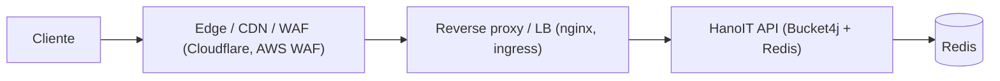

# Rate Limiting — Operación y Arquitectura (SaaS 100k+ usuarios)

> Ámbito: rate limiting **HTTP** de HanoIT API. Las cuotas por tenant/plan
> (`maxRoutesMonthly`, geocoding, upload) están **fuera de alcance** aquí y hoy
> solo se reportan en `GET /api/billing/usage` sin bloquear.

## 1. Defensa en profundidad (capas)



Para 100k+ usuarios el rate limiting de la aplicación **no** es suficiente frente a
ataques volumétricos (L3/L4/L7 DDoS). Se recomienda una estrategia por capas:

1. **Edge/CDN/WAF** (Cloudflare, AWS WAF/Shield, GCP Cloud Armor): primera línea
   anti-volumétrico, bot management, límites por país/ASN, challenge/CAPTCHA.
2. **Reverse proxy / LB** (nginx `limit_req`, ingress): límites gruesos por IP y
   protección de conexiones. Ejemplo nginx:

```nginx
limit_req_zone $binary_remote_addr zone=api:10m rate=250r/s;
server {
  location /api/ {
    limit_req zone=api burst=500 nodelay;
    proxy_set_header X-Forwarded-For $proxy_add_x_forwarded_for;
    proxy_pass http://hanoit_api;
  }
}
```

3. **Aplicación** (esta capa): reglas de negocio finas (login, OTP, register,
   invitations) y límites por principal/IP con backend distribuido (Redis).

> Importante: el edge/LB debe **fijar `X-Forwarded-For`** con la IP real del cliente
> y la app debe configurar `trusted-proxy-count` en consecuencia (ver §4).

## 2. Capas dentro de la aplicación

| Capa | Clave | Aplica a | Config |
|---|---|---|---|
| Global por IP | `GLOBAL_IP:<ip>` | Tráfico **no autenticado** | `global.*` |
| Por principal | `AUTHENTICATED:<userId>` | Tráfico **autenticado** (sustituye al global por IP) | `authenticated.*` |
| Por endpoint | `<RULE>:<discriminador>` | login, register, forgot, verify, invitations, OTP, routing v3 | `RateLimitRule` + `register.*` |
| OTP (Mongo) | `recipientHash` | `POST /api/notifications/otp/send` | `otp.send-*` |

- Implementación: [`RateLimitFilter`](../../src/main/java/com/hanoit/routing/security/ratelimit/RateLimitFilter.java),
  [`RateLimitService`](../../src/main/java/com/hanoit/routing/security/ratelimit/RateLimitService.java),
  [`RateLimitRule`](../../src/main/java/com/hanoit/routing/security/ratelimit/RateLimitRule.java).
- Algoritmo: **token bucket con refill greedy** (continuo), que evita la ráfaga de
  `2N` en el borde de ventana de la ventana fija.
- El límite por principal evita penalizar a usuarios tras un mismo NAT/oficina.

## 3. Catálogo de reglas por endpoint

| Regla | Endpoint | Límite | Ventana | Clave |
|---|---|---|---|---|
| LOGIN | `POST /api/auth/login` | 5 | 15 min | IP + email |
| REGISTER | `POST /api/auth/register` | 30 (config) | 1 h | IP |
| FORGOT_PASSWORD | `POST /api/auth/forgot-password` | 3 | 1 h | email |
| VERIFY_EMAIL | `POST /api/auth/verify-email` | 5 | 15 min | IP |
| INVITATIONS | `POST /api/invitations` | 20 | 1 h | tenantId (JWT) |
| OTP_SEND | `POST /api/notifications/otp/send` | 3 | 1 h | recipient |
| OTP_RESEND | `POST /api/notifications/otp/resend` | 2 | 1 h | otpId |
| OTP_VERIFY | `POST /api/notifications/otp/verify` | 5 | 15 min | otpId |
| ROUTING_PUBLIC | `POST /api/v1/routing/**` | 60 | 1 min | IP |

> `/api/v1/routing/**` ahora **requiere JWT** (bajo `/api/v1/**` authenticated en
> `SecurityConfig`). La regla `ROUTING_PUBLIC` por IP se conserva como defensa
> adicional para el endpoint CPU-intensivo.

## 4. Confianza de proxy (anti-spoofing de IP)

`app.security.rate-limit.trusted-proxy-count` define cuántos proxies de confianza
hay delante de la app:

- `0`: no se confía en `X-Forwarded-For`; se usa `remoteAddr` (despliegue directo).
- `1`: un LB/ingress (default).
- `2`: CDN + LB.

Se descartan los `N` saltos más a la derecha de `XFF` y se toma el inmediatamente
anterior como IP real. Un valor incorrecto permite a un cliente spoofear su IP y
evadir los límites por IP.

## 5. Respuesta y headers

En respuestas permitidas se emiten (IETF draft):

- `RateLimit-Limit`, `RateLimit-Remaining`, `RateLimit-Reset`

En 429:

- `Retry-After` (segundos) + `RateLimit-Remaining: 0` + `RateLimit-Reset`
- Body unificado [`ErrorResponse`](../../src/main/java/com/hanoit/routing/dto/response/ErrorResponse.java):

```json
{ "error": "RATE_LIMIT_EXCEEDED", "message": "Rate limit exceeded. Try again in N seconds.", "timestamp": "…", "path": "…" }
```

Los clientes deberían auto-regularse usando `RateLimit-Remaining`/`Reset` para
reducir 429 a escala.

## 6. Resiliencia y disponibilidad

- **Redis en HA** (Sentinel o Cluster) es requisito de producción para límites
  distribuidos consistentes entre instancias.
- La conexión Lettuce usa auto-reconexión + `REJECT_COMMANDS` durante caídas.
- Si Redis **no está disponible al arrancar**, la app **no falla el boot**: el
  proxy manager queda nulo y `RateLimitService` aplica un **fallback local
  in-memory** (por instancia) para las reglas sensibles
  (`fail-closed-rules`); el resto degrada a fail-open.
- `app.security.rate-limit.redis-enabled=false` desactiva Redis (dev): mismo
  fallback local para reglas sensibles.

### 6.1 Requisito de Redis HA en producción (R-02)

Sin Redis en alta disponibilidad, el fallback local es **por instancia**: en un
despliegue multi-réplica cada nodo cuenta por separado, de modo que el límite
efectivo se multiplica por el número de instancias y las reglas globales/por
principal (que NO tienen fallback local, solo las `fail-closed-rules`) dejan de
aplicarse. Recomendaciones:

- Desplegar **Redis Sentinel** (failover automático) o **Redis Cluster** (sharding
  + réplicas) con al menos 1 réplica y quórum de sentinelas impar (3).
- Configurar `spring.data.redis.*` apuntando al endpoint HA (o a Sentinel);
  proteger con `REDIS_PASSWORD`.
- Alertar sobre degradación a fallback local (ver §7): cualquier tráfico con
  `backend="local"` en prod indica Redis caído o mal configurado.
- Mantener límites gruesos por IP en el edge/LB (§1) como red de seguridad
  independiente de Redis.

## 7. Observabilidad

Métrica Micrometer emitida por `RateLimitService`:

- `ratelimit.decisions{rule, outcome=allowed|blocked, backend=redis|local}`

Ejemplos de alertas (PromQL, requiere exponer Micrometer vía Actuator/Prometheus):

```promql
# Pico de bloqueos por regla (posible ataque o límite mal calibrado)
sum by (rule) (rate(ratelimit_decisions_total{outcome="blocked"}[5m])) > 50

# Degradación a fallback local (Redis caído)
sum(rate(ratelimit_decisions_total{backend="local"}[5m])) > 0
```

### 7.1 Exposición de la métrica

- `application-prod.yml` expone `management.endpoints.web.exposure.include: health,info,metrics`.
  La métrica queda disponible en `GET /actuator/metrics/ratelimit.decisions`.
- Para **scraping Prometheus**, añadir la dependencia
  `io.micrometer:micrometer-registry-prometheus` y agregar `prometheus` a la lista
  de endpoints expuestos; el endpoint `/actuator/prometheus` publicará
  `ratelimit_decisions_total{rule,outcome,backend}`.
- `/actuator/**` es `permitAll` en `SecurityConfig`: **restringir su acceso a la
  red interna** (regla de LB/ingress) para no exponer métricas públicamente.
- Alertas mínimas recomendadas: (a) `backend="local"` > 0 en prod (Redis caído),
  (b) pico de `outcome="blocked"` por regla `LOGIN`/`OTP_SEND` (fuerza bruta).

## 8. Configuración

Política versionada en [`application.yml`](../../src/main/resources/application.yml)
(overridable por entorno). Claves principales:

```
app.security.rate-limit.enabled
app.security.rate-limit.redis-enabled
app.security.rate-limit.trusted-proxy-count
app.security.rate-limit.per-endpoint-rules-enabled
app.security.rate-limit.global.{enabled,capacity,window-seconds,exclude-patterns}
app.security.rate-limit.authenticated.{enabled,capacity,window-seconds}
app.security.rate-limit.register.{capacity,window-seconds}
app.security.rate-limit.fail-closed-rules
```

OTP (capa Mongo) en [`application.yml`](../../src/main/resources/application.yml)
bajo `otp.*`: `otp.send-max-per-window`, `otp.send-window-minutes`,
`otp.max-resends`, `otp.recipient-pepper`. La normalización del `recipient` para
la key del rate limit y para `recipientHash` está centralizada en
[`RecipientNormalizer`](../../src/main/java/com/hanoit/routing/util/RecipientNormalizer.java)
(email trim+lowercase; SMS E.164), evitando contadores divergentes Redis/Mongo.

## 9. Calibración para 100k+ usuarios (guía)

- **Global IP** (no autenticado): 250 req/s por IP es un techo anti-abuso; ajustar
  según patrones de NAT corporativo. Considérese moverlo al edge/LB.
- **Por principal**: 600/60s (~10 req/s) cubre UIs intensivas; subir para clientes
  que hagan polling.
- **Auth/OTP**: mantener estrictos (protección de fuerza bruta), no relajar.
- Preferir límites finos en la app y límites gruesos/volumétricos en edge/LB.

## 10. Fuera de alcance (futuro)

Cuotas por tenant/plan en endpoints pesados (`/api/journeys/plan`, `/api/geocoding`,
`/api/packages/upload`) para monetización y protección de coste. Hoy solo se
reportan en `GET /api/billing/usage`.
